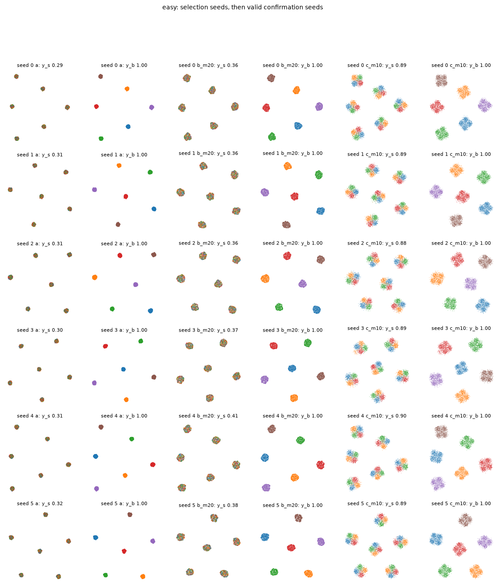
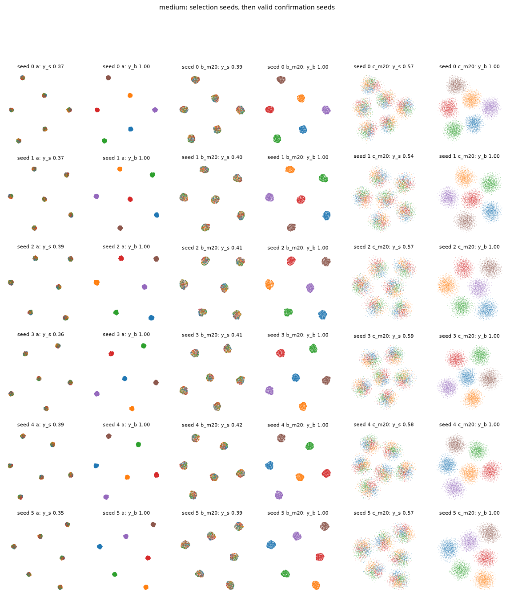
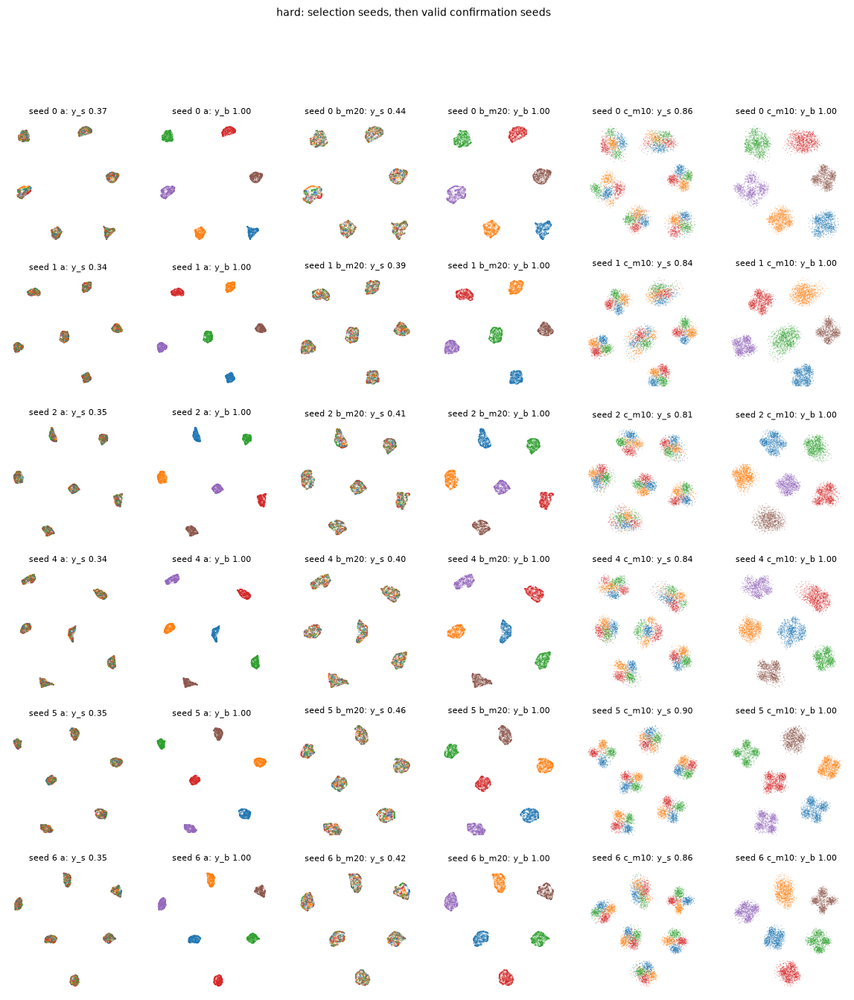
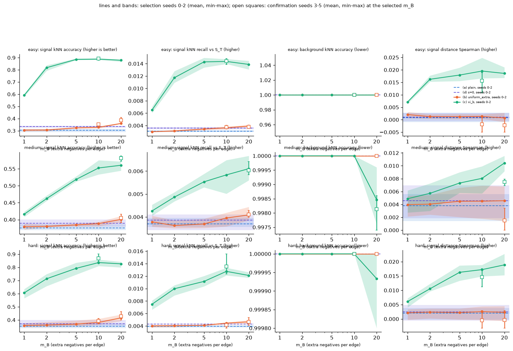
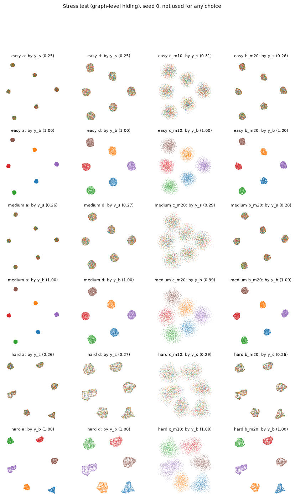

# Background-contrastive Neg-t-SNE: Phase 4 report

This project tests a change to Neg-t-SNE, a neighbor-embedding method, meant to reveal structure that is specific to one dataset (the **target**) but hidden by variation it shares with a second dataset (the **background**). This is the neighbor-embedding analogue of contrastive PCA. This report covers the final experiment on synthetic data with a known hidden signal.

## How to read this report

**Documents in this repository** that the report refers to:

| short name | file | contents |
|---|---|---|
| **Plan**, **Plan §n** | `Initial_Project_Plan.md` (repository root), section n | the project plan: goal (§0), Phases 0–4 (§1–§5), stop-and-report conditions (§6), later work (§7) |
| **NOTES** | `NOTES.md` (repository root) | working notes: package internals, decisions, and results of each phase |
| results of phase N | `results/phaseN/` | CSV/JSON results and figures; each JSON records the software environment |
| scripts | `scripts/` | the scripts that produced every result (e.g. `scripts/phase4_run.py`) |

Tables marked **(generated)** are copied verbatim from `results/phase4/*.md` by `scripts/phase4_assemble.py`; none is typed by hand. A seven-character code such as `dad1c09` is a commit in this repository's git history.

**Phases** (the project ran in five steps; each builds on the previous one):

| phase | what it did | where |
|---|---|---|
| Phase 0 | studied the `contrastive-ne` package (v0.4.0, vendored in `third_party/contrastive-ne/`), confirmed the training schedule, and fixed the determinism rules | `results/phase0/`, NOTES |
| Phase 1 | built the synthetic data generator and chose the signal strength ρ per difficulty level by a validity sweep; froze the datasets with hashes | `data/synthetic.py`, `results/phase1/` |
| Phase 2 | built ξ_B, the background-informed negative distribution, and checked it against ground truth | `method/xi_b.py`, `results/phase2/` |
| Phase 3 | added the background term to the trainer, with tests and a stability run | `method/bg_term.py`, `results/phase3/` |
| Phase 4 | this experiment | `scripts/phase4_*.py`, `results/phase4/` |

**Notation:**

| symbol | meaning |
|---|---|
| X_T, X_B | target and background data: 5000 points each, 50 features |
| y_s, y_b | ground-truth **signal** label (4 groups) and **background** label (6 clusters) of each target point. Used only for evaluation, never by the method |
| S_T | the clean signal part of X_T (ground truth, evaluation only) |
| ρ | signal strength (`signal_to_background`) |
| island | one background cluster as it appears in a 2-D embedding |
| m_B | number of extra (background) negatives per kNN edge |
| m*_c | the m_B selected for run (c) |
| (a), (b), (c), (d) | the four run types (see "Runs"). Labels like `b_m20` / `c_m10` mean run (b) / (c) with m_B = 20 / 10 |
| selection seeds | seeds 0–2, used to choose m_B |
| confirmation seeds | fresh seeds used only for the final verdict |
| `acc_s`, `acc_b`, `recall_s`, `spearman_s` | column names in the generated tables: signal kNN accuracy, background kNN accuracy, signal kNN recall, signal Spearman (see "Metrics"). "(drop)" marks a metric where lower is better, so the difference is reported as (a) minus (c) |
| same-y_b / same-y_s precision | the fraction of ξ_B pairs whose two points share a background / signal label (see "Checks with thresholds") |
| mean [min, max] | mean over seeds, with the smallest and largest seed value |

## Summary

**Pre-registered verdicts** (success criterion, rule 4 below, judged on the confirmation seeds): easy **not met**, medium **met**, hard **not met**.

**What happened.**
- **Signal revealed within background clusters.** Background negatives drawn from ξ_B reveal the hidden signal inside each background cluster, at every level. This goes well beyond both controls: the same number of uniform extra negatives (b), and the move along the attraction–repulsion spectrum (d). The (c) improvement is consistent across 3 paired confirmation seeds at every level, against (a), against (b) at the same m_B, against the best (b) at any m_B, and against (d). It holds on both primary metrics.
- **Global layout still organized by background.** The 6 background clusters stay separate islands in every run. Background kNN accuracy stays at 1.000 on easy and hard.

**Why easy and hard "fail".** The only failing clause is "background kNN accuracy drops relative to (a)". By design, the method can't do this. Background negatives add only repulsion. No target kNN edges connect different background islands, which sit about 30 units apart in the data, so nothing pulls islands together. The method can reorganize points within an island; it can't merge islands. With background accuracy at 1.000 for every run, the paired difference is exactly 0, and the rule needs it to be strictly positive.

**Why medium "passes".** Under (c), medium's background accuracy is 0.997–0.999: about 7–13 of 5000 points sit nearer another island's points. These are boundary points of islands that spread until they touch (under (c), medium's 6 islands join into one kNN-graph component). **This is not background suppression.** Medium is also the level with the *smallest* signal gain (+0.18 over the best control, against +0.51 on easy and +0.44 on hard).

## Headline (generated; confirmation seeds; signal kNN accuracy, mean [min, max])

| level | confirmation seeds | (a) plain | best (b) uniform_extra | (d) s=0 | (c) xi_b | (c) background acc | pre-registered success |
|---|---|---|---|---|---|---|---|
| easy | 3, 4, 5 | 0.312 [0.304, 0.322] | 0.387 [0.374, 0.410] (m_B=20) | 0.346 [0.337, 0.352] | 0.894 [0.890, 0.899] (m_B=10) | 1.000 [1.000, 1.000] | no |
| medium | 3, 4, 5 | 0.368 [0.355, 0.388] | 0.405 [0.391, 0.416] (m_B=20) | 0.384 [0.382, 0.387] | 0.582 [0.573, 0.588] (m_B=20) | 0.998 [0.997, 0.999] | yes |
| hard | 4, 5, 6 | 0.347 [0.339, 0.353] | 0.429 [0.399, 0.464] (m_B=20) | 0.381 [0.364, 0.394] | 0.868 [0.843, 0.902] (m_B=10) | 1.000 [1.000, 1.000] | no |

## Method and setup

### Data (Plan §2; generator `data/synthetic.py`; Phase 1)

- **Two latent variables per target point:**
  - **background:** 6 equal-weight Gaussian clusters in 5 dimensions, centers at the vertices of a regular simplex with edge 30, within-cluster std 1;
  - **signal:** 4 clusters in 3 dimensions, simplex edge 6, std 1.
- **Construction:**
  - target: X_T = ρ·A z_s + B(z_b) + ε;
  - background: X_B = B(z_b′) + ε, from the same background distribution but with no signal;
  - ε is isotropic noise with std 0.1, and D = 50.
- **Difficulty levels** (they describe how the background hides the signal from *plain* Neg-t-SNE):
  - **easy:** A and B are orthonormal maps into orthogonal subspaces;
  - **medium:** half of A's direction lies inside B's span (overlap α = 0.5);
  - **hard:** B is a random one-hidden-layer tanh network (width 64, gain 6), so the background is nonlinear.
- **Signal strength ρ.** Phase 1 chose ρ per level: the largest ρ for which plain Neg-t-SNE still hides the signal (validity criterion below). Main ρ = 0.2 (easy), 0.2 (medium), 0.3 (hard); stress-test ρ = 0.1 at every level.
- **Signal in the high-D graph.** At the main ρ the high-dimensional kNN graph of X_T still carries much of the signal (high-D signal kNN accuracy 0.70–0.89). The signal is lost only in the 2-D embedding.
- **Seeds.** Each dataset is fully determined by its seed, and its hash is recorded in `results/phase1/datasets.csv`. In every run the method seed equals the dataset seed.

### ξ_B, the background-informed negative distribution (Plan §3; `method/xi_b.py`; Phase 2)

- **Background neighbors.** For each target point i, find its k_B = 15 nearest **background** points by exact Euclidean search from X_T into X_B.
- **Score target pairs** by the Jaccard overlap of their background-neighbor sets: s_B(i, j) = |N_B(i) ∩ N_B(j)| / |N_B(i) ∪ N_B(j)|.
- **Keep the top L = 30 partners** per point. All partners tied with the 30th are kept, up to 2L = 60; beyond that, a seeded random draw within the tied block. Probabilities are proportional to s_B. Target kNN edges are not excluded.
- **No labels used.** ξ_B uses X_B and X_T only.

### Training (Plan §4; `common/embed.py`, `method/bg_term.py`; Phases 0 and 3)

- **Package.** `contrastive-ne` v0.4.0, non-parametric Neg-t-SNE, with one local change: an 11-line hook that lets the trainer add a term to the batch loss (`third_party/contrastive-ne/UPSTREAM.md`).
- **Target kNN graph.** Exact 15-nearest-neighbor graph of X_T, symmetrized by union, binary.
- **Loss.** With φ = 1/(1 + d²) (Cauchy kernel on embedding distance d), the Neg-t-SNE per-edge loss for kNN edge (i, j) is

      L_ij = −log(φ_ij/(φ_ij + c)) − Σ_{u=1..m} log(1 − φ_iu/(φ_iu + c)) − γ Σ_{b=1..m_B} log(1 − φ_ib/(φ_ib + c))

  - The first two terms are the package's own: attraction, and m = 5 uniform negatives drawn from the current minibatch. c is the package's constant (`neg_spec` = 1.0 by default).
  - The third term is the new background term, with γ = 1 and m_B extra negatives per edge. It uses the same φ, c and clamps as the package's negatives, and joins the batch loss with the package's aggregation (a sum).
  - A unit test checks that one background negative and one uniform negative at the same φ contribute identical loss and gradient.
- **Optimizer.** SGD; learning rate 1.0, annealed linearly to 0 in each stage; minibatches of 32768 directed edges; gradients clipped to ±4.
- **Two-stage schedule:**
  - **Stage 1:** plain Neg-t-SNE for 250 epochs from a PCA initialization (first two principal components, scaled so the first has std 1).
  - **Stage 2:** a fresh 500-epoch fit starting exactly from the Stage 1 embedding.
  - Only Stage 2 differs between runs. Every run on a dataset shares its Stage 1, its kNN graph and its seed.
- **Runs (all are Stage 2 settings):**

  | run | name | what Stage 2 does |
  |---|---|---|
  | (a) | plain | no background term |
  | (b) | `uniform_extra` | m_B extra negatives per edge, drawn uniformly from all other target points. This control adds the same amount of repulsion as (c) with no background information |
  | (c) | `xi_b` | the method: m_B extra negatives per edge, drawn from ξ_B(i, ·) |
  | (d) | spectrum reference | plain Neg-t-SNE at the t-SNE-like end of the attraction–repulsion spectrum (`s=0`, so c = 500/n = 0.1). It tests whether simply shifting the repulsion balance recovers the signal. The literal `neg_spec=0` is degenerate in this package: the embedding never moves |

### Metrics (`eval/metrics.py`; ground truth used for evaluation only)

| metric | definition | better |
|---|---|---|
| signal kNN accuracy | accuracy of a 15-nearest-neighbor classifier predicting y_s from the embedding; stratified 5-fold cross-validation, shuffled with seed 0. Chance ≈ 0.25 | higher |
| background kNN accuracy | the same, predicting y_b. Chance ≈ 0.17 | lower (should drop) |
| signal kNN recall | mean over points of the fraction of a point's 15 nearest neighbors in the embedding that are also among its 15 nearest neighbors in the clean signal S_T. Exact neighbors; chance = 15/4999 = 0.0030 | higher |
| signal Spearman | Spearman rank correlation between all pairwise embedding distances and all pairwise S_T distances (all 5000 points) | higher |
| mean φ | mean of φ = 1/(1 + d²) over a fixed sample of 100,000 random point pairs (per dataset and seed). Lower means a more expanded embedding | scale diagnostic |
| embedding std | standard deviation of the embedding coordinates, averaged over the two axes; also reported relative to (a) on the same seed | scale diagnostic |
| components | connected components of the 15-nearest-neighbor graph built in the 2-D embedding, and the fraction of points in components of fewer than 50 points | collapse/fragmentation diagnostic |

The reference rows "high-D X_T" (the classifier and recall applied to the 50-dimensional X_T itself) and "Stage 1 only" give context.

### Checks with thresholds

- **Dataset validity** (from Phase 1). A dataset is a valid test only if plain Neg-t-SNE, run (a), hides the signal but not the background:
  - embedding background kNN accuracy ≥ 0.90;
  - embedding signal kNN accuracy ≤ 0.50;
  - **oracle** signal kNN accuracy ≥ 0.95. The oracle is the same classifier applied directly to the clean signal S_T; it checks that the signal groups are separable at all.
- **ξ_B informativeness gates** (from Phase 2), on every dataset used:
  - ξ_B pairs share y_b at a rate ≥ 0.90;
  - ξ_B pairs share y_s at no more than chance + 0.10.

  Rates are exact expectations over ξ_B's probabilities, with each point weighted by its number of target kNN edges (as often as training draws it). The same-y_s **excess** over chance is always recorded. Pairing same-signal points works directly against the method.
- **Health:**
  - no non-finite loss or embedding at any epoch;
  - Stage 2 embedding std never grows above 10× its starting value. Stage 1's growth of about 10× from the std-1 PCA initialization is normal and not covered by this check.
- **Reproduction:**
  - dataset and ξ_B hashes match Phases 1–2;
  - run (a) reproduces the Phase 1 accuracies exactly;
  - a full rerun of easy seed 0 is bit-identical.

## Pre-registered protocol and rules (Plan §5; `common/experiment.py`; committed in `dad1c09` before any Phase 4 result)

- **Selection, then confirmation, per level.**
  1. **Selection:** on seeds 0–2, run (a), (b) and (c) at each m_B ∈ {1, 2, 5, 10, 20}, plus (d).
  2. **Freeze:** commit the chosen settings in `results/phase4/selection_{level}.json` before any confirmation run.
  3. **Confirmation:** on fresh seeds, run (a), (d), (c) at m*_c, (b) at m*_c, and (b) at each per-metric best m_B.
  4. **Checkpoint:** easy was run first, with a checkpoint before medium and hard.
- **Rule 1, metrics.**
  - **Primary:** signal kNN accuracy and signal kNN recall.
  - **Secondary:** background kNN accuracy (should drop), signal Spearman, and scale.
- **Rule 2, "improves".** Runs are paired by seed (same dataset, same Stage 1). "X improves over Y" means the mean over 3 seeds is higher **and** every per-seed difference is positive. This is reported as "consistent across 3 paired seeds", with the mean difference and the per-seed values. No p-values.
- **Rule 3, best settings (on the selection seeds).**
  - m*_c is the m_B with the highest mean signal kNN accuracy among the (c) runs.
  - The best (b) is chosen separately for each primary metric. This favors the control, because (c) is compared against the strongest (b) for each metric.
  - Ties go to the smaller m_B.
- **Rule 4, success (on the confirmation seeds).**
  - (c) at m*_c improves **both** primary metrics over (a), over (b) at m*_c, over the per-metric best (b), and over (d).
  - Background kNN accuracy drops relative to (a).
  - No (c) run is flagged.
- **Rule 5, flags (judged against (a) on the same seed).**
  - **collapse:** embedding std < 0.5× that of (a);
  - **fragmentation:** more than 5% of points are in components of fewer than 50 points.

  Flags mark runs for review; flagged runs are never dropped.
- **Rule 6, interpretation.** If the best (b) or (d) matches (c) on a primary metric, the effect is extra repulsion or a spectrum shift, not background information, and the report must say so.
- **Exclusion rule for confirmation seeds** (added after hard seed 3 failed, before any further hard confirmation result).
  - A confirmation seed whose dataset fails the validity check (judged from (a) and the oracle only, never from (b) or (c)) is excluded, and the next seed is drawn until 3 valid ones exist.
  - More than 2 exclusions in one level stops the experiment for that level.
  - Results already computed on an excluded seed appear only in Appendix B.
- **Stop-and-report conditions** (Plan §6, specialized to this experiment). The experiment stops and reports instead of adjusting anything if any of these happens:
  - a hash mismatch;
  - (a) failing to reproduce Phase 1;
  - a non-finite value, or Stage 2 std growth > 10×;
  - a fresh dataset failing the ξ_B gates;
  - a determinism failure;
  - more than 2 exclusions in one level;
  - uninterpretable results at the easy checkpoint.

## Results by level

Full per-run tables, with selection and confirmation seeds and every pre-registered comparison with per-seed differences, are in Appendix A.

**easy.**
- (c) at m_B = 10 reaches signal accuracy 0.89–0.90. The alternatives:

  | run | signal accuracy |
  |---|---|
  | (a) | 0.30–0.32 |
  | best (b), m_B = 20 | 0.37–0.41 |
  | (d) | 0.34–0.35 |

- Every comparison on both primary metrics is consistent across 3 paired seeds. Against the best (b), signal accuracy improves by +0.51 (per seed +0.52, +0.49, +0.51).
- Each background island splits into 4 clean signal sectors on all 6 seeds (figure below).
- The effect grows with m_B up to 5 (selection seeds: 0.59, 0.82 and 0.89 for m_B = 1, 2 and 5) and then plateaus.

**medium.**
- (c) at m_B = 20 reaches 0.57–0.59. The alternatives:

  | run | signal accuracy |
  |---|---|
  | (a) | 0.36–0.39 |
  | best (b) | 0.39–0.42 |
  | (d) | 0.38–0.39 |

- Every comparison is consistent across 3 paired seeds, with a smaller effect: +0.18 over the best (b).
- Islands expand and become diffuse, and the signal groups are only partly sorted.

**hard.**
- (c) at m_B = 10 reaches 0.84–0.90. The alternatives:

  | run | signal accuracy |
  |---|---|
  | (a) | 0.34–0.35 |
  | best (b) | 0.40–0.46 |
  | (d) | 0.36–0.39 |

- Every comparison is consistent across 3 paired seeds: +0.44 over the best (b).
- The islands split into signal sectors as on easy.
- **Confirmation seed 3 was excluded:** plain (a) already reached signal accuracy 0.5126 there, above the validity limit of 0.50. The confirmation seeds are therefore 4–6.

**Figures.** In each grid below:
- **rows** are seeds: 0–2 for selection, then the confirmation seeds;
- **columns** are (a), the best (b) and (c), each shown twice: colored by signal label y_s, then by background label y_b. Panel titles give the kNN accuracy.

The seed 0 embeddings of all 12 Stage 2 runs are in `results/phase4/embeddings_{easy,medium,hard}.png`.

easy (`results/phase4/embeddings_allseeds_easy.png`):



medium (`results/phase4/embeddings_allseeds_medium.png`):



hard (`results/phase4/embeddings_allseeds_hard.png`):



**Metrics against m_B** (`results/phase4/metrics_vs_mB.png`). Rows are levels and columns are metrics.
- Lines and bands show (b) and (c) on the selection seeds (mean, min–max).
- The dashed lines and bands are (a) and (d).
- The open squares are the confirmation seeds at the selected m_B.



**Why the islands split (interpretation).** Inside a background island, two forces act on the points:
- **Attraction** along target kNN edges mostly joins points of the same signal group: 59% of edges on easy, against 25% by chance.
- **ξ_B repulsion** pushes each point away from partners chosen for background similarity, which within an island are nearly blind to signal (see the excess below).

Pushing everyone apart from random island-mates while still pulling same-signal neighbors together sorts each island into signal groups. In the terms of the method's theory, the embedding learns roughly "target similarity divided by background similarity". Within an island the background part is high and nearly equal for everyone, so dividing it out leaves the signal.

Uniform extra negatives (b) mostly land in *other* islands (5 of 6), which are already far apart, so they add almost no force within an island.

**ξ_B same-signal pairing.** This number is the first thing to check when a level underperforms. It is the excess of ξ_B pairs sharing a signal group over chance (0.25), from `results/phase2/xi_b_diagnostics.csv` (selection seeds) and `results/phase4/summary_{level}_confirmation.json` (confirmation seeds):

| level | selection seeds | confirmation seeds |
|---|---|---|
| easy | +0.015 to +0.018 | +0.015 to +0.020 |
| medium | +0.058 | +0.054 to +0.064 |
| hard | +0.022 to +0.029 | +0.022 to +0.037 |

Every level stays well within the gate (+0.10).

**Why medium is weaker than hard (post-hoc interpretation, added after the verdicts).** The level names describe how hard it is for *plain* Neg-t-SNE to show the signal, not how much signal the method has to work with.
- **The target kNN graph carries the signal; ξ_B only clears room.** Attraction along target kNN edges is what sorts each island into signal groups. On medium, half of the signal direction lies inside the background span, so within a background cluster that half looks like ordinary background spread. As a result, medium's high-D graph carries clearly less signal: fewer edges join same-signal points, and the high-D signal accuracy is lower. On easy and hard, (c) recovers about as much signal as the high-D graph holds. On medium it recovers less, and its islands become diffuse rather than splitting into sectors.
- **ξ_B works slightly against the method on medium.** The same entanglement makes ξ_B pair same-signal points a little more often than chance (the excess above), which opposes the method.
- **Hard also runs at a larger ρ** (0.3 vs 0.2). Its nonlinear background hides the signal from plain Neg-t-SNE for longer, so the validity criterion allowed a 1.5× stronger signal, along a random direction rather than one built to overlap the background.

Confirmation seeds (generated):

| level | confirmation seeds | high-D X_T signal acc | target kNN edges sharing y_s | xi_B same-y_s excess | (c) signal acc | (c) / high-D |
|---|---|---|---|---|---|---|
| easy | 3, 4, 5 | 0.887 [0.882, 0.892] | 0.592 [0.587, 0.601] | +0.017 [+0.015, +0.020] | 0.894 [0.890, 0.899] (m_B=10) | 1.01 |
| medium | 3, 4, 5 | 0.711 [0.700, 0.718] | 0.471 [0.466, 0.479] | +0.059 [+0.054, +0.064] | 0.582 [0.573, 0.588] (m_B=20) | 0.82 |
| hard | 4, 5, 6 | 0.896 [0.887, 0.912] | 0.640 [0.616, 0.674] | +0.030 [+0.022, +0.037] | 0.868 [0.843, 0.902] (m_B=10) | 0.97 |

**Scale shift.** Extra repulsion spreads the embedding, so scale has to be ruled out as the explanation. Embedding std relative to (a), on the confirmation seeds:

| run | easy | medium | hard |
|---|---|---|---|
| (c) | 1.11× | 1.25× | 1.16× |
| best (b) | 1.44× | 1.46× | 1.47× |
| (d) | 1.79× | 1.82× | 1.87× |

(d) spreads the embedding the most and (b) the second most, yet both stay near (a) on signal accuracy. On easy and hard, (d) also has the lowest mean φ (most expanded on that measure too). The (c) gain is therefore not explained by a global scale change. On medium, (c) has the lowest mean φ (0.009, against 0.014 for (d)), but (d)'s larger std and much lower signal accuracy argue against scale there as well. Per-run scale against m_B is in `results/phase4/scale_vs_mB.png`.

## Post-hoc: global metrics (clearly labeled; not a decision rule)

The pre-registered global metrics, signal kNN recall and signal Spearman, for (a), best (b), (c) and (d) on the confirmation seeds (generated):

Signal kNN recall and signal distance Spearman against S_T are pre-registered metrics; this view of them for (a), best (b), (c) and (d) was added after the verdicts. Recall chance level is 15/4999 = 0.0030. Values are mean [min, max] over the confirmation seeds; differences are (c) minus the other run, per seed.

### easy (confirmation seeds 3, 4, 5)

| run | signal recall | signal Spearman | background acc |
|---|---|---|---|
| (a) plain | 0.0036 [0.0033, 0.0037] | -0.0016 [-0.0037, 0.0012] | 1.000 [1.000, 1.000] |
| (b) uniform_extra, m_B=20 | 0.0038 [0.0036, 0.0040] | -0.0023 [-0.0050, 0.0008] | 1.000 [1.000, 1.000] |
| (c) xi_b, m_B=10 | 0.0144 [0.0139, 0.0148] | 0.0156 [0.0108, 0.0189] | 1.000 [1.000, 1.000] |
| (d) s=0 reference | 0.0036 [0.0034, 0.0038] | -0.0025 [-0.0053, 0.0003] | 1.000 [1.000, 1.000] |

| (c) minus | signal recall per seed | consistent | signal Spearman per seed | consistent |
|---|---|---|---|---|
| (a) plain | +0.0102, +0.0109, +0.0115 | yes | +0.0195, +0.0178, +0.0145 | yes |
| (b) uniform_extra, m_B=20 | +0.0101, +0.0107, +0.0112 | yes | +0.0198, +0.0181, +0.0158 | yes |
| (d) s=0 reference | +0.0104, +0.0110, +0.0111 | yes | +0.0197, +0.0186, +0.0161 | yes |

### medium (confirmation seeds 3, 4, 5)

| run | signal recall | signal Spearman | background acc |
|---|---|---|---|
| (a) plain | 0.0038 [0.0036, 0.0041] | 0.0013 [-0.0004, 0.0031] | 1.000 [1.000, 1.000] |
| (b) uniform_extra, m_B=20 | 0.0041 [0.0040, 0.0043] | 0.0015 [0.0000, 0.0034] | 1.000 [1.000, 1.000] |
| (c) xi_b, m_B=20 | 0.0060 [0.0058, 0.0064] | 0.0075 [0.0069, 0.0079] | 0.998 [0.997, 0.999] |
| (d) s=0 reference | 0.0039 [0.0035, 0.0042] | 0.0020 [0.0013, 0.0033] | 1.000 [1.000, 1.000] |

| (c) minus | signal recall per seed | consistent | signal Spearman per seed | consistent |
|---|---|---|---|---|
| (a) plain | +0.0028, +0.0020, +0.0018 | yes | +0.0073, +0.0048, +0.0066 | yes |
| (b) uniform_extra, m_B=20 | +0.0024, +0.0019, +0.0016 | yes | +0.0058, +0.0045, +0.0077 | yes |
| (d) s=0 reference | +0.0029, +0.0016, +0.0019 | yes | +0.0056, +0.0047, +0.0063 | yes |

### hard (confirmation seeds 4, 5, 6)

| run | signal recall | signal Spearman | background acc |
|---|---|---|---|
| (a) plain | 0.0036 [0.0032, 0.0039] | -0.0002 [-0.0027, 0.0032] | 1.000 [1.000, 1.000] |
| (b) uniform_extra, m_B=20 | 0.0047 [0.0041, 0.0054] | -0.0004 [-0.0032, 0.0029] | 1.000 [1.000, 1.000] |
| (c) xi_b, m_B=10 | 0.0136 [0.0123, 0.0156] | 0.0146 [0.0112, 0.0176] | 1.000 [1.000, 1.000] |
| (d) s=0 reference | 0.0040 [0.0037, 0.0045] | -0.0004 [-0.0031, 0.0027] | 1.000 [1.000, 1.000] |

| (c) minus | signal recall per seed | consistent | signal Spearman per seed | consistent |
|---|---|---|---|---|
| (a) plain | +0.0091, +0.0117, +0.0091 | yes | +0.0144, +0.0177, +0.0124 | yes |
| (b) uniform_extra, m_B=20 | +0.0083, +0.0102, +0.0082 | yes | +0.0147, +0.0182, +0.0121 | yes |
| (d) s=0 reference | +0.0087, +0.0111, +0.0089 | yes | +0.0149, +0.0181, +0.0121 | yes |

**Reading.** These two metrics already show the picture, so no further measure (such as island separation relative to island size) was added.
- **Recall shows the local picture.** Signal kNN recall under (c) is about 3–4× the level of every control on easy and hard (e.g. easy 0.0144 against 0.0036–0.0038), and about 1.5× on medium, consistently across seeds.
- **Spearman shows the global picture.** The signal Spearman correlation stays near 0 (≤ 0.02) for every run, (c) included. Global distances are set by the background islands, not by the signal.
- **The absolute values are small** because exact 15-nearest neighbors in the clean 3-D signal are a very fine target. Even the high-D X_T scores only about 0.009 recall.

## Failures, surprises, and limits

- **The background clause can't be met by design** (see Summary). The pre-registered verdicts stand. Medium's pass rests on about 10 boundary points.
- **Hard seed 3 failed validity.** No rule existed for this, so the run stopped (Plan §6). The exclusion rule above was added before any further hard confirmation result. Hard ρ = 0.3 sits close to the validity boundary; (a) gives 0.34–0.37 on most seeds but 0.51 on seed 3.
- **Recall and Spearman are weak metrics here** (post-hoc section). Signal kNN accuracy carries the interpretation.
- **No collapse or fragmentation flags** on any run. Under (c), medium's islands touch and form a single kNN component, but no small fragments appear.
- **The evidence has a gap.** No run separates "ξ_B's fine-grained background similarity matters" from "repelling random points of the *same background cluster* is enough". A same-cluster uniform control, using the true background labels as a deliberate oracle, would answer it.
- **Operational note.** Laptop sleep inflated wall-clock runtimes until the timer was switched to one that pauses during sleep (Phase 3). Results were never affected.

## Next steps

1. **Cross-background attraction (main next step).** The result shows what repulsion alone can and can't do. To also suppress the background, the method needs attraction across background clusters: for example, a target kNN graph built in a background-suppressed metric, so that same-signal points in different islands become neighbors and pull the islands together.
2. **A same-background-cluster uniform control** (oracle labels), to close the gap above.
3. **The later work in Plan §7:**
   - baselines: UMAP on X_T, contrastive PCA followed by UMAP, and contrastiveVI;
   - the linear ξ_B variant;
   - real datasets with known target-specific groups.

## Stress test (graph-level hiding), not used for any choice

**Design.**
- **Data:** the same generator at ρ = 0.1 for every level, seeds 0–2. At this ρ the signal is weak even in the high-dimensional kNN graph, not only in the embedding.
- **Settings:** fixed in advance from the main selection seeds and committed in `results/phase4/stress_settings.json` before any stress fit:
  - (a);
  - (d);
  - (c) at m*_c;
  - the best (b).
- **Run once.** Nothing was tuned or rerun on these data. ξ_B diagnostics are reported but not gated.

Stress datasets: rho = 0.1 at every level, seeds 0-2. Settings frozen in stress_settings.json from the main selection seeds before any stress fit: (a), (d), (c) at m*_c and the best (b); (b) at m*_c was not part of them, so that comparison is absent. Values are mean [min, max] over seeds.

### easy

High-D X_T signal kNN accuracy (seeds 0-2, Phase 1 record): 0.509, 0.509, 0.502. xi_B same-y_b precision: 1.000, 1.000, 1.000; same-y_s excess: +0.003, +0.005, +0.003. Unhealthy runs: none.

| run | signal acc | signal recall | background acc | signal Spearman | mean phi | flags |
|---|---|---|---|---|---|---|
| high-D X_T (reference) | 0.507 [0.502, 0.509] | 0.0047 [0.0043, 0.0051] | 1.000 [1.000, 1.000] | 0.0046 [0.0027, 0.0065] |  | none |
| Stage 1 only (reference) | 0.257 [0.248, 0.264] | 0.0029 [0.0028, 0.0030] | 1.000 [1.000, 1.000] | 0.0009 [0.0000, 0.0017] | 0.0711 [0.0695, 0.0721] | none |
| (a) plain | 0.257 [0.250, 0.261] | 0.0028 [0.0027, 0.0029] | 1.000 [1.000, 1.000] | 0.0010 [0.0000, 0.0018] | 0.0700 [0.0684, 0.0712] | none |
| (d) s=0 reference | 0.255 [0.250, 0.259] | 0.0031 [0.0029, 0.0033] | 1.000 [1.000, 1.000] | 0.0011 [-0.0003, 0.0023] | 0.0136 [0.0133, 0.0138] | none |
| (c) xi_b, m_B=10 | 0.301 [0.295, 0.308] | 0.0034 [0.0033, 0.0036] | 1.000 [1.000, 1.000] | -0.0005 [-0.0018, 0.0005] | 0.0121 [0.0120, 0.0123] | none |
| (b) uniform_extra, m_B=20 | 0.270 [0.264, 0.274] | 0.0029 [0.0028, 0.0030] | 1.000 [1.000, 1.000] | 0.0011 [0.0001, 0.0023] | 0.0242 [0.0237, 0.0246] | none |

| comparison | metric | mean difference | per-seed differences | consistent across 3 paired seeds |
|---|---|---|---|---|
| (c) xi_b, m_B=10 vs (a) plain | acc_s | +0.0437 | +0.0572, +0.0404, +0.0334 | yes |
| (c) xi_b, m_B=10 vs (b) uniform_extra, m_B=20 | acc_s | +0.0313 | +0.0436, +0.0268, +0.0234 | yes |
| (c) xi_b, m_B=10 vs (d) s=0 reference | acc_s | +0.0456 | +0.0574, +0.0410, +0.0384 | yes |
| (c) xi_b, m_B=10 vs (a) plain | recall_s | +0.0007 | +0.0005, +0.0006, +0.0009 | yes |
| (c) xi_b, m_B=10 vs (b) uniform_extra, m_B=20 | recall_s | +0.0005 | +0.0005, +0.0005, +0.0006 | yes |
| (c) xi_b, m_B=10 vs (d) s=0 reference | recall_s | +0.0003 | +0.0003, +0.0003, +0.0003 | yes |
| (c) xi_b, m_B=10 vs (a) plain | acc_b (drop) | +0.0000 | +0.0000, +0.0000, +0.0000 | no |

Pre-registered criterion applied descriptively: **not met**.

### medium

High-D X_T signal kNN accuracy (seeds 0-2, Phase 1 record): 0.405, 0.403, 0.397. xi_B same-y_b precision: 1.000, 1.000, 1.000; same-y_s excess: +0.013, +0.014, +0.012. Unhealthy runs: none.

| run | signal acc | signal recall | background acc | signal Spearman | mean phi | flags |
|---|---|---|---|---|---|---|
| high-D X_T (reference) | 0.402 [0.397, 0.405] | 0.0041 [0.0038, 0.0044] | 1.000 [1.000, 1.000] | 0.0052 [0.0033, 0.0073] |  | none |
| Stage 1 only (reference) | 0.273 [0.268, 0.276] | 0.0031 [0.0028, 0.0032] | 1.000 [1.000, 1.000] | 0.0011 [-0.0002, 0.0020] | 0.0705 [0.0694, 0.0714] | none |
| (a) plain | 0.271 [0.264, 0.282] | 0.0033 [0.0032, 0.0034] | 1.000 [1.000, 1.000] | 0.0013 [-0.0004, 0.0023] | 0.0695 [0.0683, 0.0706] | none |
| (d) s=0 reference | 0.282 [0.273, 0.289] | 0.0032 [0.0031, 0.0034] | 1.000 [1.000, 1.000] | 0.0011 [-0.0003, 0.0025] | 0.0135 [0.0132, 0.0137] | none |
| (c) xi_b, m_B=20 | 0.281 [0.265, 0.289] | 0.0034 [0.0033, 0.0036] | 0.994 [0.992, 0.997] | 0.0005 [-0.0017, 0.0033] | 0.0077 [0.0076, 0.0078] | none |
| (b) uniform_extra, m_B=20 | 0.287 [0.285, 0.291] | 0.0032 [0.0031, 0.0033] | 1.000 [1.000, 1.000] | 0.0016 [0.0009, 0.0026] | 0.0240 [0.0238, 0.0242] | none |

| comparison | metric | mean difference | per-seed differences | consistent across 3 paired seeds |
|---|---|---|---|---|
| (c) xi_b, m_B=20 vs (a) plain | acc_s | +0.0099 | +0.0254, -0.0162, +0.0206 | no |
| (c) xi_b, m_B=20 vs (b) uniform_extra, m_B=20 | acc_s | -0.0057 | +0.0046, -0.0252, +0.0034 | no |
| (c) xi_b, m_B=20 vs (d) s=0 reference | acc_s | -0.0003 | +0.0162, -0.0178, +0.0006 | no |
| (c) xi_b, m_B=20 vs (a) plain | recall_s | +0.0001 | -0.0000, +0.0003, +0.0000 | no |
| (c) xi_b, m_B=20 vs (b) uniform_extra, m_B=20 | recall_s | +0.0002 | +0.0001, +0.0005, +0.0000 | yes |
| (c) xi_b, m_B=20 vs (d) s=0 reference | recall_s | +0.0002 | +0.0002, +0.0002, +0.0001 | yes |
| (c) xi_b, m_B=20 vs (a) plain | acc_b (drop) | +0.0059 | +0.0080, +0.0034, +0.0064 | yes |

Pre-registered criterion applied descriptively: **not met**.

### hard

High-D X_T signal kNN accuracy (seeds 0-2, Phase 1 record): 0.392, 0.380, 0.379. xi_B same-y_b precision: 1.000, 1.000, 1.000; same-y_s excess: +0.002, +0.004, +0.001. Unhealthy runs: none.

| run | signal acc | signal recall | background acc | signal Spearman | mean phi | flags |
|---|---|---|---|---|---|---|
| high-D X_T (reference) | 0.384 [0.379, 0.392] | 0.0041 [0.0037, 0.0045] | 1.000 [1.000, 1.000] | 0.0008 [-0.0021, 0.0029] |  | none |
| Stage 1 only (reference) | 0.254 [0.249, 0.257] | 0.0031 [0.0029, 0.0032] | 1.000 [1.000, 1.000] | 0.0024 [-0.0000, 0.0039] | 0.0483 [0.0473, 0.0492] | none |
| (a) plain | 0.254 [0.249, 0.259] | 0.0030 [0.0029, 0.0032] | 1.000 [1.000, 1.000] | 0.0025 [0.0005, 0.0041] | 0.0471 [0.0461, 0.0480] | none |
| (d) s=0 reference | 0.259 [0.253, 0.265] | 0.0032 [0.0031, 0.0033] | 1.000 [1.000, 1.000] | 0.0025 [-0.0003, 0.0053] | 0.0096 [0.0093, 0.0098] | none |
| (c) xi_b, m_B=10 | 0.287 [0.283, 0.293] | 0.0033 [0.0031, 0.0034] | 0.996 [0.996, 0.997] | 0.0025 [0.0002, 0.0042] | 0.0081 [0.0076, 0.0083] | none |
| (b) uniform_extra, m_B=20 | 0.256 [0.253, 0.260] | 0.0032 [0.0031, 0.0034] | 1.000 [1.000, 1.000] | 0.0024 [0.0000, 0.0049] | 0.0189 [0.0187, 0.0191] | none |

| comparison | metric | mean difference | per-seed differences | consistent across 3 paired seeds |
|---|---|---|---|---|
| (c) xi_b, m_B=10 vs (a) plain | acc_s | +0.0337 | +0.0338, +0.0378, +0.0294 | yes |
| (c) xi_b, m_B=10 vs (b) uniform_extra, m_B=20 | acc_s | +0.0312 | +0.0330, +0.0344, +0.0262 | yes |
| (c) xi_b, m_B=10 vs (d) s=0 reference | acc_s | +0.0280 | +0.0274, +0.0344, +0.0222 | yes |
| (c) xi_b, m_B=10 vs (a) plain | recall_s | +0.0003 | +0.0005, -0.0001, +0.0004 | no |
| (c) xi_b, m_B=10 vs (b) uniform_extra, m_B=20 | recall_s | +0.0000 | +0.0003, -0.0002, -0.0000 | no |
| (c) xi_b, m_B=10 vs (d) s=0 reference | recall_s | +0.0001 | +0.0003, -0.0003, +0.0003 | no |
| (c) xi_b, m_B=10 vs (a) plain | acc_b (drop) | +0.0035 | +0.0042, +0.0036, +0.0028 | yes |

Pre-registered criterion applied descriptively: **not met**.

Seed 0 embeddings of the stress runs. Rows alternate between coloring by y_s and by y_b, per level; columns are the runs.



**Reading.** At ρ = 0.1 the signal is hidden in the target kNN graph itself. Only 0.29–0.34 of kNN edges share a signal group (chance is 0.25), against 0.47–0.64 in the main datasets. Attraction therefore has almost nothing to sort islands by.
- **easy and hard:** (c) adds a small gain, consistent across seeds, of about +0.03 signal accuracy over the best (b), and stays far below the high-D X_T level.
- **medium:** no consistent gain.

This matches the graph-signal interpretation above: background negatives reveal signal that the target graph carries, but they cannot create it. That is a further reason the main next step is to change the attraction graph itself.

## Reproducibility

- **Environment:**
  - Python 3.12, torch 2.14.1 (CPU), numpy 2.5.2, scipy 1.18.1, scikit-learn 1.9.1;
  - `contrastive-ne` v0.4.0 (upstream commit `d5f0b53`), on an Apple M3;
  - every results JSON records the full environment.
- **Determinism:**
  - every fit runs with `torch.use_deterministic_algorithms(True)`, 4 threads, all random generators seeded from the run's seed, and exact kNN graphs;
  - a full rerun of easy seed 0 is bit-identical (`results/phase4/recheck_easy.json`).
- **Hashes and sanity check:** dataset hashes match Phase 1, and ξ_B hashes match Phase 2, for every selection seed. Run (a) reproduces the Phase 1 accuracies exactly.
- **Provenance** (commits in this repository):
  - The protocol was committed before any Phase 4 result (`dad1c09`).
  - Each `results/phase4/selection_{level}.json` was committed before its confirmation runs.
  - `results/phase4/stress_settings.json` was committed before any stress fit (`18581cc`).
- **To regenerate:**

  ```
  python scripts/phase4_run.py --level L --stage selection    # then commit the selection file
  python scripts/phase4_run.py --level L --stage confirmation
  python scripts/phase4_stress.py
  python scripts/phase4_report.py
  python scripts/phase4_assemble.py
  ```

## Appendix A: full tables (generated)

Values are mean [min, max] over seeds. Selection seeds 0-2 chose the settings; the verdict uses the fresh confirmation seeds (from 3 on; seeds whose dataset fails the validity check are excluded).

### easy

Selected on seeds 0-2: m*_c = 10; best (b) by signal accuracy m_B = 20, by signal recall m_B = 20.

#### Selection seeds 0-2

| run | signal acc | signal recall | background acc | signal Spearman | mean phi | flags |
|---|---|---|---|---|---|---|
| high-D X_T (reference) | 0.881 [0.875, 0.892] | 0.0091 [0.0086, 0.0095] | 1.000 [1.000, 1.000] | 0.0129 [0.0109, 0.0148] |  | none |
| Stage 1 only (reference) | 0.303 [0.295, 0.310] | 0.0031 [0.0030, 0.0032] | 1.000 [1.000, 1.000] | 0.0011 [0.0003, 0.0015] | 0.0776 [0.0761, 0.0787] | none |
| (a) plain | 0.303 [0.289, 0.314] | 0.0031 [0.0029, 0.0032] | 1.000 [1.000, 1.000] | 0.0008 [-0.0010, 0.0028] | 0.0765 [0.0749, 0.0775] | none |
| (b) uniform_extra, m_B=1 | 0.305 [0.294, 0.315] | 0.0030 [0.0030, 0.0031] | 1.000 [1.000, 1.000] | 0.0021 [0.0006, 0.0031] | 0.0692 [0.0677, 0.0701] | none |
| (b) uniform_extra, m_B=2 | 0.306 [0.296, 0.316] | 0.0031 [0.0030, 0.0033] | 1.000 [1.000, 1.000] | 0.0012 [0.0004, 0.0022] | 0.0634 [0.0620, 0.0642] | none |
| (b) uniform_extra, m_B=5 | 0.324 [0.317, 0.328] | 0.0034 [0.0033, 0.0036] | 1.000 [1.000, 1.000] | 0.0012 [0.0002, 0.0023] | 0.0510 [0.0498, 0.0517] | none |
| (b) uniform_extra, m_B=10 | 0.329 [0.318, 0.335] | 0.0036 [0.0034, 0.0039] | 1.000 [1.000, 1.000] | 0.0013 [0.0004, 0.0022] | 0.0387 [0.0378, 0.0392] | none |
| (b) uniform_extra, m_B=20 | 0.360 [0.356, 0.365] | 0.0039 [0.0038, 0.0041] | 1.000 [1.000, 1.000] | 0.0007 [-0.0010, 0.0028] | 0.0264 [0.0259, 0.0268] | none |
| (c) xi_b, m_B=1 | 0.591 [0.580, 0.602] | 0.0065 [0.0060, 0.0070] | 1.000 [1.000, 1.000] | 0.0071 [0.0065, 0.0075] | 0.0558 [0.0555, 0.0561] | none |
| (c) xi_b, m_B=2 | 0.818 [0.792, 0.838] | 0.0117 [0.0109, 0.0128] | 1.000 [1.000, 1.000] | 0.0162 [0.0152, 0.0177] | 0.0473 [0.0461, 0.0487] | none |
| (c) xi_b, m_B=5 | 0.886 [0.881, 0.894] | 0.0143 [0.0134, 0.0149] | 1.000 [1.000, 1.000] | 0.0179 [0.0155, 0.0209] | 0.0296 [0.0291, 0.0303] | none |
| (c) xi_b, m_B=10 | 0.888 [0.882, 0.895] | 0.0144 [0.0140, 0.0147] | 1.000 [1.000, 1.000] | 0.0195 [0.0166, 0.0248] | 0.0188 [0.0186, 0.0190] | none |
| (c) xi_b, m_B=20 | 0.879 [0.867, 0.886] | 0.0139 [0.0131, 0.0145] | 1.000 [1.000, 1.000] | 0.0186 [0.0168, 0.0210] | 0.0114 [0.0114, 0.0115] | none |
| (d) s=0 reference | 0.334 [0.324, 0.339] | 0.0036 [0.0034, 0.0037] | 1.000 [1.000, 1.000] | 0.0010 [-0.0006, 0.0027] | 0.0149 [0.0145, 0.0152] | none |

#### Confirmation seeds 3, 4, 5

| run | signal acc | signal recall | background acc | signal Spearman | mean phi | flags |
|---|---|---|---|---|---|---|
| high-D X_T (reference) | 0.887 [0.882, 0.892] | 0.0093 [0.0091, 0.0097] | 1.000 [1.000, 1.000] | 0.0105 [0.0038, 0.0161] |  | none |
| Stage 1 only (reference) | 0.313 [0.309, 0.319] | 0.0035 [0.0033, 0.0037] | 1.000 [1.000, 1.000] | -0.0017 [-0.0039, 0.0011] | 0.0777 [0.0774, 0.0783] | none |
| (a) plain | 0.312 [0.304, 0.322] | 0.0036 [0.0033, 0.0037] | 1.000 [1.000, 1.000] | -0.0016 [-0.0037, 0.0012] | 0.0765 [0.0763, 0.0768] | none |
| (d) s=0 reference | 0.346 [0.337, 0.352] | 0.0036 [0.0034, 0.0038] | 1.000 [1.000, 1.000] | -0.0025 [-0.0053, 0.0003] | 0.0150 [0.0149, 0.0153] | none |
| (c) xi_b, m_B=10 | 0.894 [0.890, 0.899] | 0.0144 [0.0139, 0.0148] | 1.000 [1.000, 1.000] | 0.0156 [0.0108, 0.0189] | 0.0188 [0.0187, 0.0189] | none |
| (b) uniform_extra, m_B=10 | 0.353 [0.349, 0.361] | 0.0037 [0.0035, 0.0041] | 1.000 [1.000, 1.000] | -0.0018 [-0.0050, 0.0017] | 0.0389 [0.0386, 0.0390] | none |
| (b) uniform_extra, m_B=20 | 0.387 [0.374, 0.410] | 0.0038 [0.0036, 0.0040] | 1.000 [1.000, 1.000] | -0.0023 [-0.0050, 0.0008] | 0.0265 [0.0264, 0.0266] | none |

#### Pre-registered comparisons (confirmation seeds 3, 4, 5)

| comparison | metric | mean difference | per-seed differences | consistent across 3 paired seeds |
|---|---|---|---|---|
| (c) xi_b, m_B=10 vs (a) plain | acc_s | +0.5820 | +0.5886, +0.5892, +0.5682 | yes |
| (c) xi_b, m_B=10 vs (b) uniform_extra, m_B=10 | acc_s | +0.5406 | +0.5432, +0.5380, +0.5406 | yes |
| (c) xi_b, m_B=10 vs (b) uniform_extra, m_B=20 | acc_s | +0.5071 | +0.5190, +0.4892, +0.5130 | yes |
| (c) xi_b, m_B=10 vs (d) s=0 reference | acc_s | +0.5479 | +0.5558, +0.5470, +0.5408 | yes |
| (c) xi_b, m_B=10 vs (a) plain | recall_s | +0.0109 | +0.0102, +0.0109, +0.0115 | yes |
| (c) xi_b, m_B=10 vs (b) uniform_extra, m_B=10 | recall_s | +0.0107 | +0.0102, +0.0106, +0.0113 | yes |
| (c) xi_b, m_B=10 vs (b) uniform_extra, m_B=20 | recall_s | +0.0106 | +0.0101, +0.0107, +0.0112 | yes |
| (c) xi_b, m_B=10 vs (d) s=0 reference | recall_s | +0.0108 | +0.0104, +0.0110, +0.0111 | yes |
| (c) xi_b, m_B=10 vs (a) plain | acc_b (drop) | +0.0000 | +0.0000, +0.0000, +0.0000 | no |

Success criterion met: **no** ((c) runs flagged: no).

### medium

Selected on seeds 0-2: m*_c = 20; best (b) by signal accuracy m_B = 20, by signal recall m_B = 20.

#### Selection seeds 0-2

| run | signal acc | signal recall | background acc | signal Spearman | mean phi | flags |
|---|---|---|---|---|---|---|
| high-D X_T (reference) | 0.704 [0.700, 0.709] | 0.0068 [0.0063, 0.0071] | 1.000 [1.000, 1.000] | 0.0131 [0.0114, 0.0155] |  | none |
| Stage 1 only (reference) | 0.373 [0.362, 0.382] | 0.0037 [0.0036, 0.0039] | 1.000 [1.000, 1.000] | 0.0042 [0.0020, 0.0060] | 0.0722 [0.0709, 0.0730] | none |
| (a) plain | 0.376 [0.369, 0.387] | 0.0037 [0.0036, 0.0040] | 1.000 [1.000, 1.000] | 0.0038 [0.0014, 0.0056] | 0.0710 [0.0698, 0.0717] | none |
| (b) uniform_extra, m_B=1 | 0.379 [0.370, 0.388] | 0.0038 [0.0036, 0.0041] | 1.000 [1.000, 1.000] | 0.0040 [0.0021, 0.0053] | 0.0644 [0.0634, 0.0650] | none |
| (b) uniform_extra, m_B=2 | 0.380 [0.377, 0.385] | 0.0036 [0.0035, 0.0039] | 1.000 [1.000, 1.000] | 0.0040 [0.0024, 0.0055] | 0.0591 [0.0582, 0.0596] | none |
| (b) uniform_extra, m_B=5 | 0.385 [0.380, 0.388] | 0.0037 [0.0035, 0.0039] | 1.000 [1.000, 1.000] | 0.0045 [0.0020, 0.0066] | 0.0478 [0.0468, 0.0483] | none |
| (b) uniform_extra, m_B=10 | 0.388 [0.381, 0.393] | 0.0040 [0.0036, 0.0042] | 1.000 [1.000, 1.000] | 0.0045 [0.0018, 0.0069] | 0.0364 [0.0358, 0.0368] | none |
| (b) uniform_extra, m_B=20 | 0.401 [0.392, 0.411] | 0.0041 [0.0039, 0.0044] | 1.000 [1.000, 1.000] | 0.0046 [0.0014, 0.0068] | 0.0248 [0.0246, 0.0249] | none |
| (c) xi_b, m_B=1 | 0.416 [0.408, 0.424] | 0.0043 [0.0041, 0.0045] | 1.000 [1.000, 1.000] | 0.0049 [0.0027, 0.0062] | 0.0477 [0.0470, 0.0482] | none |
| (c) xi_b, m_B=2 | 0.462 [0.455, 0.471] | 0.0049 [0.0047, 0.0051] | 1.000 [1.000, 1.000] | 0.0057 [0.0030, 0.0073] | 0.0352 [0.0348, 0.0354] | none |
| (c) xi_b, m_B=5 | 0.519 [0.512, 0.528] | 0.0055 [0.0053, 0.0059] | 1.000 [1.000, 1.000] | 0.0073 [0.0058, 0.0090] | 0.0210 [0.0208, 0.0213] | none |
| (c) xi_b, m_B=10 | 0.553 [0.533, 0.575] | 0.0058 [0.0050, 0.0065] | 1.000 [1.000, 1.000] | 0.0080 [0.0057, 0.0099] | 0.0138 [0.0136, 0.0140] | none |
| (c) xi_b, m_B=20 | 0.561 [0.545, 0.572] | 0.0061 [0.0056, 0.0067] | 0.998 [0.998, 1.000] | 0.0104 [0.0092, 0.0115] | 0.0090 [0.0089, 0.0092] | none |
| (d) s=0 reference | 0.390 [0.379, 0.401] | 0.0039 [0.0034, 0.0041] | 1.000 [1.000, 1.000] | 0.0046 [0.0018, 0.0069] | 0.0140 [0.0137, 0.0142] | none |

#### Confirmation seeds 3, 4, 5

| run | signal acc | signal recall | background acc | signal Spearman | mean phi | flags |
|---|---|---|---|---|---|---|
| high-D X_T (reference) | 0.711 [0.700, 0.718] | 0.0069 [0.0066, 0.0074] | 1.000 [1.000, 1.000] | 0.0099 [0.0016, 0.0173] |  | none |
| Stage 1 only (reference) | 0.365 [0.352, 0.379] | 0.0038 [0.0038, 0.0038] | 1.000 [1.000, 1.000] | 0.0016 [0.0007, 0.0032] | 0.0720 [0.0717, 0.0726] | none |
| (a) plain | 0.368 [0.355, 0.388] | 0.0038 [0.0036, 0.0041] | 1.000 [1.000, 1.000] | 0.0013 [-0.0004, 0.0031] | 0.0711 [0.0707, 0.0714] | none |
| (d) s=0 reference | 0.384 [0.382, 0.387] | 0.0039 [0.0035, 0.0042] | 1.000 [1.000, 1.000] | 0.0020 [0.0013, 0.0033] | 0.0138 [0.0137, 0.0141] | none |
| (c) xi_b, m_B=20 | 0.582 [0.573, 0.588] | 0.0060 [0.0058, 0.0064] | 0.998 [0.997, 0.999] | 0.0075 [0.0069, 0.0079] | 0.0090 [0.0090, 0.0091] | none |
| (b) uniform_extra, m_B=20 | 0.405 [0.391, 0.416] | 0.0041 [0.0040, 0.0043] | 1.000 [1.000, 1.000] | 0.0015 [0.0000, 0.0034] | 0.0246 [0.0245, 0.0247] | none |

#### Pre-registered comparisons (confirmation seeds 3, 4, 5)

| comparison | metric | mean difference | per-seed differences | consistent across 3 paired seeds |
|---|---|---|---|---|
| (c) xi_b, m_B=20 vs (a) plain | acc_s | +0.2141 | +0.2272, +0.1972, +0.2178 | yes |
| (c) xi_b, m_B=20 vs (b) uniform_extra, m_B=20 | acc_s | +0.1771 | +0.1810, +0.1686, +0.1816 | yes |
| (c) xi_b, m_B=20 vs (d) s=0 reference | acc_s | +0.1977 | +0.2064, +0.1976, +0.1890 | yes |
| (c) xi_b, m_B=20 vs (a) plain | recall_s | +0.0022 | +0.0028, +0.0020, +0.0018 | yes |
| (c) xi_b, m_B=20 vs (b) uniform_extra, m_B=20 | recall_s | +0.0019 | +0.0024, +0.0019, +0.0016 | yes |
| (c) xi_b, m_B=20 vs (d) s=0 reference | recall_s | +0.0021 | +0.0029, +0.0016, +0.0019 | yes |
| (c) xi_b, m_B=20 vs (a) plain | acc_b (drop) | +0.0019 | +0.0014, +0.0016, +0.0026 | yes |

Success criterion met: **yes** ((c) runs flagged: no).

### hard

Selected on seeds 0-2: m*_c = 10; best (b) by signal accuracy m_B = 20, by signal recall m_B = 20.

#### Selection seeds 0-2

| run | signal acc | signal recall | background acc | signal Spearman | mean phi | flags |
|---|---|---|---|---|---|---|
| high-D X_T (reference) | 0.867 [0.849, 0.882] | 0.0101 [0.0089, 0.0113] | 1.000 [1.000, 1.000] | 0.0099 [0.0055, 0.0134] |  | none |
| Stage 1 only (reference) | 0.354 [0.344, 0.372] | 0.0040 [0.0037, 0.0041] | 1.000 [1.000, 1.000] | 0.0024 [-0.0003, 0.0040] | 0.0550 [0.0542, 0.0557] | none |
| (a) plain | 0.353 [0.338, 0.371] | 0.0039 [0.0037, 0.0041] | 1.000 [1.000, 1.000] | 0.0021 [-0.0003, 0.0038] | 0.0539 [0.0530, 0.0545] | none |
| (b) uniform_extra, m_B=1 | 0.358 [0.345, 0.376] | 0.0040 [0.0038, 0.0042] | 1.000 [1.000, 1.000] | 0.0022 [-0.0003, 0.0034] | 0.0490 [0.0483, 0.0496] | none |
| (b) uniform_extra, m_B=2 | 0.361 [0.347, 0.385] | 0.0040 [0.0038, 0.0042] | 1.000 [1.000, 1.000] | 0.0024 [0.0002, 0.0037] | 0.0452 [0.0445, 0.0457] | none |
| (b) uniform_extra, m_B=5 | 0.368 [0.352, 0.396] | 0.0041 [0.0040, 0.0042] | 1.000 [1.000, 1.000] | 0.0022 [-0.0002, 0.0036] | 0.0372 [0.0367, 0.0375] | none |
| (b) uniform_extra, m_B=10 | 0.381 [0.363, 0.409] | 0.0045 [0.0042, 0.0046] | 1.000 [1.000, 1.000] | 0.0025 [-0.0003, 0.0044] | 0.0293 [0.0290, 0.0296] | none |
| (b) uniform_extra, m_B=20 | 0.415 [0.392, 0.441] | 0.0047 [0.0044, 0.0049] | 1.000 [1.000, 1.000] | 0.0023 [-0.0007, 0.0045] | 0.0212 [0.0210, 0.0214] | none |
| (c) xi_b, m_B=1 | 0.606 [0.565, 0.635] | 0.0075 [0.0066, 0.0081] | 1.000 [1.000, 1.000] | 0.0061 [0.0041, 0.0072] | 0.0392 [0.0383, 0.0401] | none |
| (c) xi_b, m_B=2 | 0.713 [0.657, 0.749] | 0.0100 [0.0089, 0.0105] | 1.000 [1.000, 1.000] | 0.0105 [0.0096, 0.0123] | 0.0330 [0.0315, 0.0343] | none |
| (c) xi_b, m_B=5 | 0.792 [0.745, 0.835] | 0.0111 [0.0103, 0.0120] | 1.000 [1.000, 1.000] | 0.0163 [0.0133, 0.0187] | 0.0230 [0.0223, 0.0233] | none |
| (c) xi_b, m_B=10 | 0.836 [0.810, 0.859] | 0.0128 [0.0121, 0.0133] | 1.000 [1.000, 1.000] | 0.0172 [0.0149, 0.0189] | 0.0157 [0.0154, 0.0159] | none |
| (c) xi_b, m_B=20 | 0.826 [0.799, 0.842] | 0.0121 [0.0117, 0.0126] | 1.000 [1.000, 1.000] | 0.0189 [0.0153, 0.0227] | 0.0104 [0.0104, 0.0104] | none |
| (d) s=0 reference | 0.372 [0.357, 0.400] | 0.0043 [0.0043, 0.0043] | 1.000 [1.000, 1.000] | 0.0025 [-0.0006, 0.0049] | 0.0110 [0.0108, 0.0112] | none |

#### Confirmation seeds 4, 5, 6

Excluded seed 3 (dataset not a valid test, judged from (a) and the oracle): (a) signal acc 0.5126 (limit 0.50), background acc 1.0000, oracle 0.9956. Its runs are in no table or comparison.

| run | signal acc | signal recall | background acc | signal Spearman | mean phi | flags |
|---|---|---|---|---|---|---|
| high-D X_T (reference) | 0.896 [0.887, 0.912] | 0.0103 [0.0097, 0.0113] | 1.000 [1.000, 1.000] | 0.0082 [0.0046, 0.0109] |  | none |
| Stage 1 only (reference) | 0.346 [0.341, 0.349] | 0.0038 [0.0036, 0.0039] | 1.000 [1.000, 1.000] | -0.0002 [-0.0030, 0.0028] | 0.0555 [0.0533, 0.0571] | none |
| (a) plain | 0.347 [0.339, 0.353] | 0.0036 [0.0032, 0.0039] | 1.000 [1.000, 1.000] | -0.0002 [-0.0027, 0.0032] | 0.0543 [0.0520, 0.0559] | none |
| (d) s=0 reference | 0.381 [0.364, 0.394] | 0.0040 [0.0037, 0.0045] | 1.000 [1.000, 1.000] | -0.0004 [-0.0031, 0.0027] | 0.0111 [0.0106, 0.0115] | none |
| (c) xi_b, m_B=10 | 0.868 [0.843, 0.902] | 0.0136 [0.0123, 0.0156] | 1.000 [1.000, 1.000] | 0.0146 [0.0112, 0.0176] | 0.0162 [0.0158, 0.0165] | none |
| (b) uniform_extra, m_B=10 | 0.392 [0.371, 0.410] | 0.0041 [0.0037, 0.0045] | 1.000 [1.000, 1.000] | -0.0005 [-0.0032, 0.0029] | 0.0296 [0.0286, 0.0304] | none |
| (b) uniform_extra, m_B=20 | 0.429 [0.399, 0.464] | 0.0047 [0.0041, 0.0054] | 1.000 [1.000, 1.000] | -0.0004 [-0.0032, 0.0029] | 0.0213 [0.0209, 0.0217] | none |

#### Pre-registered comparisons (confirmation seeds 4, 5, 6)

| comparison | metric | mean difference | per-seed differences | consistent across 3 paired seeds |
|---|---|---|---|---|
| (c) xi_b, m_B=10 vs (a) plain | acc_s | +0.5211 | +0.5040, +0.5522, +0.5072 | yes |
| (c) xi_b, m_B=10 vs (b) uniform_extra, m_B=10 | acc_s | +0.4762 | +0.4724, +0.4918, +0.4644 | yes |
| (c) xi_b, m_B=10 vs (b) uniform_extra, m_B=20 | acc_s | +0.4393 | +0.4436, +0.4386, +0.4358 | yes |
| (c) xi_b, m_B=10 vs (d) s=0 reference | acc_s | +0.4870 | +0.4788, +0.5082, +0.4740 | yes |
| (c) xi_b, m_B=10 vs (a) plain | recall_s | +0.0100 | +0.0091, +0.0117, +0.0091 | yes |
| (c) xi_b, m_B=10 vs (b) uniform_extra, m_B=10 | recall_s | +0.0094 | +0.0087, +0.0110, +0.0086 | yes |
| (c) xi_b, m_B=10 vs (b) uniform_extra, m_B=20 | recall_s | +0.0089 | +0.0083, +0.0102, +0.0082 | yes |
| (c) xi_b, m_B=10 vs (d) s=0 reference | recall_s | +0.0095 | +0.0087, +0.0111, +0.0089 | yes |
| (c) xi_b, m_B=10 vs (a) plain | acc_b (drop) | +0.0000 | +0.0000, +0.0000, +0.0000 | no |

Success criterion met: **no** ((c) runs flagged: no).

## Appendix B: excluded runs

"Plan §6" below refers to the stop-and-report conditions in `Initial_Project_Plan.md`.

Hard confirmation seed 3: the dataset failed the validity check, judged from (a) and the oracle only: (a) signal kNN accuracy 0.5126 > 0.50, background accuracy 1.000, oracle 0.9956. Before the exclusion rule existed, the first confirmation run stopped there (Plan §6), after these runs had already finished. They are listed here only and appear in no table or comparison. Lines are verbatim from that run's log:

```
hard confirmation seed=3 a      acc_s 0.513 acc_b 1.000 recall_s 0.007 (11s)
hard confirmation seed=3 d      acc_s 0.562 acc_b 1.000 recall_s 0.008 (12s)
hard confirmation seed=3 c_m10  acc_s 0.877 acc_b 1.000 recall_s 0.015 (36s)
hard confirmation seed=3 b_m10  acc_s 0.572 acc_b 1.000 recall_s 0.007 (31s)
hard confirmation seed=3 b_m20  acc_s 0.601 acc_b 1.000 recall_s 0.008 (44s)
STOP (Plan §6): hard seed 3: fresh dataset is not a valid test {'emb_acc_b': 1.0, 'emb_acc_s': 0.5126000000000001, 'oracle_acc_s': 0.9956000000000002, 'valid': False}
```
