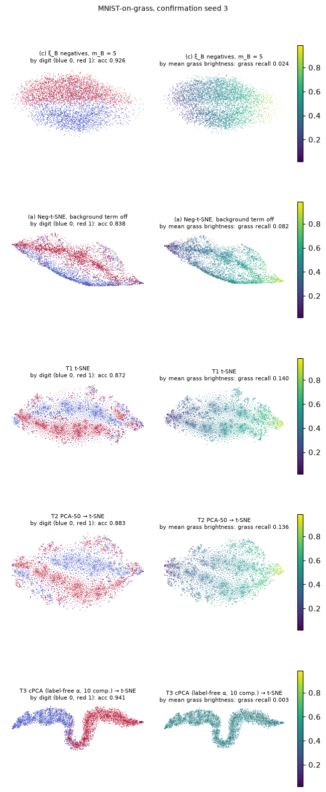
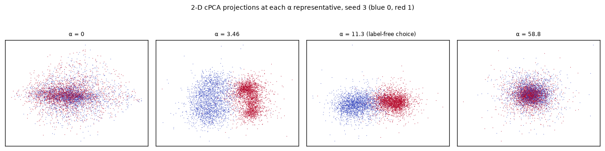

# MNIST-on-grass report: background-contrastive Neg-t-SNE on real images

This phase tests run (c), two-stage Neg-t-SNE with ξ_B background negatives, on real images: the MNIST-on-grass dataset from the contrastive PCA (cPCA) paper. Digits 0 and 1 are overlaid at 25% intensity on patches of ImageNet grass photos; the background dataset is grass patches alone. (c) is compared with three controls set by the supervisor and one reference run, all on the same data:

| label | run |
|---|---|
| (c) | our method: two-stage Neg-t-SNE + ξ_B background negatives, as in Phases 4–5b |
| (a) | reference: the same pipeline with the background term off. It separates the effect of the background term from that of Neg-t-SNE vs t-SNE. |
| T1 | t-SNE (openTSNE, library defaults) on the target images |
| T2 | PCA (50 components, fit on the target) → t-SNE |
| T3 | cPCA (label-free α, top 10 components) → t-SNE. cPCA is `baselines/cpca.py`, the project's reimplementation of contrastive 1.2.0's representative-α procedure, validated in Phase 5 prep. |

There were no new synthetic benchmarks, no other baselines and no new method variants. Everything ran on the Math Slurm cluster, and no comparison mixes cluster and Mac results.

## How to read this report

- **Shared definitions:** `REPORT.md` defines the two-stage Neg-t-SNE, ξ_B, the flags and the "consistent across 3 paired seeds" rule. `REPORT_phase5prep.md` defines the label-free α rule.
- **The spec:** the plan for this phase was given by the project owner in conversation. `results/mnist_grass/preregistration.md` records everything the results depend on, and was committed before any embedding was run.
- **Generated content:** tables marked **(generated)** are copied verbatim from `results/mnist_grass/` by `scripts/mnist_grass_assemble.py`.
- **Metrics:** all are computed on the 2-D embedding of the 5000 target images.
  - **Digit kNN accuracy** (primary): k = 15, stratified 5-fold.
  - **Recall vs clean digits:** kNN recall at k = 15 between the embedding and the clean digit images. Higher is better.
  - **Recall vs grass:** kNN recall at k = 15 between the embedding and each target image's grass patch. Lower is better: it measures how much grass structure the embedding keeps.
- **Seeds:** dataset seeds 0–2 are for selection, 3–5 for confirmation. Each seed is an independent dataset and also seeds every run on it.

## Summary

1. **(c) beats plain t-SNE (T1) and PCA → t-SNE (T2) on every confirmation seed.** Digit kNN accuracy:

   | run | mean digit kNN accuracy | (c)'s per-seed lead |
   |---|---|---|
   | (c) | 0.931 | — |
   | T1 | 0.884 | +0.040 to +0.054 |
   | T2 | 0.891 | +0.038 to +0.043 |

   (c) also keeps much less grass structure: its recall vs grass is 0.022, against 0.135 for T1 and 0.131 for T2.
2. **The gain comes from the background term, not from Neg-t-SNE.**
   - (c) beats (a), the same pipeline without the background term, by +0.065 to +0.088 on every seed (0.931 vs 0.858).
   - Without the background term, Neg-t-SNE is actually *below* t-SNE here (0.858 vs 0.884 and 0.891; descriptive, no verdict was pre-registered for it).
   - So the background term accounts for all of (c)'s advantage over the t-SNE controls, and more.
3. **cPCA → t-SNE (T3) beats (c) on every confirmation seed,** by 0.013 to 0.042 (mean 0.023): 0.955 vs 0.931.
   - T3 also removes grass structure almost entirely (recall vs grass 0.003).
   - MNIST-on-grass is additive by construction: target = digit + independent grass, with the same grass distribution in both datasets. That is exactly the case where cPCA's target-minus-background covariance points at the signal (Phase 5 prep). The synthetic phases predicted this outcome.
4. **The pre-checks matched the design** (descriptive):
   - The digit signal is in the raw-pixel kNN graph: digit kNN accuracy 0.90 on raw X_T, 0.93 on PCA-50, against 1.00 on the clean digits.
   - ξ_B pairs share their grass: patch distance 3.8–4.0, close to each target's grass nearest neighbors (3.6–3.8) and half that of random pairs (7.9–8.1).
   - ξ_B pairs are close to random in digit: same-digit excess +0.055 to +0.074, below the old 0.10 gate.
5. **Reproducibility:**
   - The cluster was validated first (two runs bit-identical). Its difference from the Mac (at most 0.027 WC) is below every Phase 5b verdict margin.
   - openTSNE and the (c) seed-3 rerun were bit-identical.
   - No seed was excluded, and no run was flagged.

## Data (`data/mnist_grass.py`, `data/README_mnist_grass.md`)

The recipe reimplements the authors' notebook (`reference/cpca_mnist_notebook.py`, not run), with five documented deviations:
- sorted filenames;
- one RNG per dataset seed;
- a random sample from all 0/1 training digits;
- no `targetplus`;
- saved provenance.

Inputs and checksums are in `data/MANIFEST.md`.

### Dataset build (generated)

1274 grass images, split 637 / 637 into target and background pools.

| seed | digit 0 | digit 1 | distinct target sources | distinct background sources | build checks |
|---|---|---|---|---|---|
| 0 | 2330 | 2670 | 635 | 637 | passed |
| 1 | 2353 | 2647 | 636 | 636 | passed |
| 2 | 2344 | 2656 | 636 | 637 | passed |
| 3 | 2328 | 2672 | 636 | 637 | passed |
| 4 | 2301 | 2699 | 637 | 636 | passed |
| 5 | 2317 | 2683 | 637 | 637 | passed |

Every seed passed every build check: shapes and ranges, exact reconstruction, disjoint pools, and a bit-identical rebuild.

## Results

### Pre-checks, selection seeds 0–2 (descriptive; generated)

#### Is the digit signal in the kNN graph?

Digit kNN accuracy (k = 15, stratified 5-fold).

| seed | raw X_T (784-D) | clean digits | PCA-50 of X_T |
|---|---|---|---|
| 0 | 0.903 | 0.998 | 0.934 |
| 1 | 0.905 | 0.999 | 0.938 |
| 2 | 0.903 | 0.998 | 0.932 |

#### ξ_B on raw pixels (k_B = 15, L = 30)

Same-digit excess of ξ_B pairs over chance (Phase 2 gate value 0.1 shown for reference; not a stop). Grass distance: mean Euclidean distance between the underlying grass patches, for ξ_B pairs (heads weighted by target-graph degree), all target pairs, and each target's 15 nearest targets by grass patch.

| seed | same digit, ξ_B | chance | excess | grass dist, ξ_B pairs | grass dist, random pairs | grass dist, grass-kNN | list length min / median / p90 / max | empty rows | tie-split rows | capped rows |
|---|---|---|---|---|---|---|---|---|---|---|
| 0 | 0.569 | 0.502 | +0.067 | 3.79 | 7.88 | 3.63 | 22 / 42 / 60 / 60 | 0 | 0.958 | 0.106 |
| 1 | 0.557 | 0.502 | +0.055 | 3.95 | 8.05 | 3.75 | 30 / 41 / 60 / 60 | 0 | 0.952 | 0.097 |
| 2 | 0.576 | 0.502 | +0.074 | 3.83 | 8.00 | 3.65 | 29 / 41 / 60 / 60 | 0 | 0.955 | 0.108 |

#### openTSNE determinism

T1 (library defaults, random_state = 0) on seed 0, run twice: **bit-identical**.

### Main runs (generated)

#### Confirmation seeds (3, 4, 5): mean [min, max]

| run | digit kNN accuracy | recall vs clean digits | recall vs grass patches (lower is better) | flagged seeds |
|---|---|---|---|---|
| (c) ξ_B negatives, m_B = 5 | 0.931 [0.926, 0.938] | 0.013 [0.013, 0.013] | 0.022 [0.021, 0.024] | 0/3 |
| (a) Neg-t-SNE, background term off | 0.858 [0.838, 0.871] | 0.006 [0.006, 0.006] | 0.079 [0.077, 0.082] | 0/3 |
| T1 t-SNE | 0.884 [0.872, 0.891] | 0.015 [0.014, 0.016] | 0.135 [0.133, 0.140] | 0/3 |
| T2 PCA-50 → t-SNE | 0.891 [0.883, 0.898] | 0.014 [0.012, 0.015] | 0.131 [0.127, 0.136] | 0/3 |
| T3 cPCA (label-free α, 10 comp.) → t-SNE | 0.955 [0.941, 0.979] | 0.035 [0.018, 0.069] | 0.003 [0.003, 0.004] | 0/3 |

Per seed, digit kNN accuracy:

| run | seed 3 | seed 4 | seed 5 |
|---|---|---|---|
| (c) ξ_B negatives, m_B = 5 | 0.926 | 0.938 | 0.930 |
| (a) Neg-t-SNE, background term off | 0.838 | 0.871 | 0.866 |
| T1 t-SNE | 0.872 | 0.891 | 0.890 |
| T2 PCA-50 → t-SNE | 0.883 | 0.898 | 0.893 |
| T3 cPCA (label-free α, 10 comp.) → t-SNE | 0.941 | 0.979 | 0.943 |

#### Pre-registered comparisons (confirmation seeds; verdicts on digit kNN accuracy only)

| comparison | per-seed difference in digit kNN accuracy ((c) − other) | mean | verdict | recall vs digits, mean difference | recall vs grass, mean difference |
|---|---|---|---|---|---|
| (c) vs T1 t-SNE | +0.054, +0.046, +0.040 | +0.047 | (c) better, consistent across 3 paired seeds | -0.002 | -0.113 |
| (c) vs T2 PCA-50 → t-SNE | +0.043, +0.040, +0.038 | +0.040 | (c) better, consistent across 3 paired seeds | -0.002 | -0.109 |
| (c) vs T3 cPCA (label-free α, 10 comp.) → t-SNE | -0.015, -0.042, -0.013 | -0.023 | T3 cPCA (label-free α, 10 comp.) → t-SNE better, consistent across 3 paired seeds | -0.022 | +0.019 |
| (c) vs (a) Neg-t-SNE, background term off | +0.088, +0.066, +0.065 | +0.073 | (c) better, consistent across 3 paired seeds | +0.007 | -0.057 |

Secondary columns: mean paired difference (c) − other; for grass recall, negative means (c) keeps less grass structure.

Determinism: (c) on seed 3 rerun: bit-identical.

#### T3: label-free α per seed

| seed | label-free α (T3) |
|---|---|
| 0 | 3.455 |
| 1 | 11.25 |
| 2 | 5.541 |
| 3 | 11.25 |
| 4 | 4.375 |
| 5 | 11.25 |

#### Appendix: selection seeds 0–2, every run

Selection rule: highest mean digit kNN accuracy over selection seeds 0-2; ties -> smaller m_B. Chosen: m_B = 5.

| run | digit kNN accuracy | recall vs clean digits | recall vs grass patches (lower is better) | flagged seeds |
|---|---|---|---|---|
| (c) ξ_B negatives, m_B = 1 | 0.923 [0.910, 0.931] | 0.010 [0.009, 0.011] | 0.048 [0.046, 0.052] | 0/3 |
| (c) ξ_B negatives, m_B = 2 | 0.935 [0.934, 0.936] | 0.012 [0.012, 0.012] | 0.036 [0.035, 0.037] | 0/3 |
| (c) ξ_B negatives, m_B = 5 | 0.937 [0.936, 0.939] | 0.012 [0.011, 0.013] | 0.023 [0.022, 0.024] | 0/3 |
| (c) ξ_B negatives, m_B = 10 | 0.930 [0.928, 0.932] | 0.012 [0.012, 0.013] | 0.018 [0.018, 0.018] | 0/3 |
| (c) ξ_B negatives, m_B = 20 | 0.924 [0.919, 0.927] | 0.012 [0.012, 0.012] | 0.014 [0.014, 0.015] | 0/3 |
| (c) ξ_B negatives, m_B = 40 | 0.922 [0.919, 0.925] | 0.012 [0.012, 0.013] | 0.015 [0.014, 0.015] | 0/3 |
| (a) Neg-t-SNE, background term off | 0.850 [0.818, 0.876] | 0.006 [0.006, 0.007] | 0.077 [0.071, 0.081] | 0/3 |
| T1 t-SNE | 0.888 [0.885, 0.895] | 0.015 [0.014, 0.016] | 0.134 [0.128, 0.137] | 0/3 |
| T2 PCA-50 → t-SNE | 0.897 [0.890, 0.909] | 0.014 [0.012, 0.016] | 0.128 [0.124, 0.131] | 0/3 |
| T3 cPCA (label-free α, 10 comp.) → t-SNE | 0.968 [0.944, 0.985] | 0.051 [0.016, 0.083] | 0.004 [0.004, 0.004] | 0/3 |

#### Cluster validation

Phase B (descriptive): the largest Mac-vs-cluster difference in WC was 0.027, below the smallest per-seed margin among the Phase 5b verdicts (0.070; L-between, (c) vs local_oracle_k5): yes. Gate (two cluster runs bit-identical): passed.

### Cluster validation (Phase B; generated)

L-cyclic confirmation seed 3 was rerun on the cluster with 4 threads, as on the Mac. The table compares it with the Mac's recorded values, next to the cluster's spread over optimization seeds 1000–1002 and the Mac's seed-to-seed spread.

| run | metric | cluster | Mac | cluster − Mac | cluster, optimization seeds 1000–1002 | Mac, seeds 3–5 |
|---|---|---|---|---|---|---|
| a | WC | 0.371 | 0.344 | +0.027 | — | 0.328–0.344 |
| a | acc_s | 0.373 | 0.347 | +0.026 | — | 0.332–0.347 |
| c_m20 | WC | 0.926 | 0.914 | +0.012 | 0.903–0.913 | 0.912–0.916 |
| c_m20 | acc_s | 0.927 | 0.912 | +0.015 | 0.904–0.915 | 0.912–0.917 |

Gate (cluster run twice, bit-identical): **passed**. Largest |Mac − cluster| WC difference 0.027; smallest per-seed margin among the Phase 5b verdicts 0.070 (L-between, (c) vs local_oracle_k5).

### Figures (confirmation seed 3)

Each run, colored by digit (left) and by the mean brightness of each image's grass patch (right):

- **(a), T1 and T2:** organized partly by grass brightness. The bright-grass end mixes the two digits.
- **(c):** splits the digits into two halves. Brightness still varies across the layout but no longer drives the neighborhoods (recall vs grass 0.024).
- **T3:** splits the digits along a single curve with no brightness structure.

The 2-D cPCA projection at each α representative, for comparison with the cPCA paper's figure:

The digits separate at the two intermediate representatives (α = 3.46 and 11.3, the label-free choice), but not at α = 0 (plain PCA) or at the largest α.

## Interpretation

- **On this dataset, the background term does what it was designed for** (interpretation). ξ_B's negatives are target points with similar grass. Repelling them pulls apart neighborhoods that formed because of grass, which lifts digit accuracy from 0.858 to 0.931 and cuts recall vs grass from 0.079 to 0.022.
- **Why cPCA still wins here.** The grass is added independently of the digit, and the target and background grass come from the same distribution. In population, the target-minus-background covariance is then the digit covariance, the identity behind every cPCA win in Phases 4–5. Phase 5b showed (c) winning only where that identity fails *globally* (L-cyclic). MNIST-on-grass is not such a case.
- **Recall vs clean digits is low for every run** (confirmation means 0.006–0.035, where chance is about 15/4999 ≈ 0.003). With only two digit classes, a 2-D layout cannot preserve the fine within-digit neighborhoods of 784-D clean digits. The metric is descriptive here and supports no conclusion.

## Limitations

- **One dataset with two digit classes.** It is additive by construction, so it favors cPCA.
- **The controls use t-SNE, our method uses Neg-t-SNE.** (a) isolates the background term, but (c) vs T1–T3 also changes the embedding algorithm. Without the background term, Neg-t-SNE was below t-SNE here.
- **m_B was selected on the same metric** used for the confirmation verdicts (on different seeds, as pre-registered). No other setting was tuned.
- **T3 is one label-free α per seed** (4.4–11.3 on the confirmation seeds). The comparison is with the label-free pipeline, not with the best α.

## Next steps

These are suggestions, not part of this phase's spec:
1. **A background-suppressed kNN graph,** marked out of scope in this phase's spec. Phase 5b suggested (c)'s limit is its raw-space graph, so a graph built after removing local background directions could close the gap to cPCA on additive data like this.
2. **A real dataset where the background is not additive,** for example one whose nuisance interacts with the signal. That is where the synthetic results predict (c) can beat cPCA.

## Reproducibility

On the cluster (see `cluster/README.md`), in this order:

    python scripts/mnist_grass_manifest.py                  # after unzipping the grass images and downloading mnist.npz
    sbatch cluster/mnist_grass_validate.sbatch              # Phase B
    sbatch cluster/mnist_grass_build.sbatch                 # build seeds 0-5, pre-checks, manifest
    sbatch --export=ALL,THREADS=1 cluster/parallel.sbatch cluster/jobs/mnist_grass_selection.txt
    python scripts/mnist_grass_run.py --merge selection
    sbatch --export=ALL,THREADS=1 cluster/parallel.sbatch cluster/jobs/mnist_grass_confirmation.txt
    python scripts/mnist_grass_run.py --merge confirmation
    python scripts/mnist_grass_report.py
    python scripts/mnist_grass_assemble.py

**Order of commits:**
- Data manifest: `dee01fa`.
- Builder and validation code: `d7505ec`.
- Phase B result: `1269dfa`.
- Build and pre-checks: `3da9bf7`.
- Pre-registration: `8f916ee`, before any embedding run.
- Selection: `3dd613a`, before any confirmation run.
- Confirmation job list: `5556465`.

**Environment:** every run used 1 thread on the cluster's AMD EPYC 9474F (CPU only, no GPU allocated). Every results JSON records the environment, the Slurm job and a clean commit.
