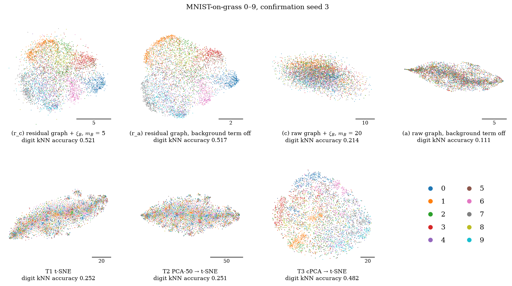
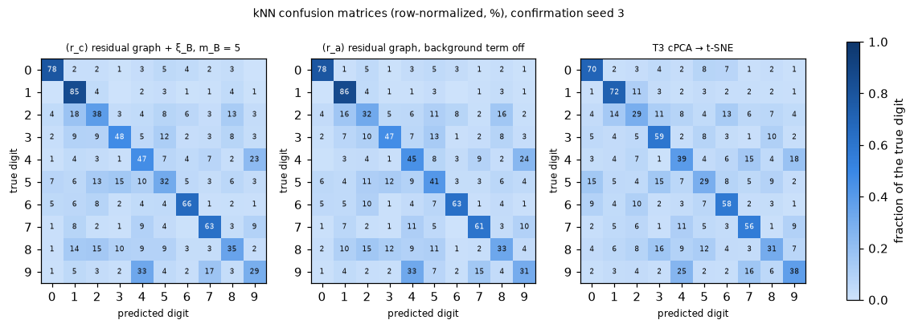

# MNIST-on-grass with digits 0–9

The earlier MNIST-on-grass phases used only digits 0 and 1. With two classes, accuracies sit close to the ceiling, and a map can score well without showing much structure. This phase repeats those experiments with **all ten digits, 500 of each per dataset**. Everything else is unchanged: the recipe (0.25 × digit + a grass patch), the sizes, the seeds, the controls, the metrics, the protocol and the cluster setup. The residual graph was **fixed** at k_loc = 30, r = 2, the label-free default from the 0/1 phase, and was not re-selected.

| label | run |
|---|---|
| (r_c) | residual graph + ξ_B background negatives (BC-NE+BN) |
| (r_a) | residual graph, background term off (BC-NE, the method's core) |
| (c) | raw-pixel graph + ξ_B background negatives (the original method) |
| (a) | raw-pixel graph, background term off (plain two-stage Neg-t-SNE) |
| T1 | t-SNE (openTSNE defaults) |
| T2 | PCA-50 → t-SNE |
| T3 | cPCA (label-free α, top 10 components) → t-SNE |

Everything ran on the Math Slurm cluster, CPU only, 1 thread per run. No comparison mixes cluster and Mac results.

## How to read this report

- **Definitions:** `REPORT_mnist_grass.md` defines the dataset recipe, (a), (c), T1–T3 and the metrics. `REPORT_bsgraph.md` defines the residual graph, (r_a) and (r_c).
- **Pre-registration:** `results/mnist_grass_0to9/preregistration.md` was committed (`a9329a6`) before any cluster job of this phase: before the dataset build, the pre-checks and every embedding.
- **Generated content:** tables marked **(generated)** are copied verbatim from `results/mnist_grass_0to9/` by `scripts/mnist_grass_0to9_assemble.py`.
- **Metrics:** all are computed on the 2-D embedding of the 5000 target images.
  - **Digit kNN accuracy** (primary): k = 15, stratified 5-fold, 10 classes. **Chance is 0.10** here, against 0.50 in the 0/1 runs.
  - **Recall vs clean digits** (higher is better) and **recall vs grass** (lower is better): kNN recall at k = 15.
  - **ARI** (secondary, pre-registered, no verdicts): k-means with k = 10 on the embedding, against the digit labels.
  - **Per-digit accuracy and confusion matrices** (descriptive): from the same classifier and folds.
- **Claim types:**
  - **pre-registered:** a comparison with a verdict under "consistent across 3 paired seeds";
  - **descriptive:** measured, no verdict;
  - **interpretation:** our explanation, not tested.

## Summary

1. **BC-NE+BN, (r_c), beats all three t-SNE controls on every confirmation seed** (pre-registered).

   | run | mean digit kNN accuracy | (r_c)'s per-seed lead |
   |---|---|---|
   | (r_c) | 0.530 | — |
   | T3 cPCA → t-SNE | 0.433 | +0.039, +0.137, +0.114 |
   | T2 PCA-50 → t-SNE | 0.255 | +0.268 to +0.287 |
   | T1 t-SNE | 0.253 | +0.268 to +0.293 |

   The verdict against T3 is new. With digits 0/1, (r_c) vs T3 was not consistent (0.973 vs 0.955). With ten digits, (r_c) is ahead on every seed.
2. **The method's core, (r_a), also beats cPCA → t-SNE on every seed** (pre-registered): +0.035, +0.106, +0.100 (0.514 vs 0.433).
3. **The residual graph is again what makes the difference** (pre-registered). (r_c) beats (c) by +0.289 to +0.316 (0.530 vs 0.226).
   - Both of the raw-graph runs fall below t-SNE here (descriptive): (c) by −0.020 to −0.038, and (a), plain Neg-t-SNE, sits at 0.115, near chance.
   - In the 0/1 runs, (c) beat T1 and T2. With ten digits, background negatives on the raw graph no longer rescue it.
4. **Background negatives now add a small, consistent gain** (pre-registered): (r_c) vs (r_a) is +0.004, +0.031 and +0.014 (mean +0.016). In the 0/1 runs this comparison was not consistent. The gain is small next to the residual graph's effect, and smaller than the seed-to-seed spread of T3.
5. **All the residual and cPCA maps remove the grass** (descriptive). Recall vs grass is 0.003–0.004 for (r_c), (r_a) and T3, against 0.14 for T1 and T2.
6. **The absolute level is modest** (descriptive).
   - At 0.53, (r_c) is far above chance (0.10). But the same classifier on the clean 784-D digits reaches 0.91, so much of the digit structure is still lost.
   - Digits 0, 1 and 6 are recovered best (0.69–0.87 for (r_c)); 5, 8 and 9 worst (0.29–0.35).
   - 4 and 9 are the largest confusion: on seed 3, 33% of the 9s are classified as 4.
7. **ARI ranks the runs the same way as the primary metric, but is low everywhere** (secondary, no verdicts).
   - (r_c) 0.244, (r_a) 0.225, T3 0.117; every other run ≤ 0.031.
   - With 0/1 (computed post hoc), (r_c) and (r_a) reach 0.87 and T3 0.80. k-means finds ten digit clusters only partly in any of these maps.
8. **Determinism:** the T1 seed-0 and (r_c) seed-3 reruns were bit-identical. No run was flagged. All build checks passed, including the 0/1 regression.

## Dataset build (generated)

1274 grass images, split 637 / 637 into target and background pools.

| seed | images per digit (min–max over digits 0–9) | distinct target sources | distinct background sources | build checks |
|---|---|---|---|---|
| 0 | 500–500 | 637 | 637 | passed |
| 1 | 500–500 | 637 | 637 | passed |
| 2 | 500–500 | 637 | 637 | passed |
| 3 | 500–500 | 637 | 637 | passed |
| 4 | 500–500 | 637 | 636 | passed |
| 5 | 500–500 | 636 | 637 | passed |

0/1 regression (stored 0/1 files match the manifest and rebuild bit-identically): **passed** on seeds 0, 1, 2, 3, 4, 5. ξ_B check refactor (all 14 fields of the stored 0/1 seed-0 pre-check reproduced exactly): **passed**.

## Pre-checks and graph quality (generated; descriptive)

Graph metrics in the space each graph is built on; mean [min, max] over seeds. Chance for digit accuracy is 0.10. The residual default (k30_r2: k_loc = 30, r = 2) was fixed in advance; the grid is a robustness check and selects nothing.

#### Seeds 0–2 (selection)

##### Reference graphs and the residual default

| graph | graph digit accuracy | edge purity | grass recall (lower is better) | clean-digit recall |
|---|---|---|---|---|
| raw | 0.375 [0.366, 0.391] | 0.222 [0.219, 0.227] | 0.498 [0.494, 0.503] | 0.022 [0.022, 0.023] |
| pca50 | 0.416 [0.411, 0.424] | 0.241 [0.238, 0.244] | 0.367 [0.362, 0.373] | 0.023 [0.023, 0.023] |
| cpca10 | 0.463 [0.445, 0.479] | 0.330 [0.319, 0.344] | 0.005 [0.005, 0.005] | 0.062 [0.055, 0.068] |
| **k30_r2 (default)** | 0.587 [0.571, 0.596] | 0.432 [0.424, 0.446] | 0.052 [0.051, 0.053] | 0.084 [0.081, 0.089] |

##### Residual grid

| graph | graph digit accuracy | edge purity | grass recall (lower is better) | clean-digit recall |
|---|---|---|---|---|
| k15_r0 | 0.578 [0.570, 0.582] | 0.419 [0.413, 0.430] | 0.076 [0.074, 0.077] | 0.080 [0.077, 0.083] |
| k15_r1 | 0.584 [0.573, 0.592] | 0.424 [0.417, 0.435] | 0.061 [0.060, 0.061] | 0.082 [0.079, 0.086] |
| k15_r2 | 0.585 [0.573, 0.594] | 0.429 [0.422, 0.440] | 0.052 [0.052, 0.053] | 0.084 [0.080, 0.088] |
| k15_r5 | 0.576 [0.558, 0.594] | 0.432 [0.423, 0.445] | 0.044 [0.044, 0.045] | 0.086 [0.082, 0.090] |
| k15_r10 | 0.567 [0.549, 0.579] | 0.426 [0.416, 0.441] | 0.043 [0.042, 0.043] | 0.086 [0.082, 0.091] |
| k30_r0 | 0.571 [0.562, 0.578] | 0.408 [0.403, 0.420] | 0.088 [0.085, 0.089] | 0.076 [0.073, 0.079] |
| k30_r1 | 0.579 [0.571, 0.587] | 0.420 [0.413, 0.432] | 0.067 [0.066, 0.069] | 0.080 [0.077, 0.084] |
| **k30_r2 (default)** | 0.587 [0.571, 0.596] | 0.432 [0.424, 0.446] | 0.052 [0.051, 0.053] | 0.084 [0.081, 0.089] |
| k30_r5 | 0.586 [0.568, 0.599] | 0.437 [0.427, 0.452] | 0.041 [0.041, 0.041] | 0.089 [0.084, 0.094] |
| k30_r10 | 0.576 [0.557, 0.586] | 0.430 [0.420, 0.445] | 0.040 [0.040, 0.041] | 0.089 [0.085, 0.093] |
| k100_r0 | 0.547 [0.537, 0.556] | 0.384 [0.379, 0.393] | 0.121 [0.116, 0.125] | 0.068 [0.066, 0.071] |
| k100_r1 | 0.560 [0.555, 0.567] | 0.398 [0.389, 0.411] | 0.091 [0.087, 0.097] | 0.073 [0.071, 0.077] |
| k100_r2 | 0.585 [0.576, 0.594] | 0.429 [0.419, 0.443] | 0.056 [0.055, 0.057] | 0.083 [0.080, 0.088] |
| k100_r5 | 0.586 [0.573, 0.595] | 0.445 [0.437, 0.460] | 0.039 [0.039, 0.040] | 0.093 [0.088, 0.098] |
| k100_r10 | 0.578 [0.565, 0.588] | 0.437 [0.426, 0.455] | 0.039 [0.038, 0.040] | 0.094 [0.089, 0.099] |

##### ξ_B on raw pixels (k_B = 15, L = 30)

| seed | clean-digit accuracy | same digit, ξ_B | chance | excess | grass dist, ξ_B pairs | grass dist, random pairs | grass dist, grass-kNN | list length min / median / p90 / max | empty rows | tie-split rows | capped rows |
|---|---|---|---|---|---|---|---|---|---|---|---|
| 0 | 0.906 | 0.108 | 0.100 | +0.009 | 3.85 | 7.98 | 3.67 | 26 / 41 / 60 / 60 | 0 | 0.950 | 0.107 |
| 1 | 0.912 | 0.109 | 0.100 | +0.009 | 3.90 | 7.98 | 3.73 | 28 / 42 / 60 / 60 | 0 | 0.952 | 0.101 |
| 2 | 0.914 | 0.110 | 0.100 | +0.010 | 3.77 | 7.96 | 3.62 | 21 / 42 / 60 / 60 | 0 | 0.949 | 0.108 |

#### Seeds 3–5 (confirmation)

##### Reference graphs and the residual default

| graph | graph digit accuracy | edge purity | grass recall (lower is better) | clean-digit recall |
|---|---|---|---|---|
| raw | 0.364 [0.348, 0.374] | 0.223 [0.220, 0.227] | 0.486 [0.483, 0.487] | 0.023 [0.022, 0.024] |
| pca50 | 0.420 [0.416, 0.424] | 0.242 [0.240, 0.247] | 0.361 [0.358, 0.368] | 0.023 [0.023, 0.024] |
| cpca10 | 0.489 [0.456, 0.544] | 0.350 [0.324, 0.397] | 0.005 [0.005, 0.006] | 0.071 [0.058, 0.094] |
| **k30_r2 (default)** | 0.583 [0.562, 0.618] | 0.426 [0.415, 0.439] | 0.053 [0.052, 0.055] | 0.086 [0.081, 0.092] |

##### Residual grid

| graph | graph digit accuracy | edge purity | grass recall (lower is better) | clean-digit recall |
|---|---|---|---|---|
| k15_r0 | 0.582 [0.564, 0.612] | 0.414 [0.403, 0.425] | 0.078 [0.076, 0.079] | 0.082 [0.077, 0.088] |
| k15_r1 | 0.584 [0.565, 0.614] | 0.420 [0.410, 0.435] | 0.062 [0.060, 0.063] | 0.084 [0.079, 0.088] |
| k15_r2 | 0.583 [0.568, 0.611] | 0.422 [0.413, 0.434] | 0.053 [0.052, 0.054] | 0.085 [0.080, 0.091] |
| k15_r5 | 0.571 [0.554, 0.601] | 0.422 [0.413, 0.433] | 0.046 [0.045, 0.048] | 0.087 [0.082, 0.092] |
| k15_r10 | 0.559 [0.542, 0.589] | 0.415 [0.406, 0.427] | 0.045 [0.044, 0.047] | 0.087 [0.082, 0.092] |
| k30_r0 | 0.575 [0.556, 0.604] | 0.404 [0.392, 0.415] | 0.090 [0.088, 0.091] | 0.078 [0.074, 0.084] |
| k30_r1 | 0.581 [0.562, 0.613] | 0.416 [0.403, 0.429] | 0.068 [0.066, 0.070] | 0.082 [0.076, 0.088] |
| **k30_r2 (default)** | 0.583 [0.562, 0.618] | 0.426 [0.415, 0.439] | 0.053 [0.052, 0.055] | 0.086 [0.081, 0.092] |
| k30_r5 | 0.574 [0.558, 0.600] | 0.428 [0.419, 0.439] | 0.043 [0.041, 0.045] | 0.089 [0.085, 0.095] |
| k30_r10 | 0.558 [0.542, 0.586] | 0.420 [0.410, 0.431] | 0.043 [0.041, 0.045] | 0.089 [0.085, 0.095] |
| k100_r0 | 0.556 [0.544, 0.572] | 0.383 [0.373, 0.390] | 0.120 [0.118, 0.124] | 0.071 [0.067, 0.076] |
| k100_r1 | 0.567 [0.544, 0.590] | 0.398 [0.384, 0.407] | 0.092 [0.091, 0.093] | 0.075 [0.070, 0.082] |
| k100_r2 | 0.588 [0.573, 0.612] | 0.425 [0.413, 0.435] | 0.058 [0.057, 0.060] | 0.085 [0.080, 0.092] |
| k100_r5 | 0.584 [0.572, 0.606] | 0.440 [0.430, 0.449] | 0.041 [0.039, 0.042] | 0.094 [0.089, 0.100] |
| k100_r10 | 0.563 [0.547, 0.589] | 0.427 [0.419, 0.437] | 0.041 [0.039, 0.043] | 0.095 [0.092, 0.101] |

##### ξ_B on raw pixels (k_B = 15, L = 30)

| seed | clean-digit accuracy | same digit, ξ_B | chance | excess | grass dist, ξ_B pairs | grass dist, random pairs | grass dist, grass-kNN | list length min / median / p90 / max | empty rows | tie-split rows | capped rows |
|---|---|---|---|---|---|---|---|---|---|---|---|
| 3 | 0.911 | 0.109 | 0.100 | +0.009 | 3.84 | 7.86 | 3.67 | 25 / 42 / 60 / 60 | 0 | 0.951 | 0.104 |
| 4 | 0.917 | 0.110 | 0.100 | +0.010 | 3.78 | 7.99 | 3.63 | 30 / 42 / 60 / 60 | 0 | 0.953 | 0.120 |
| 5 | 0.908 | 0.107 | 0.100 | +0.008 | 3.78 | 7.97 | 3.67 | 30 / 42 / 60 / 60 | 0 | 0.956 | 0.108 |

cpca10: the top 10 cPCA components at the label-free α (per seed: 0: 5.541, 1: 5.541, 2: 5.541, 3: 4.375, 4: 5.541, 5: 5.541).

What the pre-checks show (descriptive):
- **Raw-pixel neighborhoods are mostly grass.** Mean graph digit accuracy is 0.36–0.38 on raw pixels, and about half of each image's graph neighbors (grass recall 0.48–0.50) are also among its 15 nearest images by grass patch.
- **The residual default gives the best graph:** mean graph digit accuracy 0.58–0.59, against 0.42 for PCA-50 and 0.46–0.49 for cPCA-10. Its grass recall is 0.05. cPCA-10 removes grass even more completely (0.005), but keeps less digit structure.
- **The default is not a lucky choice.** All 15 variants on the grid have means of 0.55–0.59. The lowest on both seed sets is k_loc = 100, r = 0: with many background neighbors, subtracting the mean alone isn't enough.
- **ξ_B pairs barely favor the same digit:** an excess of +0.008 to +0.010 over chance. They are close in grass (distance 3.8–3.9, against 7.9–8.0 for random pairs), as in the 0/1 data.

## Results (generated)

#### Confirmation seeds (3, 4, 5): mean [min, max]

Chance digit kNN accuracy is 0.10. ARI is secondary, with no verdicts.

| run | digit kNN accuracy | recall vs clean digits | recall vs grass (lower is better) | ARI (k-means, k = 10) | flagged seeds |
|---|---|---|---|---|---|
| (r_c) residual graph + ξ_B, m_B = 5 | 0.530 [0.521, 0.544] | 0.052 [0.048, 0.054] | 0.003 [0.003, 0.003] | 0.244 [0.237, 0.248] | 0/3 |
| (r_a) residual graph, background term off | 0.514 [0.510, 0.517] | 0.050 [0.046, 0.053] | 0.004 [0.003, 0.004] | 0.225 [0.205, 0.243] | 0/3 |
| (c) raw graph + ξ_B, m_B = 20 | 0.226 [0.214, 0.236] | 0.009 [0.008, 0.009] | 0.019 [0.018, 0.020] | 0.031 [0.026, 0.035] | 0/3 |
| (a) raw graph, background term off | 0.115 [0.111, 0.119] | 0.003 [0.003, 0.003] | 0.097 [0.095, 0.099] | 0.001 [0.001, 0.002] | 0/3 |
| T1 t-SNE | 0.253 [0.252, 0.256] | 0.013 [0.013, 0.014] | 0.142 [0.140, 0.144] | 0.002 [0.001, 0.003] | 0/3 |
| T2 PCA-50 → t-SNE | 0.255 [0.251, 0.257] | 0.013 [0.013, 0.013] | 0.141 [0.140, 0.144] | 0.002 [0.002, 0.003] | 0/3 |
| T3 cPCA → t-SNE | 0.433 [0.408, 0.482] | 0.054 [0.044, 0.072] | 0.003 [0.003, 0.004] | 0.117 [0.105, 0.132] | 0/3 |

Per seed, digit kNN accuracy:

| run | seed 3 | seed 4 | seed 5 |
|---|---|---|---|
| (r_c) residual graph + ξ_B, m_B = 5 | 0.521 | 0.544 | 0.525 |
| (r_a) residual graph, background term off | 0.517 | 0.514 | 0.510 |
| (c) raw graph + ξ_B, m_B = 20 | 0.214 | 0.228 | 0.236 |
| (a) raw graph, background term off | 0.111 | 0.116 | 0.119 |
| T1 t-SNE | 0.252 | 0.252 | 0.256 |
| T2 PCA-50 → t-SNE | 0.251 | 0.257 | 0.256 |
| T3 cPCA → t-SNE | 0.482 | 0.408 | 0.411 |

Per seed, ARI:

| run | seed 3 | seed 4 | seed 5 |
|---|---|---|---|
| (r_c) residual graph + ξ_B, m_B = 5 | 0.237 | 0.248 | 0.248 |
| (r_a) residual graph, background term off | 0.243 | 0.205 | 0.226 |
| (c) raw graph + ξ_B, m_B = 20 | 0.026 | 0.035 | 0.031 |
| (a) raw graph, background term off | 0.002 | 0.002 | 0.001 |
| T1 t-SNE | 0.003 | 0.001 | 0.001 |
| T2 PCA-50 → t-SNE | 0.002 | 0.002 | 0.003 |
| T3 cPCA → t-SNE | 0.132 | 0.113 | 0.105 |

#### Pre-registered comparisons (confirmation seeds; verdicts on digit kNN accuracy only)

Differences are first run − second run; secondary columns are mean paired differences, without verdicts.

| comparison | per-seed difference in digit kNN accuracy | mean | verdict | recall vs digits, mean difference | recall vs grass, mean difference | ARI, mean difference |
|---|---|---|---|---|---|---|
| (r_c) residual graph + ξ_B, m_B = 5 vs T1 t-SNE | +0.269, +0.293, +0.268 | +0.277 | (r_c) better, consistent across 3 paired seeds | +0.038 | -0.139 | +0.242 |
| (r_c) residual graph + ξ_B, m_B = 5 vs T2 PCA-50 → t-SNE | +0.270, +0.287, +0.268 | +0.275 | (r_c) better, consistent across 3 paired seeds | +0.039 | -0.139 | +0.242 |
| (r_c) residual graph + ξ_B, m_B = 5 vs T3 cPCA → t-SNE | +0.039, +0.137, +0.114 | +0.097 | (r_c) better, consistent across 3 paired seeds | -0.002 | -0.001 | +0.127 |
| (r_a) residual graph, background term off vs T3 cPCA → t-SNE | +0.035, +0.106, +0.100 | +0.080 | (r_a) better, consistent across 3 paired seeds | -0.004 | +0.000 | +0.108 |
| (r_c) residual graph + ξ_B, m_B = 5 vs (c) raw graph + ξ_B, m_B = 20 | +0.307, +0.316, +0.289 | +0.304 | (r_c) better, consistent across 3 paired seeds | +0.043 | -0.017 | +0.214 |
| (r_c) residual graph + ξ_B, m_B = 5 vs (r_a) residual graph, background term off | +0.004, +0.031, +0.014 | +0.016 | (r_c) better, consistent across 3 paired seeds | +0.002 | -0.001 | +0.019 |

#### Descriptive comparisons (no verdicts)

| comparison | per-seed difference in digit kNN accuracy | mean | verdict | recall vs digits, mean difference | recall vs grass, mean difference | ARI, mean difference |
|---|---|---|---|---|---|---|
| (a) raw graph, background term off vs T1 t-SNE | -0.141, -0.136, -0.137 | -0.138 | (descriptive) T1 better, consistent across 3 paired seeds | -0.010 | -0.045 | -0.000 |
| (c) raw graph + ξ_B, m_B = 20 vs T1 t-SNE | -0.038, -0.023, -0.020 | -0.027 | (descriptive) T1 better, consistent across 3 paired seeds | -0.005 | -0.123 | +0.029 |
| (c) raw graph + ξ_B, m_B = 20 vs T2 PCA-50 → t-SNE | -0.037, -0.029, -0.021 | -0.029 | (descriptive) T2 better, consistent across 3 paired seeds | -0.004 | -0.122 | +0.028 |
| (c) raw graph + ξ_B, m_B = 20 vs T3 cPCA → t-SNE | -0.267, -0.179, -0.175 | -0.207 | (descriptive) T3 better, consistent across 3 paired seeds | -0.045 | +0.016 | -0.086 |

#### Per-digit kNN accuracy (confirmation seeds, mean)

| run | 0 | 1 | 2 | 3 | 4 | 5 | 6 | 7 | 8 | 9 |
|---|---|---|---|---|---|---|---|---|---|---|
| (r_c) residual graph + ξ_B, m_B = 5 | 0.763 | 0.866 | 0.471 | 0.494 | 0.453 | 0.289 | 0.686 | 0.593 | 0.339 | 0.346 |
| (r_a) residual graph, background term off | 0.747 | 0.867 | 0.427 | 0.485 | 0.473 | 0.283 | 0.621 | 0.565 | 0.339 | 0.329 |
| (c) raw graph + ξ_B, m_B = 20 | 0.461 | 0.451 | 0.175 | 0.207 | 0.215 | 0.097 | 0.197 | 0.225 | 0.081 | 0.153 |
| (a) raw graph, background term off | 0.217 | 0.164 | 0.111 | 0.119 | 0.097 | 0.096 | 0.107 | 0.101 | 0.069 | 0.071 |
| T1 t-SNE | 0.462 | 0.403 | 0.243 | 0.252 | 0.200 | 0.137 | 0.286 | 0.257 | 0.140 | 0.152 |
| T2 PCA-50 → t-SNE | 0.445 | 0.421 | 0.240 | 0.252 | 0.198 | 0.148 | 0.282 | 0.270 | 0.143 | 0.151 |
| T3 cPCA → t-SNE | 0.589 | 0.685 | 0.283 | 0.529 | 0.329 | 0.230 | 0.499 | 0.480 | 0.312 | 0.397 |

#### Determinism

- T1 t-SNE on seed 0 (selection) rerun: bit-identical.
- (r_c) residual graph + ξ_B, m_B = 5 on seed 3 (confirmation) rerun: bit-identical.

#### T3: label-free α per seed

| seed | label-free α (T3) |
|---|---|
| 0 | 5.541 |
| 1 | 5.541 |
| 2 | 5.541 |
| 3 | 4.375 |
| 4 | 5.541 |
| 5 | 5.541 |

#### Beside the 0/1 runs (descriptive; confirmation seeds 3–5, all cluster results)

0/1 values are the stored MNIST-on-grass and background-suppressed graph confirmation runs, each method at the m_B selected in its own phase. Chance is 0.50 there and 0.10 here, so accuracies are not directly comparable. The 0/1 ARI (k-means, k = 2) was computed post hoc from the saved embeddings (`ari_01_posthoc.csv`); it was not pre-registered.

| run | m_B (0–9 / 0/1) | digit kNN accuracy, 0–9 | digit kNN accuracy, 0/1 | ARI, 0–9 | ARI, 0/1 (post hoc) | recall vs grass, 0–9 | recall vs grass, 0/1 |
|---|---|---|---|---|---|---|---|
| (r_c) | 5 / 1 | 0.530 [0.521, 0.544] | 0.973 [0.972, 0.974] | 0.244 [0.237, 0.248] | 0.874 [0.857, 0.887] | 0.003 [0.003, 0.003] | 0.003 [0.003, 0.004] |
| (r_a) | — | 0.514 [0.510, 0.517] | 0.972 [0.970, 0.974] | 0.225 [0.205, 0.243] | 0.873 [0.856, 0.887] | 0.004 [0.003, 0.004] | 0.004 [0.004, 0.004] |
| (c) | 20 / 5 | 0.226 [0.214, 0.236] | 0.931 [0.926, 0.938] | 0.031 [0.026, 0.035] | 0.031 [0.020, 0.040] | 0.019 [0.018, 0.020] | 0.022 [0.021, 0.024] |
| (a) | — | 0.115 [0.111, 0.119] | 0.858 [0.838, 0.871] | 0.001 [0.001, 0.002] | 0.005 [0.002, 0.009] | 0.097 [0.095, 0.099] | 0.079 [0.077, 0.082] |
| T1 | — | 0.253 [0.252, 0.256] | 0.884 [0.872, 0.891] | 0.002 [0.001, 0.003] | 0.007 [0.003, 0.009] | 0.142 [0.140, 0.144] | 0.135 [0.133, 0.140] |
| T2 | — | 0.255 [0.251, 0.257] | 0.891 [0.883, 0.898] | 0.002 [0.002, 0.003] | 0.014 [0.004, 0.030] | 0.141 [0.140, 0.144] | 0.131 [0.127, 0.136] |
| T3 | — | 0.433 [0.408, 0.482] | 0.955 [0.941, 0.979] | 0.117 [0.105, 0.132] | 0.797 [0.733, 0.905] | 0.003 [0.003, 0.004] | 0.003 [0.003, 0.004] |

#### Appendix: selection seeds 0–2, every run

Selection rule: highest mean digit kNN accuracy over selection seeds 0-2; ties -> smaller m_B. Chosen: m_B = 20 for (c), m_B = 5 for (r_c).

| run | digit kNN accuracy | recall vs clean digits | recall vs grass (lower is better) | ARI (k-means, k = 10) | flagged seeds |
|---|---|---|---|---|---|
| (r_c) residual graph + ξ_B, m_B = 1 | 0.525 [0.501, 0.554] | 0.050 [0.046, 0.052] | 0.003 [0.003, 0.003] | 0.237 [0.218, 0.262] | 0/3 |
| (r_c) residual graph + ξ_B, m_B = 2 | 0.534 [0.514, 0.550] | 0.050 [0.048, 0.052] | 0.003 [0.003, 0.003] | 0.238 [0.219, 0.259] | 0/3 |
| (r_c) residual graph + ξ_B, m_B = 5 | 0.534 [0.515, 0.555] | 0.050 [0.049, 0.051] | 0.003 [0.002, 0.003] | 0.239 [0.217, 0.258] | 0/3 |
| (r_c) residual graph + ξ_B, m_B = 10 | 0.526 [0.513, 0.550] | 0.048 [0.047, 0.050] | 0.003 [0.002, 0.003] | 0.239 [0.215, 0.261] | 0/3 |
| (r_c) residual graph + ξ_B, m_B = 20 | 0.526 [0.505, 0.539] | 0.047 [0.045, 0.049] | 0.002 [0.002, 0.003] | 0.231 [0.209, 0.252] | 0/3 |
| (r_c) residual graph + ξ_B, m_B = 40 | 0.524 [0.509, 0.535] | 0.045 [0.042, 0.048] | 0.003 [0.002, 0.003] | 0.228 [0.204, 0.249] | 0/3 |
| (r_a) residual graph, background term off | 0.528 [0.511, 0.554] | 0.050 [0.046, 0.052] | 0.004 [0.004, 0.004] | 0.237 [0.220, 0.260] | 0/3 |
| (c) raw graph + ξ_B, m_B = 1 | 0.168 [0.155, 0.182] | 0.005 [0.005, 0.006] | 0.075 [0.073, 0.076] | 0.005 [0.003, 0.006] | 0/3 |
| (c) raw graph + ξ_B, m_B = 2 | 0.183 [0.171, 0.196] | 0.006 [0.006, 0.007] | 0.057 [0.055, 0.058] | 0.010 [0.010, 0.010] | 0/3 |
| (c) raw graph + ξ_B, m_B = 5 | 0.208 [0.194, 0.222] | 0.007 [0.007, 0.008] | 0.034 [0.034, 0.035] | 0.018 [0.016, 0.021] | 0/3 |
| (c) raw graph + ξ_B, m_B = 10 | 0.214 [0.203, 0.225] | 0.008 [0.007, 0.008] | 0.024 [0.023, 0.025] | 0.023 [0.020, 0.026] | 0/3 |
| (c) raw graph + ξ_B, m_B = 20 | 0.217 [0.195, 0.232] | 0.008 [0.008, 0.009] | 0.019 [0.018, 0.021] | 0.029 [0.022, 0.037] | 0/3 |
| (c) raw graph + ξ_B, m_B = 40 | 0.215 [0.202, 0.225] | 0.008 [0.008, 0.009] | 0.019 [0.017, 0.019] | 0.028 [0.023, 0.034] | 0/3 |
| (a) raw graph, background term off | 0.114 [0.106, 0.121] | 0.003 [0.003, 0.004] | 0.097 [0.094, 0.099] | 0.000 [0.000, 0.001] | 0/3 |
| T1 t-SNE | 0.246 [0.243, 0.250] | 0.013 [0.013, 0.013] | 0.143 [0.139, 0.146] | 0.002 [0.001, 0.003] | 0/3 |
| T2 PCA-50 → t-SNE | 0.255 [0.253, 0.257] | 0.013 [0.013, 0.014] | 0.139 [0.136, 0.141] | 0.002 [0.001, 0.005] | 0/3 |
| T3 cPCA → t-SNE | 0.418 [0.401, 0.439] | 0.047 [0.042, 0.052] | 0.003 [0.003, 0.004] | 0.109 [0.106, 0.112] | 0/3 |

### Figures (confirmation seed 3)

Each run colored by digit (left; each digit's number is placed at the median of its points) and by mean grass-patch brightness (right):

- **(r_a) and (r_c):** separate regions for 0, 1, 3, 6 and 7. 2, 5 and 8 overlap in the middle, and 4 and 9 share one region. There is no grass-brightness gradient.
- **T3:** the digits are spread more diffusely, also with no brightness gradient.
- **(a), (c), T1 and T2:** the digits are mixed, and the layout runs from dark to bright grass. Grass brightness is the main axis of these maps.

Row-normalized kNN confusion matrices for (r_c), (r_a) and T3:

## Interpretation

- **With ten digits, the background dominates raw neighborhoods even more.** (interpretation) With 0/1, a 25%-intensity digit still determined most raw-pixel neighbors (raw graph digit accuracy 0.90). With ten digits of similar shapes, it mostly doesn't (0.37). Every run built on the raw graph inherits that, which is why (a) and (c) fall to or below t-SNE. The residual graph removes the grass before neighbors are chosen, so it keeps its advantage.
- **Why cPCA → t-SNE falls behind here, although the data are additive.** (interpretation, untested) In the population, cPCA's identity still holds. But T3 keeps only the top 10 cPCA components at one label-free α, and ten digit classes may need more directions than that. T3 also varies with α: seed 3, the only one with a different α (4.375), is its best seed (0.482 vs 0.408–0.411). This phase does not separate these causes.
- **Background negatives help a little once there is more to separate.** (interpretation) With the residual graph, ξ_B repels images with similar grass. With 0/1 there was nothing left for it to do. With ten digits the map is more crowded, and the extra repulsion gives a small, consistent gain.

## Limitations

- **Still an additive dataset.** Target = 0.25 × digit + grass, exactly as before. This is not the non-additive test the earlier reports call for.
- **Labels were used for selection.** m_B for (c) and (r_c) was chosen with labels on the selection seeds, as pre-registered.
  - For (r_c), m_B = 5 (0.5337) won over m_B = 2 (0.5336) by less than 0.0001; under the rule, only exact ties go to the smaller m_B.
  - The verdicts come from separate confirmation seeds.
- **Different embedding algorithms.** The comparisons with T1–T3 also change the algorithm (Neg-t-SNE vs t-SNE). (a) vs T1 shows that plain Neg-t-SNE is far below t-SNE here (−0.136 to −0.141, descriptive), so the residual graph's gain is larger than its margin over T1 suggests.
- **T3 is one label-free setting.** It uses a fixed 10 components, and cPCA with more components or another α was not tried.
- **ARI depends on k-means.** k-means looks for round clusters, and no map here has ten clean clusters, so the ARI values are low and secondary. The 0/1 ARI was computed post hoc.

## Next steps

These are suggestions, not part of this phase's spec:
1. **A real dataset with a non-additive background,** as proposed in the earlier reports. It is still the open test.
2. **Optional, descriptive: T3 with more cPCA components** (for example 20 or 50). This would show whether cPCA's gap here comes from keeping only 10 components.
3. **Revisit what ξ_B is for.** It is redundant with two classes and gives a small gain with ten. Does it help more as the number of classes, or the crowding of the map, grows?

## Reproducibility

On the cluster (see `cluster/README.md`), in this order:

    sbatch cluster/mnist_grass_0to9_build.sbatch
    sbatch --export=ALL,THREADS=1 cluster/parallel.sbatch cluster/jobs/mnist_grass_0to9_prechecks.txt
    python scripts/mnist_grass_0to9_prechecks.py --summarize
    sbatch --export=ALL,THREADS=1 cluster/parallel.sbatch cluster/jobs/mnist_grass_0to9_selection.txt
    python scripts/mnist_grass_0to9_run.py --merge selection
    python scripts/mnist_grass_0to9_run.py --make-jobs confirmation
    sbatch --export=ALL,THREADS=1 cluster/parallel.sbatch cluster/jobs/mnist_grass_0to9_confirmation.txt
    python scripts/mnist_grass_0to9_run.py --merge confirmation
    python scripts/mnist_grass_0to9_ari01.py
    python scripts/mnist_grass_0to9_report.py
    python scripts/mnist_grass_0to9_assemble.py

**Order of commits:**
- Builder, metrics and tests: `1aa2c55`.
- Pre-registration and run scripts: `a9329a6`.
- Datasets built: `a41619c`.
- Pre-checks: `065e966`.
- Selection: `9a3ec00`.
- Confirmation job list: `ba1f582`.
- Report scripts: `e16afa1`.
- Confirmation, ARI and tables: `f55ce92`.

**Jobs:** 6084 (build, 2 min), 6085 (pre-checks, 1 min 13 s), 6086 (selection, 11 min), 6087 (confirmation, 4 min 48 s). Every results JSON records the environment, the Slurm job, 1 thread and a clean commit.
