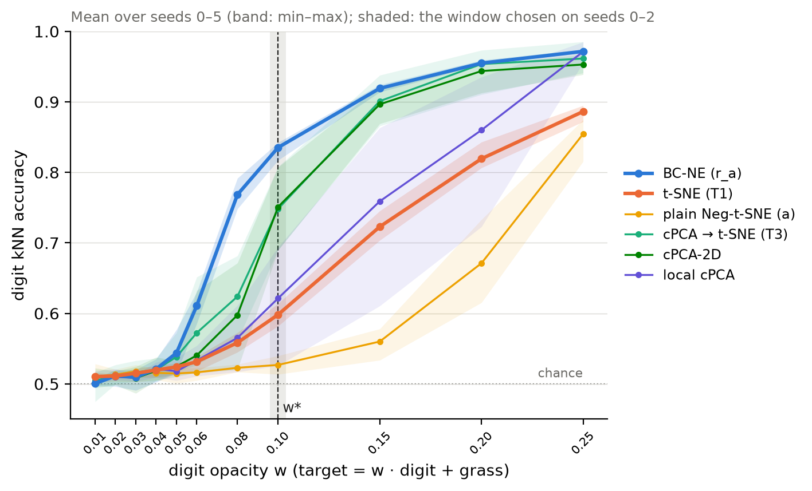
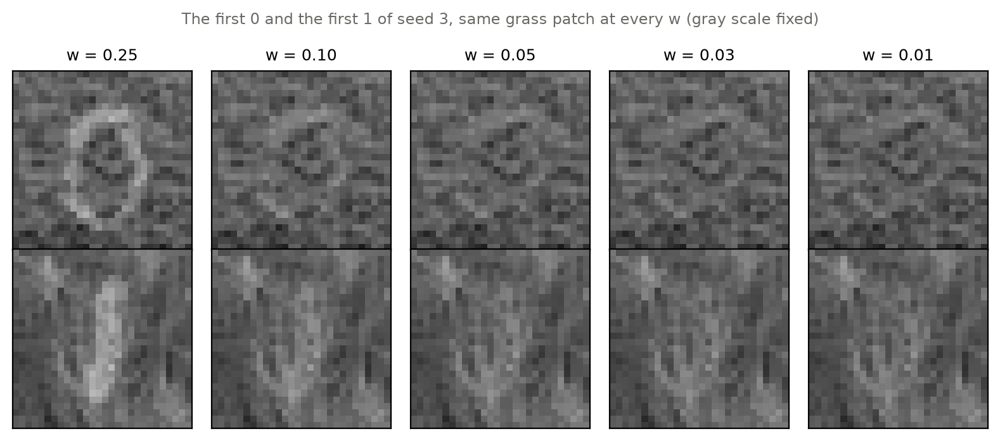
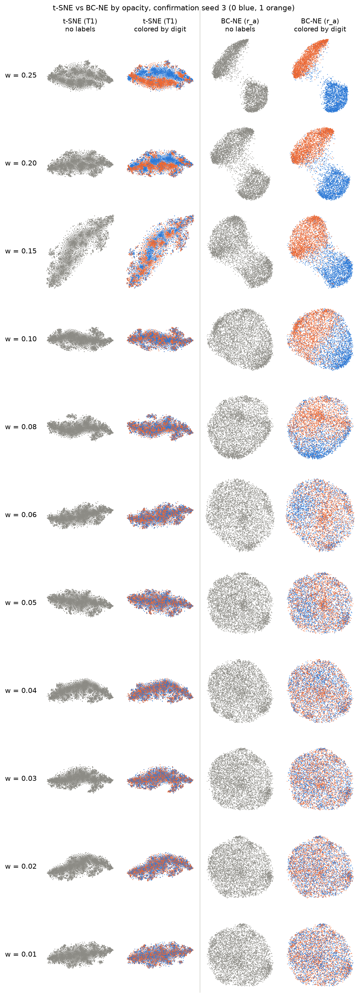
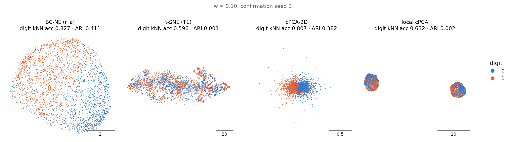

# Digit opacity on MNIST-on-grass 0/1

At the standard recipe (target = 0.25 × digit + grass), both BC-NE and plain t-SNE separate 0 from 1. This phase makes
the digits fainter, X_T(w) = w · digit + grass for w from 0.25 down to 0.01, to find **a range of opacities where
BC-NE still separates the digits and t-SNE does not**.
- **Claim type:** pre-registered (`results/mnist_grass_opacity/preregistration.md`, `91fdb42`), with w\* chosen on
  seeds 0–2 and three checks at w\* on seeds 3–5. Everything else is descriptive.
- **BC-NE** is (r_a) in its adopted single-stage form: the residual graph (k_loc = 30, r = 2), one 750-epoch
  Neg-t-SNE run. **t-SNE** is openTSNE with library defaults (T1).
- **Baselines, new from this phase:** cPCA-2D and local cPCA, alongside cPCA → t-SNE (T3) and plain Neg-t-SNE (a).
- **Data:** the six stored 0/1 datasets. Only the opacity changes; the digits, grass patches and background are the
  same at every w. Every run checked that w = 0.25 reproduces the stored target bit for bit.
- **Platform:** every run is on the cluster. Nothing is compared with earlier phases' numbers.

## Summary

1. **By the pre-registered levels, the window is a single grid point, and the result is mixed.**
   - **Selection (seeds 0–2):** the only w with mean BC-NE ≥ 0.80 and mean t-SNE ≤ 0.60 is 0.10, so w\* = 0.10.
   - **Confirmation at w\* (seeds 3–5):**
     - C1 **holds**: BC-NE 0.827, 0.842, 0.841;
     - C2 **fails narrowly**: t-SNE 0.596, 0.611, 0.614, so two seeds are just above 0.60;
     - C3 **holds**: BC-NE beats t-SNE by +0.232, +0.230, +0.227.
   - **So at w = 0.10,** BC-NE separates the digits at the 0.80 level on every seed and leads t-SNE by 0.23, but
     t-SNE is not at or below 0.60 on every seed.
   - **The levels leave little room.** Over all six seeds, mean t-SNE falls to 0.60 at w ≈ 0.101 and mean BC-NE falls
     below 0.80 at w ≈ 0.089, by linear interpolation.
2. **By the project owner's visual judgment, the range is wider: w = 0.15, 0.10 and 0.08** (seed 3).
   - **Judgment:** t-SNE separates the digits at w = 0.25 and 0.20 only. BC-NE separates them down to 0.08. Below
     that, neither does: "there is no clear clustering by digit".
   - **Where it differs from the levels:**
     - t-SNE at w = 0.15: accuracy 0.704, above 0.60, but no visible clustering by digit;
     - BC-NE at w = 0.08: accuracy 0.749, below 0.80, but visibly separated.
   - It was recorded verbatim and committed (`14594f4`) before this report. It is one viewer on one seed and does not
     change C1–C3.
3. **BC-NE's lead over t-SNE is largest at w = 0.08–0.15** (all six seeds, mean): +0.196 at 0.15, +0.237 at 0.10,
   +0.210 at 0.08, against +0.086 at 0.25 and +0.136 at 0.20.
   - At w ≤ 0.05, every method is near chance (0.5); the best mean is BC-NE's 0.544 at 0.05.
4. **cPCA at its label-free α matches BC-NE at visible opacities and falls behind at faint ones** (all six seeds,
   mean):

   | w | BC-NE | cPCA → t-SNE (T3) | cPCA-2D | t-SNE |
   |---|---|---|---|---|
   | 0.25 | 0.972 | 0.961 | 0.953 | 0.886 |
   | 0.15 | 0.919 | 0.901 | 0.897 | 0.723 |
   | 0.10 | 0.835 | 0.748 | 0.751 | 0.598 |
   | 0.08 | 0.768 | 0.624 | 0.598 | 0.558 |

   - α was not tuned here. The tuned-T3 phase showed the label-free α can miss the best range, so a tuned cPCA might
     close this gap.
5. **Local cPCA sits between t-SNE and global cPCA from w = 0.20 to 0.06** (0.621 at w = 0.10).
   - It found two background clusters (K = 2) at every seed and w, and was applicable everywhere.
   - Its embedding keeps the two clusters as separate islands, each with both digits mixed in.
6. **Plain Neg-t-SNE (a) is below t-SNE at every w from 0.20 to 0.04** (below that, both are at chance), so BC-NE's advantage comes from the residual graph, not
   from Neg-t-SNE itself.
7. **Grass is removed at every w** by BC-NE (recall vs grass 0.004–0.011) and cPCA (0.003–0.006), against
   0.134–0.186 for t-SNE.
8. **ARI needs care here.** For t-SNE, plain Neg-t-SNE and local cPCA it is about 0 at every w, even where their kNN
   accuracy is 0.85–0.97: k-means' two-way split follows the layout's large-scale shape (t-SNE's stripes, local cPCA's
   two background islands), not the digits. BC-NE's ARI falls from 0.874 at w = 0.25 to 0.442 at 0.10, where its two
   digit groups touch.
9. **Checks pass.** Every rerun was bit-identical (seed 0 at w = 0.25, and seed 3 at w\*), and every run reproduced
   the stored w = 0.25 target.

## Results (generated)

### Digit kNN accuracy, selection seeds 0–2: mean [min, max]

| w | BC-NE (r_a) | t-SNE (T1) | plain Neg-t-SNE (a) | cPCA → t-SNE (T3) | cPCA-2D | local cPCA |
|---|---|---|---|---|---|---|
| 0.25 | 0.972 [0.971, 0.973] | 0.888 [0.885, 0.895] | 0.850 [0.815, 0.875] | 0.968 [0.944, 0.985] | 0.957 [0.942, 0.965] | 0.977 [0.966, 0.985] |
| 0.20 | 0.954 [0.953, 0.955] | 0.813 [0.806, 0.822] | 0.679 [0.624, 0.733] | 0.949 [0.910, 0.973] | 0.938 [0.913, 0.950] | 0.847 [0.723, 0.912] |
| 0.15 | 0.918 [0.914, 0.920] | 0.716 [0.704, 0.727] | 0.551 [0.534, 0.569] | 0.878 [0.866, 0.886] | 0.876 [0.869, 0.882] | 0.732 [0.611, 0.817] |
| 0.10 | 0.834 [0.817, 0.842] | 0.589 [0.582, 0.602] | 0.522 [0.514, 0.526] | 0.737 [0.690, 0.797] | 0.740 [0.690, 0.804] | 0.603 [0.526, 0.647] |
| 0.08 | 0.771 [0.748, 0.792] | 0.548 [0.545, 0.551] | 0.522 [0.517, 0.525] | 0.665 [0.653, 0.682] | 0.656 [0.634, 0.671] | 0.573 [0.548, 0.611] |
| 0.06 | 0.606 [0.586, 0.620] | 0.526 [0.518, 0.532] | 0.515 [0.505, 0.520] | 0.589 [0.556, 0.652] | 0.558 [0.516, 0.632] | 0.537 [0.511, 0.554] |
| 0.05 | 0.529 [0.515, 0.552] | 0.522 [0.513, 0.527] | 0.514 [0.501, 0.522] | 0.547 [0.524, 0.572] | 0.530 [0.528, 0.533] | 0.525 [0.511, 0.537] |
| 0.04 | 0.516 [0.502, 0.534] | 0.518 [0.509, 0.525] | 0.515 [0.506, 0.521] | 0.519 [0.504, 0.530] | 0.513 [0.505, 0.521] | 0.522 [0.509, 0.531] |
| 0.03 | 0.508 [0.491, 0.517] | 0.512 [0.509, 0.515] | 0.518 [0.503, 0.527] | 0.511 [0.506, 0.514] | 0.511 [0.494, 0.524] | 0.507 [0.506, 0.509] |
| 0.02 | 0.512 [0.510, 0.514] | 0.510 [0.508, 0.511] | 0.513 [0.504, 0.521] | 0.514 [0.504, 0.527] | 0.514 [0.512, 0.518] | 0.507 [0.506, 0.509] |
| 0.01 | 0.500 [0.500, 0.500] | 0.510 [0.507, 0.516] | 0.515 [0.506, 0.528] | 0.501 [0.475, 0.516] | 0.513 [0.501, 0.522] | 0.509 [0.501, 0.519] |

### Window and w\* (selection seeds)

Window W (mean r_a ≥ 0.80 and mean T1 ≤ 0.60): 0.10. w\* (largest w in W): 0.10. Largest mean r_a − T1 difference at w = 0.10.

### Digit kNN accuracy, confirmation seeds 3–5: mean [min, max]

| w | BC-NE (r_a) | t-SNE (T1) | plain Neg-t-SNE (a) | cPCA → t-SNE (T3) | cPCA-2D | local cPCA |
|---|---|---|---|---|---|---|
| 0.25 | 0.972 [0.970, 0.974] | 0.884 [0.872, 0.891] | 0.859 [0.838, 0.872] | 0.955 [0.941, 0.979] | 0.949 [0.939, 0.967] | 0.965 [0.955, 0.976] |
| 0.20 | 0.956 [0.953, 0.959] | 0.825 [0.814, 0.843] | 0.663 [0.615, 0.697] | 0.959 [0.952, 0.967] | 0.950 [0.947, 0.953] | 0.872 [0.775, 0.935] |
| 0.15 | 0.920 [0.916, 0.924] | 0.730 [0.704, 0.745] | 0.569 [0.557, 0.578] | 0.924 [0.910, 0.938] | 0.917 [0.908, 0.922] | 0.785 [0.656, 0.863] |
| 0.10 | 0.837 [0.827, 0.842] | 0.607 [0.596, 0.614] | 0.532 [0.522, 0.540] | 0.760 [0.720, 0.808] | 0.762 [0.724, 0.807] | 0.640 [0.595, 0.694] |
| 0.08 | 0.766 [0.749, 0.777] | 0.569 [0.565, 0.573] | 0.524 [0.521, 0.528] | 0.583 [0.562, 0.598] | 0.539 [0.520, 0.553] | 0.558 [0.517, 0.580] |
| 0.06 | 0.615 [0.593, 0.630] | 0.537 [0.533, 0.539] | 0.518 [0.514, 0.523] | 0.556 [0.527, 0.587] | 0.523 [0.517, 0.530] | 0.529 [0.520, 0.536] |
| 0.05 | 0.558 [0.546, 0.577] | 0.527 [0.523, 0.529] | 0.516 [0.515, 0.517] | 0.529 [0.517, 0.543] | 0.519 [0.510, 0.524] | 0.510 [0.505, 0.515] |
| 0.04 | 0.526 [0.519, 0.535] | 0.521 [0.515, 0.525] | 0.516 [0.511, 0.520] | 0.521 [0.509, 0.536] | 0.525 [0.508, 0.538] | 0.521 [0.517, 0.528] |
| 0.03 | 0.512 [0.505, 0.520] | 0.518 [0.516, 0.522] | 0.518 [0.516, 0.520] | 0.522 [0.504, 0.533] | 0.506 [0.487, 0.517] | 0.510 [0.504, 0.514] |
| 0.02 | 0.511 [0.496, 0.520] | 0.512 [0.510, 0.514] | 0.514 [0.510, 0.521] | 0.509 [0.500, 0.522] | 0.510 [0.498, 0.516] | 0.513 [0.508, 0.521] |
| 0.01 | 0.501 [0.497, 0.507] | 0.511 [0.506, 0.514] | 0.505 [0.503, 0.509] | 0.508 [0.502, 0.516] | 0.507 [0.494, 0.517] | 0.509 [0.504, 0.518] |

### Pre-registered checks at w\*

At w\* = 0.10, confirmation seeds 3, 4, 5:

| check | per seed | verdict |
|---|---|---|
| C1: r_a ≥ 0.80 on every seed | 0.827, 0.842, 0.841 | **holds** |
| C2: T1 ≤ 0.60 on every seed | 0.596, 0.611, 0.614 | **fails** |
| C3: r_a − T1 | +0.232, +0.230, +0.227 (mean +0.230) | r_a better, consistent across 3 paired seeds |

### Digit kNN accuracy, all six seeds: mean [min, max]

| w | BC-NE (r_a) | t-SNE (T1) | plain Neg-t-SNE (a) | cPCA → t-SNE (T3) | cPCA-2D | local cPCA |
|---|---|---|---|---|---|---|
| 0.25 | 0.972 [0.970, 0.974] | 0.886 [0.872, 0.895] | 0.854 [0.815, 0.875] | 0.961 [0.941, 0.985] | 0.953 [0.939, 0.967] | 0.971 [0.955, 0.985] |
| 0.20 | 0.955 [0.953, 0.959] | 0.819 [0.806, 0.843] | 0.671 [0.615, 0.733] | 0.954 [0.910, 0.973] | 0.944 [0.913, 0.953] | 0.860 [0.723, 0.935] |
| 0.15 | 0.919 [0.914, 0.924] | 0.723 [0.704, 0.745] | 0.560 [0.534, 0.578] | 0.901 [0.866, 0.938] | 0.897 [0.869, 0.922] | 0.759 [0.611, 0.863] |
| 0.10 | 0.835 [0.817, 0.842] | 0.598 [0.582, 0.614] | 0.527 [0.514, 0.540] | 0.748 [0.690, 0.808] | 0.751 [0.690, 0.807] | 0.621 [0.526, 0.694] |
| 0.08 | 0.768 [0.748, 0.792] | 0.558 [0.545, 0.573] | 0.523 [0.517, 0.528] | 0.624 [0.562, 0.682] | 0.598 [0.520, 0.671] | 0.565 [0.517, 0.611] |
| 0.06 | 0.611 [0.586, 0.630] | 0.531 [0.518, 0.539] | 0.516 [0.505, 0.523] | 0.572 [0.527, 0.652] | 0.540 [0.516, 0.632] | 0.533 [0.511, 0.554] |
| 0.05 | 0.544 [0.515, 0.577] | 0.524 [0.513, 0.529] | 0.515 [0.501, 0.522] | 0.538 [0.517, 0.572] | 0.524 [0.510, 0.533] | 0.518 [0.505, 0.537] |
| 0.04 | 0.521 [0.502, 0.535] | 0.520 [0.509, 0.525] | 0.516 [0.506, 0.521] | 0.520 [0.504, 0.536] | 0.519 [0.505, 0.538] | 0.522 [0.509, 0.531] |
| 0.03 | 0.510 [0.491, 0.520] | 0.515 [0.509, 0.522] | 0.518 [0.503, 0.527] | 0.516 [0.504, 0.533] | 0.508 [0.487, 0.524] | 0.508 [0.504, 0.514] |
| 0.02 | 0.511 [0.496, 0.520] | 0.511 [0.508, 0.514] | 0.513 [0.504, 0.521] | 0.511 [0.500, 0.527] | 0.512 [0.498, 0.518] | 0.510 [0.506, 0.521] |
| 0.01 | 0.500 [0.497, 0.507] | 0.510 [0.506, 0.516] | 0.510 [0.503, 0.528] | 0.504 [0.475, 0.516] | 0.510 [0.494, 0.522] | 0.509 [0.501, 0.519] |

### Crossing points (descriptive, all six seeds, linear interpolation)

| curve | crosses at w |
|---|---|
| mean r_a falls below 0.80 | 0.089 |
| mean T1 falls to 0.60 | 0.101 |

### ARI (k-means, k = 2), all six seeds: mean

| w | BC-NE (r_a) | t-SNE (T1) | plain Neg-t-SNE (a) | cPCA → t-SNE (T3) | cPCA-2D | local cPCA |
|---|---|---|---|---|---|---|
| 0.25 | 0.874 | 0.005 | 0.005 | 0.818 | 0.806 | 0.005 |
| 0.20 | 0.798 | 0.003 | 0.003 | 0.802 | 0.773 | 0.004 |
| 0.15 | 0.683 | 0.003 | 0.002 | 0.634 | 0.628 | 0.002 |
| 0.10 | 0.442 | 0.001 | 0.001 | 0.269 | 0.275 | 0.001 |
| 0.08 | 0.148 | 0.001 | 0.001 | 0.082 | 0.067 | 0.001 |
| 0.06 | 0.009 | 0.000 | 0.000 | 0.032 | 0.018 | 0.001 |
| 0.05 | 0.001 | 0.000 | 0.000 | 0.006 | 0.004 | 0.001 |
| 0.04 | 0.001 | 0.000 | 0.000 | 0.001 | 0.002 | 0.000 |
| 0.03 | 0.000 | 0.000 | 0.000 | 0.001 | 0.001 | 0.000 |
| 0.02 | 0.000 | 0.000 | 0.000 | 0.000 | 0.000 | 0.000 |
| 0.01 | 0.000 | 0.000 | 0.000 | 0.000 | -0.000 | 0.000 |

### Recall vs grass (lower is better), all six seeds: mean

| w | BC-NE (r_a) | t-SNE (T1) | plain Neg-t-SNE (a) | cPCA → t-SNE (T3) | cPCA-2D | local cPCA |
|---|---|---|---|---|---|---|
| 0.25 | 0.004 | 0.134 | 0.078 | 0.004 | 0.003 | 0.006 |
| 0.20 | 0.005 | 0.152 | 0.094 | 0.004 | 0.003 | 0.006 |
| 0.15 | 0.005 | 0.167 | 0.105 | 0.004 | 0.003 | 0.006 |
| 0.10 | 0.007 | 0.179 | 0.111 | 0.004 | 0.003 | 0.006 |
| 0.08 | 0.009 | 0.181 | 0.112 | 0.004 | 0.003 | 0.006 |
| 0.06 | 0.011 | 0.184 | 0.114 | 0.005 | 0.004 | 0.007 |
| 0.05 | 0.011 | 0.185 | 0.115 | 0.005 | 0.004 | 0.007 |
| 0.04 | 0.011 | 0.186 | 0.115 | 0.005 | 0.004 | 0.007 |
| 0.03 | 0.011 | 0.186 | 0.115 | 0.005 | 0.004 | 0.008 |
| 0.02 | 0.011 | 0.186 | 0.116 | 0.006 | 0.004 | 0.008 |
| 0.01 | 0.011 | 0.186 | 0.116 | 0.006 | 0.004 | 0.008 |

### Recall vs clean digits, all six seeds: mean

| w | BC-NE (r_a) | t-SNE (T1) | plain Neg-t-SNE (a) | cPCA → t-SNE (T3) | cPCA-2D | local cPCA |
|---|---|---|---|---|---|---|
| 0.25 | 0.057 | 0.015 | 0.006 | 0.043 | 0.017 | 0.038 |
| 0.20 | 0.037 | 0.009 | 0.004 | 0.041 | 0.017 | 0.015 |
| 0.15 | 0.020 | 0.006 | 0.003 | 0.020 | 0.011 | 0.007 |
| 0.10 | 0.008 | 0.004 | 0.003 | 0.007 | 0.005 | 0.004 |
| 0.08 | 0.005 | 0.004 | 0.003 | 0.005 | 0.004 | 0.003 |
| 0.06 | 0.004 | 0.003 | 0.003 | 0.004 | 0.003 | 0.003 |
| 0.05 | 0.003 | 0.003 | 0.003 | 0.003 | 0.003 | 0.003 |
| 0.04 | 0.003 | 0.003 | 0.003 | 0.003 | 0.003 | 0.003 |
| 0.03 | 0.003 | 0.003 | 0.003 | 0.003 | 0.003 | 0.003 |
| 0.02 | 0.003 | 0.003 | 0.003 | 0.003 | 0.003 | 0.003 |
| 0.01 | 0.003 | 0.003 | 0.003 | 0.003 | 0.003 | 0.003 |

### cPCA's label-free α per w

| w | label-free α of T3 / cPCA-2D, seeds 0–5 |
|---|---|
| 0.25 | 3.46, 11.3, 5.54, 11.3, 4.38, 11.3 |
| 0.20 | 2.73, 8.89, 4.38, 4.38, 3.46, 5.54 |
| 0.15 | 5.54, 5.54, 5.54, 4.38, 2.73, 3.46 |
| 0.10 | 3.46, 4.38, 4.38, 3.46, 4.38, 4.38 |
| 0.08 | 3.46, 3.46, 3.46, 4.38, 4.38, 4.38 |
| 0.06 | 3.46, 3.46, 2.15, 2.73, 3.46, 4.38 |
| 0.05 | 2.73, 3.46, 3.46, 3.46, 2.73, 3.46 |
| 0.04 | 4.38, 3.46, 3.46, 3.46, 2.73, 2.73 |
| 0.03 | 4.38, 3.46, 3.46, 3.46, 2.73, 2.73 |
| 0.02 | 4.38, 3.46, 3.46, 3.46, 2.73, 2.73 |
| 0.01 | 4.38, 3.46, 3.46, 3.46, 2.73, 2.73 |

### Local cPCA: clusters (selection and confirmation seeds)

| seed | w | K (silhouette) | clusters: target / background points | applicable | α per cluster |
|---|---|---|---|---|---|
| 0 | 0.25 | 2 | 2200/2780, 2800/2220 | yes | 2.15, 5.54 |
| 0 | 0.20 | 2 | 2285/2780, 2715/2220 | yes | 4.38, 18 |
| 0 | 0.15 | 2 | 2370/2780, 2630/2220 | yes | 8.89, 11.3 |
| 0 | 0.10 | 2 | 2458/2780, 2542/2220 | yes | 7.02, 7.02 |
| 0 | 0.08 | 2 | 2493/2780, 2507/2220 | yes | 7.02, 7.02 |
| 0 | 0.06 | 2 | 2533/2780, 2467/2220 | yes | 3.46, 5.54 |
| 0 | 0.05 | 2 | 2557/2780, 2443/2220 | yes | 3.46, 5.54 |
| 0 | 0.04 | 2 | 2572/2780, 2428/2220 | yes | 3.46, 5.54 |
| 0 | 0.03 | 2 | 2600/2780, 2400/2220 | yes | 3.46, 4.38 |
| 0 | 0.02 | 2 | 2614/2780, 2386/2220 | yes | 7.02, 4.38 |
| 0 | 0.01 | 2 | 2630/2780, 2370/2220 | yes | 7.02, 5.54 |
| 1 | 0.25 | 2 | 2740/2239, 2260/2761 | yes | 7.02, 4.38 |
| 1 | 0.20 | 2 | 2653/2239, 2347/2761 | yes | 14.3, 7.02 |
| 1 | 0.15 | 2 | 2566/2239, 2434/2761 | yes | 58.8, 11.3 |
| 1 | 0.10 | 2 | 2464/2239, 2536/2761 | yes | 58.8, 7.02 |
| 1 | 0.08 | 2 | 2434/2239, 2566/2761 | yes | 7.02, 7.02 |
| 1 | 0.06 | 2 | 2402/2239, 2598/2761 | yes | 7.02, 7.02 |
| 1 | 0.05 | 2 | 2378/2239, 2622/2761 | yes | 4.38, 7.02 |
| 1 | 0.04 | 2 | 2356/2239, 2644/2761 | yes | 4.38, 7.02 |
| 1 | 0.03 | 2 | 2330/2239, 2670/2761 | yes | 7.02, 7.02 |
| 1 | 0.02 | 2 | 2316/2239, 2684/2761 | yes | 7.02, 7.02 |
| 1 | 0.01 | 2 | 2291/2239, 2709/2761 | yes | 4.38, 7.02 |
| 2 | 0.25 | 2 | 2551/2141, 2449/2859 | yes | 7.02, 8.89 |
| 2 | 0.20 | 2 | 2459/2141, 2541/2859 | yes | 74.4, 7.02 |
| 2 | 0.15 | 2 | 2363/2141, 2637/2859 | yes | 11.3, 8.89 |
| 2 | 0.10 | 2 | 2277/2141, 2723/2859 | yes | 8.89, 5.54 |
| 2 | 0.08 | 2 | 2245/2141, 2755/2859 | yes | 7.02, 4.38 |
| 2 | 0.06 | 2 | 2204/2141, 2796/2859 | yes | 7.02, 4.38 |
| 2 | 0.05 | 2 | 2187/2141, 2813/2859 | yes | 7.02, 4.38 |
| 2 | 0.04 | 2 | 2167/2141, 2833/2859 | yes | 7.02, 5.54 |
| 2 | 0.03 | 2 | 2153/2141, 2847/2859 | yes | 5.54, 5.54 |
| 2 | 0.02 | 2 | 2131/2141, 2869/2859 | yes | 7.02, 5.54 |
| 2 | 0.01 | 2 | 2110/2141, 2890/2859 | yes | 7.02, 5.54 |

| seed | w | K (silhouette) | clusters: target / background points | applicable | α per cluster |
|---|---|---|---|---|---|
| 3 | 0.25 | 2 | 2815/2269, 2185/2731 | yes | 8.89, 14.3 |
| 3 | 0.20 | 2 | 2724/2269, 2276/2731 | yes | 14.3, 8.89 |
| 3 | 0.15 | 2 | 2627/2269, 2373/2731 | yes | 11.3, 7.02 |
| 3 | 0.10 | 2 | 2527/2269, 2473/2731 | yes | 8.89, 7.02 |
| 3 | 0.08 | 2 | 2490/2269, 2510/2731 | yes | 7.02, 5.54 |
| 3 | 0.06 | 2 | 2440/2269, 2560/2731 | yes | 5.54, 4.38 |
| 3 | 0.05 | 2 | 2428/2269, 2572/2731 | yes | 5.54, 5.54 |
| 3 | 0.04 | 2 | 2407/2269, 2593/2731 | yes | 5.54, 5.54 |
| 3 | 0.03 | 2 | 2388/2269, 2612/2731 | yes | 5.54, 5.54 |
| 3 | 0.02 | 2 | 2372/2269, 2628/2731 | yes | 5.54, 5.54 |
| 3 | 0.01 | 2 | 2346/2269, 2654/2731 | yes | 5.54, 4.38 |
| 4 | 0.25 | 2 | 2279/2810, 2721/2190 | yes | 2.73, 7.02 |
| 4 | 0.20 | 2 | 2384/2810, 2616/2190 | yes | 22.9, 18 |
| 4 | 0.15 | 2 | 2445/2810, 2555/2190 | yes | 18, 14.3 |
| 4 | 0.10 | 2 | 2536/2810, 2464/2190 | yes | 7.02, 14.3 |
| 4 | 0.08 | 2 | 2573/2810, 2427/2190 | yes | 14.3, 11.3 |
| 4 | 0.06 | 2 | 2610/2810, 2390/2190 | yes | 14.3, 11.3 |
| 4 | 0.05 | 2 | 2621/2810, 2379/2190 | yes | 14.3, 11.3 |
| 4 | 0.04 | 2 | 2646/2810, 2354/2190 | yes | 14.3, 11.3 |
| 4 | 0.03 | 2 | 2669/2810, 2331/2190 | yes | 14.3, 11.3 |
| 4 | 0.02 | 2 | 2687/2810, 2313/2190 | yes | 14.3, 11.3 |
| 4 | 0.01 | 2 | 2705/2810, 2295/2190 | yes | 14.3, 11.3 |
| 5 | 0.25 | 2 | 2320/2904, 2680/2096 | yes | 5.54, 14.3 |
| 5 | 0.20 | 2 | 2423/2904, 2577/2096 | yes | 7.02, 11.3 |
| 5 | 0.15 | 2 | 2522/2904, 2478/2096 | yes | 5.54, 11.3 |
| 5 | 0.10 | 2 | 2604/2904, 2396/2096 | yes | 3.46, 14.3 |
| 5 | 0.08 | 2 | 2642/2904, 2358/2096 | yes | 5.54, 11.3 |
| 5 | 0.06 | 2 | 2678/2904, 2322/2096 | yes | 4.38, 8.89 |
| 5 | 0.05 | 2 | 2698/2904, 2302/2096 | yes | 5.54, 8.89 |
| 5 | 0.04 | 2 | 2718/2904, 2282/2096 | yes | 5.54, 11.3 |
| 5 | 0.03 | 2 | 2730/2904, 2270/2096 | yes | 5.54, 8.89 |
| 5 | 0.02 | 2 | 2754/2904, 2246/2096 | yes | 5.54, 11.3 |
| 5 | 0.01 | 2 | 2769/2904, 2231/2096 | yes | 5.54, 7.02 |

### Checks

| stage | rerun (seed, w) | bit-identical, per run |
|---|---|---|
| selection | (0, 0.25) | BC-NE (r_a) yes, t-SNE (T1) yes, plain Neg-t-SNE (a) yes, cPCA → t-SNE (T3) yes, cPCA-2D yes, local cPCA yes |
| confirmation | (3, 0.10) | BC-NE (r_a) yes, t-SNE (T1) yes, plain Neg-t-SNE (a) yes, cPCA → t-SNE (T3) yes, cPCA-2D yes, local cPCA yes |

Every run checked its dataset's SHA-256 and that X_T(0.25) reproduces the stored target bit for bit (a failure stops the run; none stopped).

### Runtimes (one thread)

| process | median runtime per process (s) | range |
|---|---|---|
| BC-NE (r_a) | 108 | 77–154 |
| t-SNE (T1) | 40 | 32–51 |
| plain Neg-t-SNE (a) | 100 | 72–127 |
| cPCA fit + T3 + cPCA-2D | 39 | 31–64 |
| local cPCA | 125 | 87–156 |

### Visual judgment (project owner)

| w | T1 accuracy, seed 3 | T1 above 0.60 | T1 separates the digits (project owner, visual) | r_a accuracy, seed 3 | r_a at least 0.80 | r_a separates the digits (project owner, visual) |
|---|---|---|---|---|---|---|
| 0.25 | 0.872 | yes | yes | 0.970 | yes | yes |
| 0.20 | 0.818 | yes | yes | 0.953 | yes | yes |
| 0.15 | 0.704 | yes | no | 0.916 | yes | yes |
| 0.10 | 0.596 | no | no | 0.827 | yes | yes |
| 0.08 | 0.568 | no | no | 0.749 | no | yes |
| 0.06 | 0.533 | no | no | 0.593 | no | no |
| 0.05 | 0.528 | no | no | 0.552 | no | no |
| 0.04 | 0.522 | no | no | 0.535 | no | no |
| 0.03 | 0.517 | no | no | 0.520 | no | no |
| 0.02 | 0.512 | no | no | 0.517 | no | no |
| 0.01 | 0.512 | no | no | 0.507 | no | no |

- **t-SNE (T1):** the judgment and the accuracy level (above 0.60) disagree at w = 0.15.
- **BC-NE (r_a):** the judgment and the accuracy level (at least 0.80) disagree at w = 0.08.

## Figures

**Accuracy against opacity** (all six seeds, mean with min–max band; chance at 0.5; the window shaded, w\* marked):

**How faint the digits are:** one 0 and one 1 (seed 3) at several w.

**t-SNE vs BC-NE at every w** (seed 3), each without labels and colored by digit. The project owner's visual judgment
was made from this figure.

**Every run at w\* = 0.10** (seed 3):

The per-run inspection figures are `results/mnist_grass_opacity/inspection_{T1,r_a}_seed3.png`.

## Limitations

- **The window rests on one grid point.** Between w = 0.10 and 0.15 there is no grid value, and the pre-registered
  levels (0.80 and 0.60) leave a range only about 0.012 wide in w. C2 missed by at most 0.014.
- **The levels are a choice.** 0.80 and 0.60 were picked before the runs as reasonable values, not derived. The
  visual judgment suggests 0.60 is strict for t-SNE: at 0.704 the project owner saw no clustering by digit.
- **The visual judgment is one viewer on one seed,** made with the colored panels in view, so it is not blind to the
  labels.
- **cPCA used its label-free α.** A tuned α was not tried at low opacity.
- **One dataset, two digits, additive background.** As in every MNIST-on-grass phase, target = digit + grass, the
  case where global cPCA is exact in the population.

## Reproducibility

On the cluster (see `cluster/README.md`):

    python scripts/opacity_run.py --make-jobs selection
    sbatch --export=ALL,THREADS=1 cluster/parallel.sbatch cluster/jobs/mnist_grass_opacity_selection.txt
    python scripts/opacity_run.py --merge selection       # writes selection.json; commit it before confirmation
    python scripts/opacity_run.py --make-jobs confirmation
    sbatch --export=ALL,THREADS=1 cluster/parallel.sbatch cluster/jobs/mnist_grass_opacity_confirmation.txt
    python scripts/opacity_run.py --merge confirmation
    python scripts/opacity_report.py
    python scripts/opacity_assemble.py

- **Commits:**
  - pre-registration, run script and jobs: `91fdb42`;
  - selection results and `selection.json`: `0e957e2`, before any confirmation run;
  - confirmation results, tables and figures: `9b49103`;
  - side-by-side figure: `2658ddd`, `7854120`;
  - the project owner's visual judgment: `14594f4`, before this report.
- **Jobs:** 6264 (smoke test, 5 processes, 1 min 23 s), 6265 (selection, 170 processes, 11 min 53 s) and 6268
  (confirmation, 170 processes, 11 min 20 s).
- **Recorded in every run JSON:** the environment, the Slurm job, 1 thread and a clean commit. Embeddings (`.npy`)
  stay on the cluster.
