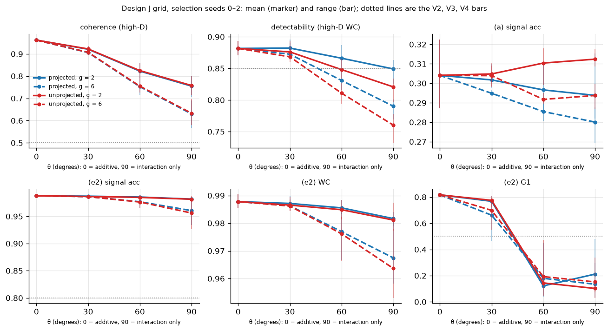
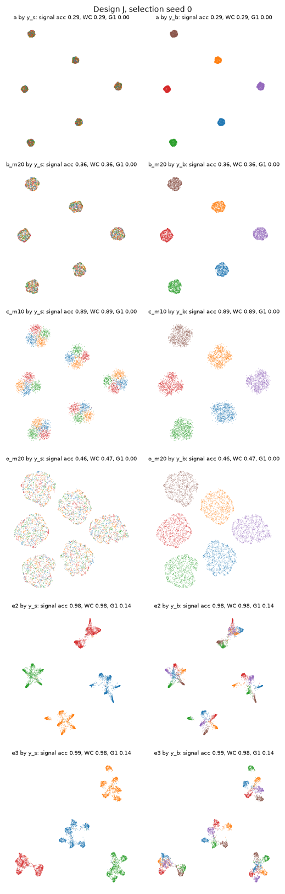
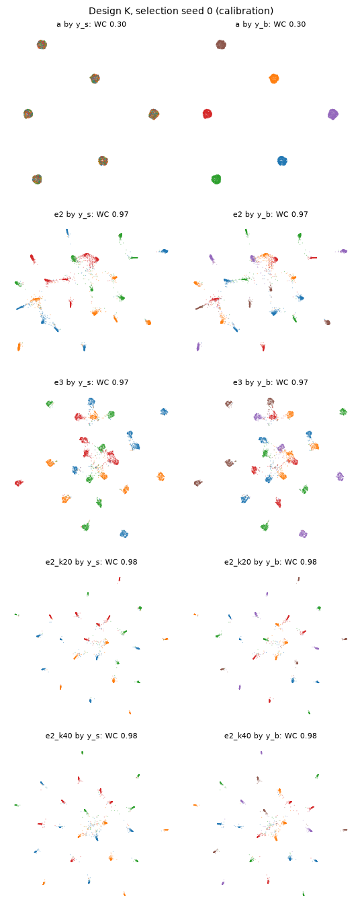

# Phase 5a report: benchmarks that break cPCA's additive assumption

Phase 5 prep (`REPORT_phase5prep.md`) found that cPCA → Neg-t-SNE nearly solves every Phase 4 dataset. The reason was structural: in each Phase 4 generator the signal was added to the background independently, so in the population the target covariance minus the background covariance equals the signal covariance. That identity is exactly what cPCA exploits.

This phase built two benchmark families designed to break the identity. It asked two questions:

1. **Design J.** Is there a regime where cPCA fails but the signal is still shared across background clusters, so that a global, signal-organized layout is meaningful?
2. **Design K.** When each background cluster has its own signal directions, do ξ_B negatives (run (c)) beat cPCA at revealing the signal within clusters?

No new embedding method was built.

## How to read this report

**Shared definitions.**
- `REPORT.md` (repository root) defines the project, the two-stage Neg-t-SNE, runs (a)–(c), ξ_B, the flags, and the "consistent across 3 paired seeds" rule. See its sections "How to read this report" and "Method and setup".
- `REPORT_phase5prep.md` defines the global metrics G1–G3, the cPCA runs (e2) and (e3), and the label-free α rule.

This report uses those definitions without repeating them, except where it restates them for clarity.

**The Phase 5a spec.** The project owner gave the plan for this phase in conversation; it is not a file in the repository. The section "Design" below states everything from it that the results depend on. The owner changed two things while reviewing the implementation plan:
- J's knobs became a fixed-strength mixing angle θ, with the projection and the MLP gain as grid factors.
- (e2-k20) and (e2-k40) were added for Design K, together with predictions P1–P3 and the data diagnostics.

**Files referred to:**

| short name | file | contents |
|---|---|---|
| **grid prediction** | `results/phase5a/grid_J.md` (top section) | the Design J prediction, committed before any J dataset was evaluated |
| **predictions** | `results/phase5a/predictions.md` | P1–P3, with their status at commit time |
| **pre-registration** | `results/phase5a/preregistration.md` | datasets, metrics, selection and comparison rules, committed before any (b), (c) or (o) run |
| results | `results/phase5a/` | CSV/JSON results, generated tables (`*.md`) and figures |
| scripts | `scripts/phase5a_*.py`, `common/benchmark.py`, `data/synthetic_j.py`, `data/synthetic_k.py`, `eval/benchmark_metrics.py` | the code that produced every result |

Tables marked **(generated)** are copied verbatim from `results/phase5a/*.md` by `scripts/phase5a_assemble.py`; none is typed by hand. A seven-character code such as `9ed1110` is a commit in this repository's git history.

**Run labels:**

| label | run |
|---|---|
| (a) | plain two-stage Neg-t-SNE on X_T |
| (b) | (a) plus m_B uniform extra negatives per edge |
| (c) | (a) plus m_B ξ_B negatives per edge (background-neighborhood negatives, built as in Phase 2) |
| (o) | (a) plus m_B **oracle same-cluster** negatives per edge: drawn uniformly from the other points of the head's *true* background cluster. It uses labels, so it is a control, not a method. It runs through the same sampling and loss code as (c). |
| (e2) | cPCA → Neg-t-SNE: the top 10 cPCA components at the label-free α, embedded like (a) |
| (e3) | cPCA → UMAP on the same 10-D input |
| (e2-k20), (e2-k40) | Design K only: (e2) on the top 20 or top 40 components, at the same α |

**New metrics** (k = 15; kNN accuracy uses the stratified 5-fold classifier of `REPORT.md`):

| metric | definition |
|---|---|
| WC | within-cluster signal accuracy: signal kNN accuracy computed inside each true background cluster separately, size-weighted over clusters. It measures local signal separation whatever the global layout. |
| detectability | WC computed on high-D X_T, before any embedding: whether the signal is locally present at all |
| coherence | for background cluster k and signal group g, d_kg = (mean of X_T over cell (k, g)) − (mean of X_T over cluster k). Coherence is the mean over g and cluster pairs k ≠ k′ of cos(d_kg, d_k′g). About 1 when "same signal" points the same way in every cluster; about 0 for unrelated cluster-specific signals. |

## Summary

1. **Design K stopped at calibration: cPCA already reveals the signal within clusters.**
   - (e2) reaches WC 0.970–0.980, against the validity bar of ≤ 0.80. (e2-k20) and (e2-k40) reach 0.978–0.984.
   - **Why:** K's per-cluster signal maps lie outside the background's span, and each has mean zero, so the target-minus-background covariance is still exactly the (now 18-dimensional) signal covariance. Breaking *independence* this way does not hurt cPCA.
   - **The diagnostics agree:** along K's signal directions, the background's global and within-cluster variances are equal (ratio 1.00), the case in which (c) is predicted to have no advantage.
   - **Consequence:** (c) was never run on K, so question 2 is unanswered.
2. **Design J has one valid configuration, but it is valid only through local metrics.**
   - Of 16 configurations, only θ = 60°, projected, g = 2 meets V1–V4 on every selection seed. At θ ≤ 30°, cPCA solves the dataset (V3 fails). At θ ≥ 60°, every other configuration fails V2 on at least one seed: the signal is no longer locally detectable in high-D.
   - In that configuration, (e2) still has signal accuracy 0.98 and G3 "shares signal" = 1. Its embedding is organized by signal globally, but each signal blob splits into background sub-lobes.
   - G1 and G2 look only at the 15 nearest neighbors, which fall inside one sub-lobe, so they read "background-organized" and V3 counts cPCA as failing.
   - **Mechanism** (interpretation): the interaction Δ = M(z_b, z_s) − M(z_b, 0), averaged over the signal, still depends on the background cluster. This background main effect lies outside span(B) and never appears in X_B (Δ is 0 at the reference signal), so cPCA cannot remove it. It accounts for about 9% of the signal variance here, and coherence, which subtracts cluster means, does not see it.
3. **On fresh seeds, cPCA passed the frozen global thresholds on 2 of 3 seeds.**
   - On confirmation seeds 3 and 4, the label-free α was 37 and 29, and (e2) met G1 ≥ 0.50, G2 ≤ 0.50 and G3 ≥ 0.50 (G1 0.63 and 0.61).
   - On seed 5 (α = 4.4), and on the selection seeds (α 2.7–3.5), G1 was 0.10–0.15.
   - So J's "cPCA fails" property depends on which α representative the label-free rule selects. The pattern is consistent with large α removing the sub-lobes, but it was not tested directly.
4. **(e2) beats (c) on every pre-registered metric, consistently across 3 paired seeds.**
   - Signal accuracy: 0.98 vs 0.86. G1: 0.45 vs 0.00. G2: 0.60 vs 1.00. G3: 1.00 vs 0.00.
   - (c) reveals the signal within background islands (signal accuracy 0.86, up from 0.30 for (a)), but its global layout stays organized by background, as in Phase 4.
5. **(c) beats the oracle same-cluster control by +0.39 signal accuracy, consistently across 3 paired seeds** (0.86 vs 0.47).
   - This is the control `REPORT.md` listed as Next steps #1. Repelling random points of the same true background cluster spreads each island but recovers little signal; ξ_B's fine-grained background neighborhoods account for most of (c)'s gain.
   - **Caveats:** shown here on one dataset family. (o)'s selection mean was still rising at the largest m_B (20).
6. **Predictions.**
   - **P1 not confirmed:** projected configurations failed V3 with coherence still high, through the hidden background main effect.
   - **P2 not confirmed** (descriptive): the one valid configuration is projected.
   - **P3 not applicable** for both designs: K has no main runs, and J's chosen configuration is projected.
7. **Overall answer to question 1: no.** Within this family, no J configuration was found where cPCA fails robustly while the signal stays shared.
   - **The only valid configuration** fails V3 through background sub-structure inside a signal-first layout, and only at some α.
   - **The configurations predicted to favor (c)** are the unprojected ones (global/local background-variance ratio 46–69). At θ = 30° cPCA solved them; at θ ≥ 60° they failed V2. None was run in the main runs.

## Design

### Design J: jointly nonlinear signal (`data/synthetic_j.py`)

    target:      X_T = B z_b + ρ (cos θ · Ã z_s + sin θ · Δ̃) + ε
    background:  X_B = B z_b′ + ε′
    Δ = M(z_b, z_s) − M(z_b, s0)      (projected off span(B) when "proj")

- **Shared with Phase 4 "easy":** the latents z_b and z_s, the maps B and A, the noise, and X_B are all those of "easy", bit for bit (tested). The reference signal s0 = 0 is the signal-simplex centroid, so X_B is the target generator evaluated at s0.
- **M** is a fixed random 2-layer tanh MLP: input [z_b / std_b ; z_s / std_s], 64 hidden units, first-layer weights scaled by the gain g. It is drawn from a separate seed stream.
- **Normalization:** Ã z_s and Δ̃ are each scaled to unit total variance per dataset, so θ mixes a background-independent and a background-dependent signal at fixed total strength.
- **Grid:** θ ∈ {0°, 30°, 60°, 90°} × projection P ∈ {projected, unprojected} × g ∈ {2, 6}, 16 configurations. At θ = 0° the dataset doesn't depend on P or g.
- **ρ_J = 0.812** (= 0.2 · √16.5), from the Phase 1 rule at θ = 0°.

### Design K: cluster-specific signal directions (`data/synthetic_k.py`)

    X_T = B z_b + ρ A_{y_b} z_s + ε,    X_B = B z_b′ + ε′

- Each background cluster k has its own random D × 3 map A_k with orthonormal columns, orthogonal to span(B).
- Everything else is "easy", bit for bit.
- **ρ_K = 0.2**, from the Phase 1 rule.

### Calibration and validity (selection seeds 0–2; runs (a), (e2), (e3) only)

| criterion | meaning | condition |
|---|---|---|
| V1 | background dominates | (a) signal accuracy ≤ 0.50 and (a) background accuracy ≥ 0.90 |
| V2 | signal present | detectability ≥ 0.85 |
| V3 (J) | cPCA does not solve it | (e2) fails at least one of: G1 ≥ 0.50, G2 ≤ 0.50, G3 "shares signal" ≥ 0.50, signal accuracy > 0.80 |
| V3-K | cPCA does not reveal the within-cluster signal | (e2) WC ≤ 0.80 |
| V4 (J) | signal still shared | coherence ≥ 0.5 |

- **Validity:** a configuration is valid if it meets every criterion on every selection seed.
- **J choice:** the valid configuration with the largest mean coherence; ties go to the smaller θ, then projected, then the smaller g.
- **Stops:** the sanity configuration θ = 0° had to fail V3 (cPCA solves the additive case), and it did. K stops if V3-K fails.

### Main runs (Design J only; rules from the pre-registration)

- **Selection** (seeds 0–2): (a); (b), (c) and (o) at m_B ∈ {1, 2, 5, 10, 20}; (e2) and (e3). Within each group, m_B is chosen by the highest mean signal accuracy, with ties going to the smaller m_B.
- **Confirmation** (fresh seeds from 3): (a), best (b), best (c), best (o), (e2), (e3).
- **Exclusion:** a confirmation seed is excluded if it fails V1, V2 or V4 (judged from the data and (a), never from (e2)); at most 2 exclusions are allowed. No seed was excluded.
- **Pre-registered comparisons:** (c) vs (e2), and (c) vs (o), each on signal accuracy, G1, G2 and G3 "shares signal", under "consistent across 3 paired seeds".

## Results

### Pre-registered predictions (generated)

| prediction | status when committed | outcome | evidence |
|---|---|---|---|
| P1: J projected configurations fail V3 only where coherence (V4) is low | pre-registered | **not confirmed** | projected configurations meeting V3 and V4 on every selection seed: t60_proj_g2, t60_proj_g6, t90_proj_g2, t90_proj_g6 |
| P2: any valid J configuration is unprojected | descriptive, added after results | **not confirmed** | valid configurations: t60_proj_g2 |
| P3 (J): (c) beats (e2) on WC; neither passes G1 | pre-registered | **not applicable (the chosen J configuration is projected)** | chosen configuration t60_proj_g2 |
| P3 (K): (c) beats (e2) on WC; neither passes G1 | pre-registered | **not applicable (Design K stopped at calibration: V3-K failed on every seed, so (c) was never run)** | (e2) WC on selection seeds: 0.970, 0.972, 0.980 |

### Design J calibration grid (generated)

The top section of `results/phase5a/grid_J.md`, not repeated here, holds the prediction exactly as committed before the grid ran (`c93c891`).

#### Generated tables

Each cell is the mean [min, max] over selection seeds 0–2, and each V column counts the seeds that meet it.
θ = 0° does not depend on P or g, so its four rows are one dataset per seed.

##### Data diagnostics and validity

| configuration | θ | P | g | coherence | detectability (high-D WC) | (a) signal acc | (a) background acc | V1 | V2 | V3 | V4 | valid |
|---|---|---|---|---|---|---|---|---|---|---|---|---|
| t0_proj_g2 | 0° | proj | 2 | 0.962 [0.960, 0.966] | 0.882 [0.870, 0.894] | 0.304 [0.287, 0.323] | 1.000 [1.000, 1.000] | 3/3 | 3/3 | 0/3 | 3/3 | no |
| t0_proj_g6 | 0° | proj | 6 | 0.962 [0.960, 0.966] | 0.882 [0.870, 0.894] | 0.304 [0.287, 0.323] | 1.000 [1.000, 1.000] | 3/3 | 3/3 | 0/3 | 3/3 | no |
| t0_unproj_g2 | 0° | unproj | 2 | 0.962 [0.960, 0.966] | 0.882 [0.870, 0.894] | 0.304 [0.287, 0.323] | 1.000 [1.000, 1.000] | 3/3 | 3/3 | 0/3 | 3/3 | no |
| t0_unproj_g6 | 0° | unproj | 6 | 0.962 [0.960, 0.966] | 0.882 [0.870, 0.894] | 0.304 [0.287, 0.323] | 1.000 [1.000, 1.000] | 3/3 | 3/3 | 0/3 | 3/3 | no |
| t30_proj_g2 | 30° | proj | 2 | 0.921 [0.912, 0.934] | 0.882 [0.875, 0.896] | 0.302 [0.298, 0.310] | 1.000 [1.000, 1.000] | 3/3 | 3/3 | 0/3 | 3/3 | no |
| t30_proj_g6 | 30° | proj | 6 | 0.906 [0.896, 0.920] | 0.872 [0.863, 0.890] | 0.295 [0.294, 0.297] | 1.000 [1.000, 1.000] | 3/3 | 3/3 | 1/3 | 3/3 | no |
| t30_unproj_g2 | 30° | unproj | 2 | 0.922 [0.915, 0.935] | 0.876 [0.867, 0.893] | 0.305 [0.298, 0.310] | 1.000 [1.000, 1.000] | 3/3 | 3/3 | 0/3 | 3/3 | no |
| t30_unproj_g6 | 30° | unproj | 6 | 0.907 [0.899, 0.922] | 0.868 [0.860, 0.883] | 0.304 [0.298, 0.309] | 1.000 [1.000, 1.000] | 3/3 | 3/3 | 1/3 | 3/3 | no |
| t60_proj_g2 | 60° | proj | 2 | 0.823 [0.792, 0.858] | 0.866 [0.851, 0.887] | 0.297 [0.286, 0.310] | 1.000 [1.000, 1.000] | 3/3 | 3/3 | 3/3 | 3/3 | yes |
| t60_proj_g6 | 60° | proj | 6 | 0.753 [0.716, 0.797] | 0.831 [0.816, 0.850] | 0.285 [0.281, 0.289] | 1.000 [1.000, 1.000] | 3/3 | 0/3 | 3/3 | 3/3 | no |
| t60_unproj_g2 | 60° | unproj | 2 | 0.825 [0.802, 0.860] | 0.848 [0.834, 0.865] | 0.310 [0.299, 0.318] | 1.000 [1.000, 1.000] | 3/3 | 1/3 | 3/3 | 3/3 | no |
| t60_unproj_g6 | 60° | unproj | 6 | 0.755 [0.727, 0.801] | 0.811 [0.794, 0.827] | 0.292 [0.290, 0.295] | 1.000 [1.000, 1.000] | 3/3 | 0/3 | 3/3 | 3/3 | no |
| t90_proj_g2 | 90° | proj | 2 | 0.755 [0.706, 0.799] | 0.849 [0.826, 0.863] | 0.294 [0.282, 0.315] | 1.000 [1.000, 1.000] | 3/3 | 2/3 | 3/3 | 3/3 | no |
| t90_proj_g6 | 90° | proj | 6 | 0.630 [0.567, 0.690] | 0.790 [0.769, 0.801] | 0.280 [0.269, 0.288] | 1.000 [1.000, 1.000] | 3/3 | 0/3 | 3/3 | 3/3 | no |
| t90_unproj_g2 | 90° | unproj | 2 | 0.758 [0.717, 0.802] | 0.821 [0.797, 0.834] | 0.312 [0.309, 0.317] | 1.000 [1.000, 1.000] | 3/3 | 0/3 | 3/3 | 3/3 | no |
| t90_unproj_g6 | 90° | unproj | 6 | 0.633 [0.580, 0.697] | 0.760 [0.732, 0.778] | 0.294 [0.287, 0.300] | 1.000 [1.000, 1.000] | 3/3 | 0/3 | 3/3 | 3/3 | no |

##### cPCA runs at the label-free α

Signal accuracy, WC, G1, G2 and G3 "shares signal" for (e2) cPCA → Neg-t-SNE and (e3) cPCA → UMAP. Frozen thresholds: G1 ≥ 0.50, G2 ≤ 0.50, G3 ≥ 0.50, and V3 also counts signal accuracy ≤ 0.80 as a failure.

| configuration | (e2) signal acc | (e2) WC | (e2) G1 | (e2) G2 | (e2) G3 | (e3) signal acc | (e3) WC | (e3) G1 | (e3) G2 | (e3) G3 |
|---|---|---|---|---|---|---|---|---|---|---|
| t0_proj_g2 | 0.988 [0.986, 0.990] | 0.988 [0.986, 0.990] | 0.817 [0.814, 0.820] | 0.175 [0.172, 0.178] | 1.000 [1.000, 1.000] | 0.988 [0.986, 0.989] | 0.988 [0.986, 0.989] | 0.816 [0.814, 0.818] | 0.176 [0.164, 0.187] | 1.000 [1.000, 1.000] |
| t0_proj_g6 | 0.988 [0.986, 0.990] | 0.988 [0.986, 0.990] | 0.817 [0.814, 0.820] | 0.175 [0.172, 0.178] | 1.000 [1.000, 1.000] | 0.988 [0.986, 0.989] | 0.988 [0.986, 0.989] | 0.816 [0.814, 0.818] | 0.176 [0.164, 0.187] | 1.000 [1.000, 1.000] |
| t0_unproj_g2 | 0.988 [0.986, 0.990] | 0.988 [0.986, 0.990] | 0.817 [0.814, 0.820] | 0.175 [0.172, 0.178] | 1.000 [1.000, 1.000] | 0.988 [0.986, 0.989] | 0.988 [0.986, 0.989] | 0.816 [0.814, 0.818] | 0.176 [0.164, 0.187] | 1.000 [1.000, 1.000] |
| t0_unproj_g6 | 0.988 [0.986, 0.990] | 0.988 [0.986, 0.990] | 0.817 [0.814, 0.820] | 0.175 [0.172, 0.178] | 1.000 [1.000, 1.000] | 0.988 [0.986, 0.989] | 0.988 [0.986, 0.989] | 0.816 [0.814, 0.818] | 0.176 [0.164, 0.187] | 1.000 [1.000, 1.000] |
| t30_proj_g2 | 0.987 [0.985, 0.990] | 0.987 [0.985, 0.990] | 0.768 [0.703, 0.806] | 0.251 [0.191, 0.340] | 1.000 [1.000, 1.000] | 0.986 [0.984, 0.989] | 0.986 [0.984, 0.988] | 0.748 [0.666, 0.793] | 0.285 [0.228, 0.390] | 1.000 [1.000, 1.000] |
| t30_proj_g6 | 0.986 [0.985, 0.989] | 0.986 [0.985, 0.989] | 0.661 [0.466, 0.776] | 0.385 [0.250, 0.614] | 1.000 [1.000, 1.000] | 0.984 [0.982, 0.987] | 0.984 [0.982, 0.987] | 0.620 [0.392, 0.752] | 0.432 [0.282, 0.682] | 1.000 [1.000, 1.000] |
| t30_unproj_g2 | 0.987 [0.984, 0.989] | 0.987 [0.984, 0.989] | 0.775 [0.725, 0.806] | 0.242 [0.193, 0.308] | 1.000 [1.000, 1.000] | 0.987 [0.984, 0.988] | 0.986 [0.983, 0.988] | 0.758 [0.691, 0.796] | 0.269 [0.207, 0.358] | 1.000 [1.000, 1.000] |
| t30_unproj_g6 | 0.986 [0.984, 0.988] | 0.986 [0.984, 0.988] | 0.698 [0.550, 0.792] | 0.344 [0.230, 0.521] | 1.000 [1.000, 1.000] | 0.985 [0.983, 0.987] | 0.985 [0.983, 0.987] | 0.655 [0.470, 0.770] | 0.399 [0.265, 0.611] | 1.000 [1.000, 1.000] |
| t60_proj_g2 | 0.986 [0.983, 0.988] | 0.986 [0.983, 0.988] | 0.122 [0.104, 0.145] | 0.900 [0.879, 0.917] | 1.000 [1.000, 1.000] | 0.984 [0.981, 0.987] | 0.984 [0.981, 0.987] | 0.121 [0.110, 0.141] | 0.907 [0.893, 0.915] | 1.000 [1.000, 1.000] |
| t60_proj_g6 | 0.977 [0.966, 0.983] | 0.977 [0.967, 0.984] | 0.180 [0.039, 0.451] | 0.843 [0.609, 0.963] | 0.986 [0.958, 1.000] | 0.975 [0.963, 0.983] | 0.974 [0.965, 0.983] | 0.167 [0.040, 0.411] | 0.853 [0.636, 0.967] | 0.917 [0.792, 1.000] |
| t60_unproj_g2 | 0.985 [0.981, 0.988] | 0.985 [0.981, 0.988] | 0.144 [0.126, 0.172] | 0.884 [0.858, 0.900] | 1.000 [1.000, 1.000] | 0.984 [0.980, 0.987] | 0.984 [0.979, 0.987] | 0.136 [0.122, 0.158] | 0.890 [0.871, 0.902] | 1.000 [1.000, 1.000] |
| t60_unproj_g6 | 0.976 [0.966, 0.982] | 0.976 [0.966, 0.982] | 0.192 [0.047, 0.472] | 0.833 [0.591, 0.957] | 0.986 [0.958, 1.000] | 0.975 [0.965, 0.982] | 0.975 [0.966, 0.981] | 0.179 [0.049, 0.431] | 0.843 [0.621, 0.958] | 0.944 [0.833, 1.000] |
| t90_proj_g2 | 0.982 [0.979, 0.984] | 0.982 [0.979, 0.984] | 0.212 [0.077, 0.480] | 0.816 [0.583, 0.933] | 1.000 [1.000, 1.000] | 0.980 [0.978, 0.982] | 0.980 [0.978, 0.982] | 0.202 [0.076, 0.452] | 0.829 [0.620, 0.938] | 0.986 [0.958, 1.000] |
| t90_proj_g6 | 0.961 [0.934, 0.982] | 0.967 [0.958, 0.980] | 0.134 [0.032, 0.295] | 0.872 [0.711, 0.967] | 0.806 [0.458, 1.000] | 0.959 [0.931, 0.982] | 0.965 [0.953, 0.980] | 0.127 [0.032, 0.272] | 0.878 [0.723, 0.970] | 0.819 [0.458, 1.000] |
| t90_unproj_g2 | 0.982 [0.978, 0.987] | 0.981 [0.977, 0.987] | 0.102 [0.071, 0.152] | 0.915 [0.880, 0.935] | 0.986 [0.958, 1.000] | 0.980 [0.975, 0.986] | 0.979 [0.974, 0.986] | 0.098 [0.070, 0.138] | 0.921 [0.894, 0.938] | 0.958 [0.875, 1.000] |
| t90_unproj_g6 | 0.956 [0.926, 0.979] | 0.964 [0.953, 0.978] | 0.152 [0.030, 0.337] | 0.853 [0.662, 0.971] | 0.833 [0.542, 1.000] | 0.955 [0.925, 0.978] | 0.961 [0.948, 0.976] | 0.138 [0.028, 0.299] | 0.869 [0.703, 0.975] | 0.806 [0.417, 1.000] |

##### α and the oracle α (descriptive)

The oracle α is chosen by 10-D cPCA signal accuracy. It separates "α selection failed" from "no linear projection works" and does not enter V3.

| configuration | selected α (range) | 10-D signal acc at selected α | oracle α (range) | 10-D signal acc at oracle α | (a) WC |
|---|---|---|---|---|---|
| t0_proj_g2 | 8.89–58.8 | 0.989 [0.988, 0.991] | 2.73–46.4 | 0.989 [0.988, 0.992] | 0.311 [0.295, 0.327] |
| t0_proj_g6 | 8.89–58.8 | 0.989 [0.988, 0.991] | 2.73–46.4 | 0.989 [0.988, 0.992] | 0.311 [0.295, 0.327] |
| t0_unproj_g2 | 8.89–58.8 | 0.989 [0.988, 0.991] | 2.73–46.4 | 0.989 [0.988, 0.992] | 0.311 [0.295, 0.327] |
| t0_unproj_g6 | 8.89–58.8 | 0.989 [0.988, 0.991] | 2.73–46.4 | 0.989 [0.988, 0.992] | 0.311 [0.295, 0.327] |
| t30_proj_g2 | 3.46–22.9 | 0.987 [0.984, 0.989] | 1.7–28.9 | 0.988 [0.987, 0.990] | 0.307 [0.299, 0.323] |
| t30_proj_g6 | 3.46–14.3 | 0.987 [0.985, 0.989] | 1.34–28.9 | 0.988 [0.986, 0.990] | 0.300 [0.296, 0.305] |
| t30_unproj_g2 | 3.46–18 | 0.987 [0.984, 0.990] | 8.89–36.7 | 0.988 [0.986, 0.990] | 0.303 [0.299, 0.312] |
| t30_unproj_g6 | 3.46–18 | 0.986 [0.984, 0.988] | 1.34–22.9 | 0.988 [0.986, 0.990] | 0.301 [0.299, 0.303] |
| t60_proj_g2 | 2.73–3.46 | 0.985 [0.982, 0.988] | 1.34–2.73 | 0.986 [0.983, 0.988] | 0.299 [0.285, 0.311] |
| t60_proj_g6 | 3.46–58.8 | 0.977 [0.966, 0.985] | 1.7–2.73 | 0.983 [0.980, 0.986] | 0.290 [0.284, 0.299] |
| t60_unproj_g2 | 2.73–3.46 | 0.984 [0.982, 0.988] | 2.73–3.46 | 0.985 [0.982, 0.988] | 0.313 [0.309, 0.319] |
| t60_unproj_g6 | 3.46–46.4 | 0.976 [0.966, 0.984] | 1.7–1.7 | 0.982 [0.979, 0.985] | 0.296 [0.294, 0.298] |
| t90_proj_g2 | 3.46–36.7 | 0.983 [0.981, 0.985] | 1.7–1.7 | 0.986 [0.983, 0.990] | 0.297 [0.286, 0.318] |
| t90_proj_g6 | 4.38–58.8 | 0.963 [0.938, 0.983] | 1.34–2.73 | 0.979 [0.972, 0.986] | 0.281 [0.273, 0.287] |
| t90_unproj_g2 | 3.46–4.38 | 0.982 [0.978, 0.987] | 1.7–1.7 | 0.985 [0.980, 0.990] | 0.311 [0.305, 0.317] |
| t90_unproj_g6 | 3.46–58.8 | 0.959 [0.930, 0.982] | 1.34–2.15 | 0.976 [0.968, 0.985] | 0.293 [0.285, 0.298] |

##### The interaction map M (θ > 0)

| configuration | median abs preactivation | fraction of abs preactivations > 2 | fraction of Δ's variance in span(B) (before projection) |
|---|---|---|---|
| t30_proj_g2 | 1.326 [1.284, 1.382] | 0.311 [0.300, 0.329] | 0.096 [0.080, 0.109] |
| t30_proj_g6 | 3.976 [3.846, 4.135] | 0.735 [0.725, 0.745] | 0.100 [0.079, 0.123] |
| t30_unproj_g2 | 1.326 [1.284, 1.382] | 0.311 [0.300, 0.329] | 0.096 [0.080, 0.109] |
| t30_unproj_g6 | 3.976 [3.846, 4.135] | 0.735 [0.725, 0.745] | 0.100 [0.079, 0.123] |
| t60_proj_g2 | 1.326 [1.284, 1.382] | 0.311 [0.300, 0.329] | 0.096 [0.080, 0.109] |
| t60_proj_g6 | 3.976 [3.846, 4.135] | 0.735 [0.725, 0.745] | 0.100 [0.079, 0.123] |
| t60_unproj_g2 | 1.326 [1.284, 1.382] | 0.311 [0.300, 0.329] | 0.096 [0.080, 0.109] |
| t60_unproj_g6 | 3.976 [3.846, 4.135] | 0.735 [0.725, 0.745] | 0.100 [0.079, 0.123] |
| t90_proj_g2 | 1.326 [1.284, 1.382] | 0.311 [0.300, 0.329] | 0.096 [0.080, 0.109] |
| t90_proj_g6 | 3.976 [3.846, 4.135] | 0.735 [0.725, 0.745] | 0.100 [0.079, 0.123] |
| t90_unproj_g2 | 1.326 [1.284, 1.382] | 0.311 [0.300, 0.329] | 0.096 [0.080, 0.109] |
| t90_unproj_g6 | 3.976 [3.846, 4.135] | 0.735 [0.725, 0.745] | 0.100 [0.079, 0.123] |

##### Prediction check

- Projected configurations with V3 and V4 met on every seed (any one contradicts the prediction): t60_proj_g2, t60_proj_g6, t90_proj_g2, t90_proj_g6. **The prediction is contradicted.**
- Unprojected configurations with V3 and V4 met on every seed (supports the second claim): t60_unproj_g2, t60_unproj_g6, t90_unproj_g2, t90_unproj_g6.
- Seeds meeting both V3 and V4, per configuration with θ > 0: t30_proj_g2 0/3; t30_proj_g6 1/3; t30_unproj_g2 0/3; t30_unproj_g6 1/3; t60_proj_g2 3/3; t60_proj_g6 3/3; t60_unproj_g2 3/3; t60_unproj_g6 3/3; t90_proj_g2 3/3; t90_proj_g6 3/3; t90_unproj_g2 3/3; t90_unproj_g6 3/3.

##### Chosen configuration

Rule: among the configurations valid on every selection seed (V1–V4), the largest mean coherence; ties go to the smaller θ, then projected before unprojected, then the smaller g.

**t60_proj_g2**

### Validity per seed (generated)

ρ: J = 0.8124 (the Phase 1 grid × √16.5; J's signal has unit total variance), K = 0.2. Each was chosen by the Phase 1 rule and confirmed on seeds 0–2.

| Criterion | Condition |
|---|---|
| V1 | (a) signal acc ≤ 0.50 and (a) background acc ≥ 0.90 |
| V2 | high-D WC (detectability) ≥ 0.85 |
| V3 (J) | (e2) fails one of G1 ≥ 0.50, G2 ≤ 0.50, G3 ≥ 0.50, signal acc > 0.80 |
| V3-K | (e2) WC ≤ 0.80 |
| V4 (J) | coherence ≥ 0.5 |

#### Design J, chosen configuration t60_proj_g2

| seed | (a) signal acc | (a) background acc | detectability | coherence | (e2) signal acc | (e2) WC | (e2) G1 | (e2) G2 | (e2) G3 | V1 | V2 | V3 | V4 |
|---|---|---|---|---|---|---|---|---|---|---|---|---|---|
| 0 | 0.286 | 1.000 | 0.887 | 0.858 | 0.985 | 0.985 | 0.145 | 0.879 | 1.000 | True | True | True | True |
| 1 | 0.294 | 1.000 | 0.851 | 0.792 | 0.983 | 0.983 | 0.104 | 0.917 | 1.000 | True | True | True | True |
| 2 | 0.310 | 1.000 | 0.861 | 0.818 | 0.988 | 0.988 | 0.117 | 0.905 | 1.000 | True | True | True | True |

#### Design K

| seed | (a) signal acc | (a) background acc | detectability | coherence | (e2) signal acc | (e2) WC | (e2) G1 | (e2) G2 | (e2) G3 | V1 | V2 | V3 | V4 |
|---|---|---|---|---|---|---|---|---|---|---|---|---|---|
| 0 | 0.301 | 1.000 | 0.893 | 0.011 | 0.963 | 0.970 | 0.020 | 0.955 | 0.542 | True | True | False | False |
| 1 | 0.299 | 1.000 | 0.876 | 0.001 | 0.956 | 0.972 | 0.013 | 0.958 | 0.375 | True | True | False | False |
| 2 | 0.314 | 1.000 | 0.883 | -0.004 | 0.970 | 0.980 | 0.010 | 0.970 | 0.125 | True | True | False | False |

For K, V4 is not a criterion. Coherence is reported because it should be about 0, which makes the global metrics G1–G3 ill-posed for K.

### Data diagnostics (descriptive; generated)

Computed from the generators' clean components on selection seeds 0–2, with no embeddings. Each cell is the mean [min, max] over seeds.

- **Signal variance in span(B):** the fraction of the clean signal's variance inside the background map's span.
- **Background variance along the signal:** the clean signal's top principal directions (those explaining 90% of its variance) are taken first. Along them, the global background variance over all of X_B is compared with the mean within-background-cluster variance.
- **Rationale:** cPCA can only use directions with low *global* background variance, while ξ_B, built from background neighborhoods, effectively uses directions with low *local* background variance. Configurations with a large global/local ratio are where (c) is predicted to have an advantage.
- **Background main effect in the signal** (added after the grid results): the share of the clean signal's variance explained by the target's background-cluster means. Coherence subtracts those means, so it cannot see this effect. In J, the interaction term carries it outside span(B), where X_B never shows it.
- **Caveat on coherence:** it measures alignment in ambient coordinates, so it can call a signal incoherent even when the signal is consistent in the background's own frame (for example, with a curved background). V4 is unchanged; this caveat applies to every low-coherence result.

| configuration | signal var in span(B) | signal directions (90%) | global bg var | mean within-cluster bg var | global / local | coherence | background main effect |
|---|---|---|---|---|---|---|---|
| t0_proj_g2 | 0.000 [0.000, 0.000] | 3 | 0.030 [0.030, 0.030] | 0.030 [0.030, 0.030] | 1.002 [1.001, 1.002] | 0.962 [0.960, 0.966] | 0.001 [0.001, 0.002] |
| t0_proj_g6 | 0.000 [0.000, 0.000] | 3 | 0.030 [0.030, 0.030] | 0.030 [0.030, 0.030] | 1.002 [1.001, 1.002] | 0.962 [0.960, 0.966] | 0.001 [0.001, 0.002] |
| t0_unproj_g2 | 0.000 [0.000, 0.000] | 3 | 0.030 [0.030, 0.030] | 0.030 [0.030, 0.030] | 1.002 [1.001, 1.002] | 0.962 [0.960, 0.966] | 0.001 [0.001, 0.002] |
| t0_unproj_g6 | 0.000 [0.000, 0.000] | 3 | 0.030 [0.030, 0.030] | 0.030 [0.030, 0.030] | 1.002 [1.001, 1.002] | 0.962 [0.960, 0.966] | 0.001 [0.001, 0.002] |
| t30_proj_g2 | 0.000 [0.000, 0.000] | 3 | 0.030 [0.030, 0.030] | 0.030 [0.030, 0.030] | 1.002 [1.001, 1.002] | 0.921 [0.912, 0.934] | 0.030 [0.028, 0.031] |
| t30_proj_g6 | 0.000 [0.000, 0.000] | 4, 5 | 0.043 [0.040, 0.050] | 0.043 [0.040, 0.050] | 1.001 [1.001, 1.001] | 0.906 [0.896, 0.920] | 0.054 [0.053, 0.055] |
| t30_unproj_g2 | 0.023 [0.020, 0.026] | 3 | 3.617 [3.059, 4.337] | 0.077 [0.070, 0.087] | 46.460 [43.492, 49.929] | 0.922 [0.915, 0.935] | 0.030 [0.029, 0.034] |
| t30_unproj_g6 | 0.024 [0.020, 0.030] | 4, 5 | 18.992 [6.585, 41.856] | 0.289 [0.129, 0.585] | 59.493 [51.235, 71.546] | 0.907 [0.899, 0.922] | 0.055 [0.052, 0.058] |
| t60_proj_g2 | 0.000 [0.000, 0.000] | 7, 8 | 0.077 [0.070, 0.080] | 0.077 [0.070, 0.080] | 1.001 [1.001, 1.001] | 0.823 [0.792, 0.858] | 0.087 [0.086, 0.088] |
| t60_proj_g6 | 0.000 [0.000, 0.000] | 11, 12 | 0.117 [0.110, 0.121] | 0.117 [0.110, 0.121] | 1.001 [1.001, 1.001] | 0.753 [0.716, 0.797] | 0.159 [0.156, 0.165] |
| t60_unproj_g2 | 0.069 [0.060, 0.077] | 7, 8 | 51.840 [37.465, 73.353] | 0.756 [0.566, 1.027] | 67.975 [66.227, 71.448] | 0.825 [0.802, 0.860] | 0.089 [0.084, 0.098] |
| t60_unproj_g6 | 0.073 [0.059, 0.089] | 12, 13 | 92.589 [76.589, 111.480] | 1.339 [1.147, 1.569] | 68.946 [66.762, 71.040] | 0.755 [0.727, 0.801] | 0.163 [0.154, 0.171] |
| t90_proj_g2 | 0.000 [0.000, 0.000] | 9, 10 | 0.093 [0.090, 0.100] | 0.093 [0.089, 0.099] | 1.001 [1.000, 1.001] | 0.755 [0.706, 0.799] | 0.121 [0.115, 0.123] |
| t90_proj_g6 | 0.000 [0.000, 0.000] | 14, 15 | 0.143 [0.139, 0.149] | 0.143 [0.139, 0.149] | 1.001 [1.001, 1.001] | 0.630 [0.567, 0.690] | 0.220 [0.216, 0.223] |
| t90_unproj_g2 | 0.096 [0.080, 0.109] | 9, 10, 11 | 81.252 [57.572, 100.585] | 1.166 [0.852, 1.409] | 69.392 [67.551, 71.370] | 0.758 [0.717, 0.802] | 0.124 [0.116, 0.137] |
| t90_unproj_g6 | 0.100 [0.079, 0.123] | 14, 15 | 121.319 [99.854, 152.326] | 1.739 [1.476, 2.119] | 69.476 [67.633, 71.880] | 0.633 [0.580, 0.697] | 0.224 [0.215, 0.236] |
| K | 0.000 [0.000, 0.000] | 13, 14 | 0.133 [0.129, 0.141] | 0.133 [0.129, 0.140] | 1.001 [1.001, 1.001] | 0.002 [-0.004, 0.011] | 0.001 [0.001, 0.002] |

The "background main effect" column was added after the grid results (descriptive). It quantifies the effect described in Summary item 2.

### Design K calibration runs (generated)

(e2-k20) and (e2-k40) use the same label-free α as (e2), with the top 20 and top 40 cPCA components. V3-K is defined with the 10-component (e2) only.

| run | WC | signal acc | G1 (ill-posed for K) | G2 (ill-posed for K) |
|---|---|---|---|---|
| (a) plain Neg-t-SNE | 0.306 [0.296, 0.319] | 0.304 [0.299, 0.314] | 0.000 [0.000, 0.000] | 1.000 [1.000, 1.000] |
| (e2) cPCA → Neg-t-SNE | 0.974 [0.970, 0.980] | 0.963 [0.956, 0.970] | 0.014 [0.010, 0.020] | 0.961 [0.955, 0.970] |
| (e3) cPCA → UMAP | 0.971 [0.966, 0.976] | 0.961 [0.957, 0.966] | 0.014 [0.009, 0.019] | 0.961 [0.953, 0.970] |
| (e2-k20) cPCA top 20 → Neg-t-SNE | 0.981 [0.978, 0.984] | 0.980 [0.978, 0.982] | 0.005 [0.003, 0.007] | 0.986 [0.983, 0.989] |
| (e2-k40) cPCA top 40 → Neg-t-SNE | 0.980 [0.978, 0.983] | 0.980 [0.979, 0.981] | 0.005 [0.003, 0.006] | 0.984 [0.982, 0.986] |

α selected per seed: 8.89, 11.3, 5.54. 10-D WC at the selected α: 0.985, 0.982, 0.986; at the oracle α: 0.987, 0.984, 0.988.

### Design J main runs (generated)

#### Confirmation seeds (3, 4, 5): mean [min, max]

| run | signal acc | WC | G1 | G2 (background acc) | G3 shares signal | flagged seeds |
|---|---|---|---|---|---|---|
| (a) plain Neg-t-SNE | 0.302 [0.289, 0.316] | 0.308 [0.301, 0.317] | 0.000 [0.000, 0.000] | 1.000 [1.000, 1.000] | 0.000 [0.000, 0.000] | 0/3 |
| (b) uniform extra negatives, m_B = 20 | 0.371 [0.346, 0.400] | 0.375 [0.347, 0.403] | 0.000 [0.000, 0.000] | 1.000 [1.000, 1.000] | 0.000 [0.000, 0.000] | 0/3 |
| (c) ξ_B negatives, m_B = 10 | 0.858 [0.830, 0.900] | 0.858 [0.830, 0.904] | 0.000 [0.000, 0.000] | 1.000 [1.000, 1.000] | 0.000 [0.000, 0.000] | 0/3 |
| (o) oracle same-cluster negatives, m_B = 20 | 0.472 [0.445, 0.514] | 0.474 [0.440, 0.513] | 0.000 [0.000, 0.000] | 1.000 [1.000, 1.000] | 0.000 [0.000, 0.000] | 0/3 |
| (e2) cPCA → Neg-t-SNE | 0.984 [0.983, 0.986] | 0.984 [0.983, 0.986] | 0.454 [0.119, 0.634] | 0.602 [0.434, 0.899] | 1.000 [1.000, 1.000] | 0/3 |
| (e3) cPCA → UMAP | 0.983 [0.980, 0.986] | 0.983 [0.981, 0.986] | 0.419 [0.114, 0.594] | 0.644 [0.480, 0.907] | 1.000 [1.000, 1.000] | 0/3 |

#### Frozen G1–G3 thresholds per confirmation seed

Frozen thresholds, per seed: G1 ≥ 0.50, G2 ≤ 0.50, G3 shares signal ≥ 0.50.

| run | seeds meeting G1 | seeds meeting G2 | seeds meeting G3 | seeds meeting all three |
|---|---|---|---|---|
| (a) plain Neg-t-SNE | 0/3 | 0/3 | 0/3 | 0/3 |
| (b) uniform extra negatives, m_B = 20 | 0/3 | 0/3 | 0/3 | 0/3 |
| (c) ξ_B negatives, m_B = 10 | 0/3 | 0/3 | 0/3 | 0/3 |
| (o) oracle same-cluster negatives, m_B = 20 | 0/3 | 0/3 | 0/3 | 0/3 |
| (e2) cPCA → Neg-t-SNE | 2/3 | 2/3 | 3/3 | 2/3 |
| (e3) cPCA → UMAP | 2/3 | 1/3 | 3/3 | 1/3 |

#### Pre-registered comparisons (confirmation seeds)

Primary metrics: acc_s, G1, G2, G3_shares_signal.

| comparison | metric | per-seed difference (x − y) | mean | verdict |
|---|---|---|---|---|
| (c) vs (e2) | acc_s | -0.155, -0.086, -0.138 | -0.126 | e2 better, consistent across 3 paired seeds |
| (c) vs (e2) | G1 | -0.634, -0.610, -0.119 | -0.454 | e2 better, consistent across 3 paired seeds |
| (c) vs (e2) | G2 (lower is better) | +0.566, +0.528, +0.101 | +0.398 | e2 better, consistent across 3 paired seeds |
| (c) vs (e2) | G3_shares_signal | -1.000, -1.000, -1.000 | -1.000 | e2 better, consistent across 3 paired seeds |
| (c) vs (o) | acc_s | +0.385, +0.386, +0.388 | +0.386 | c better, consistent across 3 paired seeds |
| (c) vs (o) | G1 | +0.000, +0.000, +0.000 | +0.000 | not consistent |
| (c) vs (o) | G2 (lower is better) | +0.000, +0.000, +0.000 | +0.000 | not consistent |
| (c) vs (o) | G3_shares_signal | +0.000, +0.000, +0.000 | +0.000 | not consistent |

#### Descriptive comparisons (no verdict)

| comparison | metric | per-seed difference (x − y) | mean | verdict |
|---|---|---|---|---|
| (c) vs (a) | acc_s | +0.541, +0.584, +0.543 | +0.556 | c better, consistent across 3 paired seeds |
| (c) vs (a) | G1 | +0.000, +0.000, +0.000 | +0.000 | not consistent |
| (c) vs (a) | G2 (lower is better) | +0.000, +0.000, +0.000 | +0.000 | not consistent |
| (c) vs (a) | G3_shares_signal | +0.000, +0.000, +0.000 | +0.000 | not consistent |
| (c) vs (b) | acc_s | +0.484, +0.500, +0.478 | +0.487 | c better, consistent across 3 paired seeds |
| (c) vs (b) | G1 | +0.000, +0.000, +0.000 | +0.000 | not consistent |
| (c) vs (b) | G2 (lower is better) | +0.000, +0.000, +0.000 | +0.000 | not consistent |
| (c) vs (b) | G3_shares_signal | +0.000, +0.000, +0.000 | +0.000 | not consistent |
| (c) vs (e3) | acc_s | -0.151, -0.086, -0.136 | -0.124 | e3 better, consistent across 3 paired seeds |
| (c) vs (e3) | G1 | -0.594, -0.549, -0.114 | -0.419 | e3 better, consistent across 3 paired seeds |
| (c) vs (e3) | G2 (lower is better) | +0.520, +0.456, +0.093 | +0.356 | e3 better, consistent across 3 paired seeds |
| (c) vs (e3) | G3_shares_signal | -1.000, -1.000, -1.000 | -1.000 | e3 better, consistent across 3 paired seeds |

#### ξ_B diagnostics and data checks (confirmation seeds)

| seed | same-y_b precision of ξ_B | same-y_s excess | gates | coherence | detectability |
|---|---|---|---|---|---|
| 3 | 1.000 | +0.014 | pass | 0.812 | 0.855 |
| 4 | 1.000 | +0.020 | pass | 0.829 | 0.886 |
| 5 | 1.000 | +0.016 | pass | 0.790 | 0.863 |

#### Excluded seeds

No confirmation seed was excluded.

#### Appendix: selection seeds 0–2, every run

Selection rule: highest mean acc_s over selection seeds 0-2 per group; ties -> smaller m_B. Chosen: (b) m_B = 20, (c) m_B = 10, (o) m_B = 20.

| run | signal acc | WC | G1 | G2 (background acc) | G3 shares signal | flagged seeds |
|---|---|---|---|---|---|---|
| (a) plain Neg-t-SNE | 0.297 [0.286, 0.310] | 0.299 [0.285, 0.311] | 0.000 [0.000, 0.000] | 1.000 [1.000, 1.000] | 0.000 [0.000, 0.000] | 0/3 |
| (b) uniform extra negatives, m_B = 1 | 0.303 [0.288, 0.321] | 0.305 [0.290, 0.312] | 0.000 [0.000, 0.000] | 1.000 [1.000, 1.000] | 0.000 [0.000, 0.000] | 0/3 |
| (b) uniform extra negatives, m_B = 2 | 0.300 [0.284, 0.315] | 0.301 [0.291, 0.309] | 0.000 [0.000, 0.000] | 1.000 [1.000, 1.000] | 0.000 [0.000, 0.000] | 0/3 |
| (b) uniform extra negatives, m_B = 5 | 0.302 [0.291, 0.311] | 0.309 [0.296, 0.317] | 0.000 [0.000, 0.000] | 1.000 [1.000, 1.000] | 0.000 [0.000, 0.000] | 0/3 |
| (b) uniform extra negatives, m_B = 10 | 0.334 [0.313, 0.353] | 0.334 [0.315, 0.347] | 0.000 [0.000, 0.000] | 1.000 [1.000, 1.000] | 0.000 [0.000, 0.000] | 0/3 |
| (b) uniform extra negatives, m_B = 20 | 0.358 [0.350, 0.362] | 0.361 [0.355, 0.368] | 0.000 [0.000, 0.000] | 1.000 [1.000, 1.000] | 0.000 [0.000, 0.000] | 0/3 |
| (c) ξ_B negatives, m_B = 1 | 0.587 [0.537, 0.622] | 0.587 [0.539, 0.624] | 0.000 [0.000, 0.000] | 1.000 [1.000, 1.000] | 0.000 [0.000, 0.000] | 0/3 |
| (c) ξ_B negatives, m_B = 2 | 0.774 [0.754, 0.809] | 0.773 [0.753, 0.807] | 0.000 [0.000, 0.000] | 1.000 [1.000, 1.000] | 0.000 [0.000, 0.000] | 0/3 |
| (c) ξ_B negatives, m_B = 5 | 0.849 [0.820, 0.877] | 0.849 [0.820, 0.876] | 0.000 [0.000, 0.000] | 1.000 [1.000, 1.000] | 0.000 [0.000, 0.000] | 0/3 |
| (c) ξ_B negatives, m_B = 10 | 0.869 [0.846, 0.891] | 0.868 [0.844, 0.889] | 0.000 [0.000, 0.000] | 1.000 [1.000, 1.000] | 0.000 [0.000, 0.000] | 0/3 |
| (c) ξ_B negatives, m_B = 20 | 0.856 [0.836, 0.878] | 0.857 [0.839, 0.878] | 0.000 [0.000, 0.000] | 1.000 [1.000, 1.000] | 0.000 [0.000, 0.000] | 0/3 |
| (o) oracle same-cluster negatives, m_B = 1 | 0.313 [0.299, 0.322] | 0.315 [0.298, 0.326] | 0.000 [0.000, 0.000] | 1.000 [1.000, 1.000] | 0.000 [0.000, 0.000] | 0/3 |
| (o) oracle same-cluster negatives, m_B = 2 | 0.337 [0.329, 0.341] | 0.341 [0.334, 0.347] | 0.000 [0.000, 0.000] | 1.000 [1.000, 1.000] | 0.000 [0.000, 0.000] | 0/3 |
| (o) oracle same-cluster negatives, m_B = 5 | 0.382 [0.379, 0.387] | 0.380 [0.373, 0.390] | 0.000 [0.000, 0.000] | 1.000 [1.000, 1.000] | 0.000 [0.000, 0.000] | 0/3 |
| (o) oracle same-cluster negatives, m_B = 10 | 0.421 [0.406, 0.429] | 0.425 [0.408, 0.434] | 0.000 [0.000, 0.000] | 1.000 [1.000, 1.000] | 0.000 [0.000, 0.000] | 0/3 |
| (o) oracle same-cluster negatives, m_B = 20 | 0.455 [0.440, 0.463] | 0.462 [0.448, 0.471] | 0.000 [0.000, 0.000] | 1.000 [1.000, 1.000] | 0.000 [0.000, 0.000] | 0/3 |
| (e2) cPCA → Neg-t-SNE | 0.986 [0.983, 0.988] | 0.986 [0.983, 0.988] | 0.122 [0.104, 0.145] | 0.900 [0.879, 0.917] | 1.000 [1.000, 1.000] | 0/3 |
| (e3) cPCA → UMAP | 0.984 [0.981, 0.987] | 0.984 [0.981, 0.987] | 0.121 [0.110, 0.141] | 0.907 [0.893, 0.915] | 1.000 [1.000, 1.000] | 0/3 |

##### ξ_B diagnostics and data checks (selection seeds)

| seed | same-y_b precision of ξ_B | same-y_s excess | gates | coherence | detectability |
|---|---|---|---|---|---|
| 0 | 1.000 | +0.014 | pass | 0.858 | 0.887 |
| 1 | 1.000 | +0.016 | pass | 0.792 | 0.851 |
| 2 | 1.000 | +0.013 | pass | 0.818 | 0.861 |

### Figures

**Design J grid** (selection seeds 0–2): mean and range against θ. Dotted lines mark the V2, V3 and V4 bars.

**Design J main runs**, selection seed 0, colored by signal y_s (left) and background y_b (right):

**Design K calibration runs**, selection seed 0:

## Interpretation

- **Why K did not break cPCA.** cPCA needs only that the target-minus-background covariance points at the signal. In K, cluster-specific maps make the signal *depend* on the background, but each cluster's signal has mean zero and lies outside the background's span. So no cross-covariance with the background appears, and the identity survives with a higher-dimensional signal covariance. Ten components already reveal each cluster's signal (WC 0.97), and 20 or 40 do slightly better (0.98).
- **Why J's valid configuration is a weak test.** The non-additive term does more than make the signal background-dependent: it adds a background-dependent *mean shift* outside the background's span. The background data never shows this shift, so cPCA keeps it, and the embedding shows background sub-lobes inside signal blobs. The frozen G1 and G2 thresholds, which read local neighbor composition, score this as cPCA failing. G3, which reads the arrangement of cells, scores it as signal-organized (1.00 on every seed).
- **What (c) shows here.** (c) behaves as in Phase 4. It separates the signal within each background island (signal accuracy 0.86, WC 0.86) and leaves the global layout organized by background (G1 = 0, G2 = 1). The oracle same-cluster control isolates where that gain comes from: the same number of repulsions, drawn from the right background cluster but without ξ_B's neighborhood structure, recovers far less (0.47).
- **Coherence caveat.** Coherence measures alignment in ambient coordinates. It can call a signal incoherent even when the signal is consistent in the background's own frame (for example, with a curved background). V4 was not changed for this; it applies to every low-coherence result above. In this grid, every J configuration had coherence of at least 0.56 on every seed.

## Limitations

- **One valid J configuration, and its V3 status did not replicate.** cPCA failed the frozen thresholds on 1 of 3 confirmation seeds, and the outcome tracked the label-free α. V3 was judged with one α per dataset; a check across all α representatives was not part of the protocol.
- **G1 and G2 are local.** They count neighbors among the 15 nearest, so they cannot tell a background-organized layout from a signal-organized layout with background sub-structure. G3 can. In this phase it disagreed with G1/G2 for (e2) on every selection seed and on confirmation seed 5.
- **The regime predicted to favor (c) was not tested.** Unprojected J configurations have background variance along the signal that is 46–69 times larger globally than within clusters. At the calibrated ρ, cPCA solved them at θ = 30°, and they failed V2 at θ ≥ 60°, so none was run.
- **The oracle control's m_B grid may be too short.** (o)'s mean signal accuracy was still rising at m_B = 20 (0.45 on the selection seeds).
- **Synthetic data only**, with discrete background clusters, as in all earlier phases.

## Next steps

1. **Remove the hidden background main effect from J.** Center the interaction, using Δ − E[Δ | z_b] (estimated per background state), then rerun the grid. This tests whether cPCA's failure then requires low coherence, as the grid prediction expected.
2. **Test where the diagnostics predict an advantage for (c).** Use unprojected or partially projected configurations with a large global/local background-variance ratio and with detectability kept above the V2 bar (e.g. smaller θ or g, or a larger ρ checked against V1).
3. **Judge "cPCA fails" across all α representatives,** not only the label-free choice, so a benchmark counts as hard for cPCA only if no representative solves it.

## Reproducibility

Run with the cne-bg environment, in this order:

    python scripts/phase5a_calibrate.py --step rho
    python scripts/phase5a_calibrate.py --step grid
    python scripts/phase5a_calibrate.py --step k
    python scripts/phase5a_calibrate.py --step summary
    python scripts/phase5a_calibrate.py --step diagnostics
    python scripts/phase5a_calibrate.py --step freeze
    python scripts/phase5a_run.py --design J --stage selection
    python scripts/phase5a_run.py --design J --stage confirmation
    python scripts/phase5a_run.py --design J --recheck
    python scripts/phase5a_report.py
    python scripts/phase5a_assemble.py

**Order of commits:**
- J grid prediction: `c93c891`, before any J dataset.
- Predictions P1–P3: `4336ea0`.
- (e2-k20) and (e2-k40) added: `21585f0`, before K calibration.
- Calibration results: `843e189`.
- Freeze: `9ed1110`, before any (b), (c) or (o) run.
- J selection: `2aa4462`.

**Checks:**
- The rerun of J selection seed 0 is bit-identical in every row and embedding (`results/phase5a/recheck_J.json`).
- The Phase 4 easy recheck stayed bit-identical after this phase's code changes (`results/phase5a/phase4_recheck_after_5a_changes.json`).
- Every results JSON records the environment.
