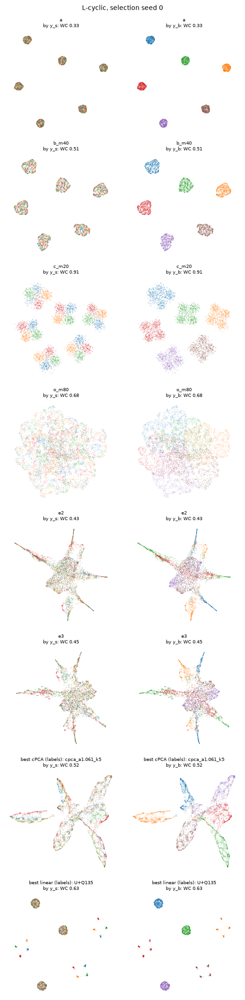
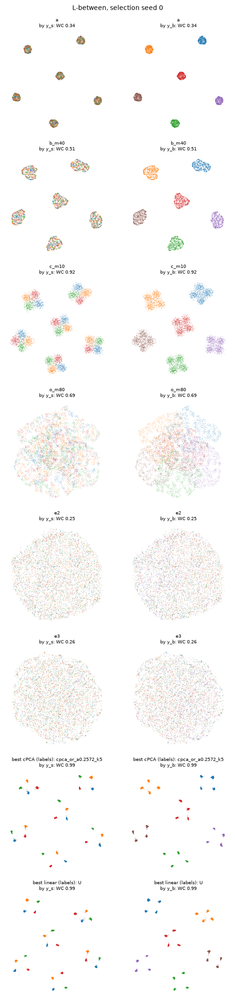

# Phase 5b report: Design L, where linear suppression is structurally limited

In every benchmark up to Phase 5a, some linear subspace held the signal and left out the background variation that hides it, so cPCA → Neg-t-SNE could win. This phase built two benchmarks where that is impossible or hard:

- **L-cyclic (primary).** Cluster k's signal block is cluster k−1's nuisance block. Any linear projection that keeps cluster k's signal also keeps cluster k−1's nuisance.
- **L-between (secondary).** The signal lies in the between-cluster directions. cPCA can keep it only at α < 1, while its label-free α rule tends to pick α > 1.

It asked two questions, both on WC (within-cluster signal accuracy):

1. **L-cyclic:** does (c) (ξ_B negatives) beat every "linear projection → standard Neg-t-SNE" pipeline, including the ones chosen with labels?
2. **L-between:** is label-free cPCA's failure only an α-selection failure?

No new embedding method was built.

## How to read this report

**Shared definitions.**
- `REPORT.md` defines the project, the two-stage Neg-t-SNE, runs (a)–(c), ξ_B, the flags, and the "consistent across 3 paired seeds" rule.
- `REPORT_phase5prep.md` defines G1–G3, the cPCA runs (e2) and (e3), and the label-free α rule.
- `REPORT_phase5a.md` defines WC, detectability, coherence and the oracle same-cluster control (o).

**The Phase 5b spec** was given by the project owner in conversation. "Design" below states everything the results depend on. The owner made one change in plan review, before any Design L dataset existed: the linear and cPCA ceilings are judged at the **embedding level** (each projection embedded with (a)'s two-stage Neg-t-SNE), not by high-D kNN. The spec's high-D ceiling could not pass V3 whenever V2 held (`results/phase5b/predictions.md`, "Change to P1").

**Files referred to:**

| short name | file | contents |
|---|---|---|
| **predictions** | `results/phase5b/predictions.md` | P1–P5 and the definitions used to judge them, committed before any Design L result |
| **pre-registration** | `results/phase5b/preregistration.md` | runs, selection rule, comparisons, exclusion and stop rules, committed before any (b), (c) or (o) run |
| results | `results/phase5b/` | CSV/JSON results, generated tables (`*.md`) and figures |
| scripts | `scripts/phase5b_*.py`, `common/benchmark_l.py`, `data/synthetic_l.py` | the code that produced every result |

Tables marked **(generated)** are copied verbatim from `results/phase5b/*.md` by `scripts/phase5b_assemble.py`; none is typed by hand. A seven-character code such as `9c35a0b` is a commit in this repository's git history.

**Run labels:**

| label | run |
|---|---|
| (a) | plain two-stage Neg-t-SNE on X_T |
| (b) | (a) plus m_B uniform extra negatives per edge |
| (c) | (a) plus m_B ξ_B negatives per edge |
| (o) | (a) plus m_B oracle same-cluster negatives per edge (uses labels; a control) |
| (e2), (e3) | cPCA on the top 10 components at the label-free α, then Neg-t-SNE or UMAP |
| cPCA variants | cPCA → Neg-t-SNE for every α representative × k ∈ {3, 5, 10, 20}, plus, per k, the α with the best high-D WC on the full grid |
| best cPCA | the per-seed maximum WC over all cPCA variants, chosen with labels: a conservative upper bound, not a fair baseline |
| best linear | the per-seed maximum WC over the labeled linear projections, embedded (L-cyclic: the 64 subsets of the six Q blocks, each with U; L-between: U, and U ∪ V). Descriptive. |

## Summary

1. **L-cyclic: (c) beats every linear-projection pipeline, including the label-chosen ones, consistently across 3 paired seeds.**
   - WC on the confirmation seeds: (c) 0.914, best labeled linear projection 0.624, best cPCA variant 0.530, label-free (e2) 0.420, (a) 0.335 (means; tables below).
   - (c) beats best cPCA by +0.36 to +0.41 on every seed (pre-registered) and the best labeled linear projection by +0.29 (descriptive).
   - **Per cluster** (a cluster counts as revealed at per-cluster WC ≥ 0.80): (c) reveals all 6 clusters on every seed (per-cluster WC ≥ 0.85). The best linear projection is always an alternating subset (U+Q135 on every confirmation seed) and reveals exactly 3 clusters (WC 0.98–1.00) while leaving the other 3 near chance (0.23–0.29). Of the cPCA variants, none reveals more than one cluster, and the best-WC variant reveals none.
2. **L-between: label-free cPCA's failure is not only an α-selection failure; it also needs a small k.**
   - The label-free rule picked α > 1 on every seed (1.34–2.15), and every α > 1 gives WC about 0.25 at every k: it subtracts the between-cluster variance, which is where the signal lies.
   - But α < 1 alone is not enough. At the pipeline's fixed k = 10, the best α < 1 gives only 0.35: components 6–10 bring in the within-cluster nuisance V, and embedding U ∪ V gives the same 0.35.
   - Only α < 1 **and** k ≤ 5 reveals the signal (0.99, every cluster), which is the same as the labeled projection onto U. On 2 of 3 confirmation seeds, the best variant is plain PCA (α = 0, k = 5).
   - So on L-between, best cPCA beats (c) by 0.07–0.08 on every seed (means 0.989 vs 0.914), as predicted (P4).
3. **(c) beats the oracle same-cluster control and uniform negatives on both designs,** consistently across 3 paired seeds: by +0.21 / +0.22 over (o) at m_B = 80 and by +0.39 over (b) at m_B = 40. This repeats Phase 5a's finding for (o) on WC.
4. **All five predictions confirmed** (P1–P5; table below). P1: the embedding-level linear ceiling was 0.627 on the selection seeds, inside the predicted 0.5–0.7, and 0.624 on the confirmation seeds.
5. **(c) reaches about the high-D detectability.** Its WC (0.91) is close to the high-D WC of X_T (0.92) on both designs. Interpretation (not tested): ξ_B removes most of the background's hold on the embedding but cannot do better than the high-D kNN graph it embeds, while a projection that drops the nuisance dimensions (U on L-between) can.

## Design

### Generator (`data/synthetic_l.py`)

    L-cyclic:   target  x = B_U c_k + σ_w Q_{k+1} w + ρ Q_k z_s + ε      background  x = B_U c_k + σ_w Q_{k+1} w + ε
    L-between:  target  x = B_U c_k + σ_w V w + ρ W z_s + ε              background  x = B_U c_k + σ_w V w + ε

- **Shared:** K = 6 background clusters with centers on a 5-D simplex (edge 30), mapped through B_U (D × 5). 4 signal groups on a 3-D simplex (edge 6, σ_s = 1). Noise std 0.1 in every dimension. Nuisance w ~ N(0, I_3) with σ_w = √(5/3), matching easy's within-cluster variance. n_T = n_B = 5000, D = 50.
- **Subspaces:** one orthonormal D × 23 draw per seed: B_U, then six 3-D blocks Q_0…Q_5 (indices mod 6). L-between uses V = Q_0 for the nuisance and W = B_U R (R a random 5 × 3 orthonormal matrix) for the signal, so the signal lies inside the between-cluster span.
- **Balance:** clusters are exactly balanced and identical in X_T and X_B, so C_T − C_B is the signal covariance in population: cPCA's target is the signal in both variants.
- **ρ = 0.2 for both variants,** from the Phase 1 rule.

### Validity (selection seeds 0–2)

| criterion | condition |
|---|---|
| V1 | (a) signal accuracy ≤ 0.50 and (a) background accuracy ≥ 0.90 |
| V2 | detectability (high-D WC) ≥ 0.85 |
| V2b | high-D signal kNN accuracy ≥ 0.65 |
| V3 (L-cyclic) | label-free (e2) WC, the embedded linear ceiling and the embedded cPCA ceiling all ≤ 0.80 |
| V3 (L-between) | label-free (e2) WC ≤ 0.80 |

Both variants were valid on every selection seed. ξ_B passed the Phase 2 gates on every selection and confirmation seed (same-y_b precision 1.000, same-y_s excess +0.035 to +0.044).

### Main runs (rules from the pre-registration)

- **Selection** (seeds 0–2): (a); (b) and (c) at m_B ∈ {1, 2, 5, 10, 20, 40}; (o) at m_B ∈ {1, 2, 5, 10, 20, 40, 80}; (e2), (e3). Best m_B per group by mean WC; ties to the smaller m_B.
- **Confirmation** (seeds 3–5; none excluded): (a), best (b), best (c), best (o), (e2), (e3), every cPCA variant, and, descriptive, every labeled linear projection, embedded.
- **Pre-registered comparisons** on WC: (c) vs (e2), vs best cPCA, vs (o), vs (b).

## Results

### Pre-registered predictions (generated)

The predictions as committed are in `results/phase5b/predictions.md` (`04a1450`). P1 and P3 are judged on the selection seeds, the others on the confirmation seeds.

| prediction | outcome | evidence |
|---|---|---|
| P1 (L-cyclic): embedding-level linear ceiling ≈ 0.5–0.7 | **confirmed** | mean over selection seeds 0.627 (per seed 0.628, 0.624, 0.628) |
| P2 (L-cyclic): (c) beats (e2) and best cPCA on WC | **confirmed** | vs (e2): consistent; vs best cPCA: consistent |
| P3 (L-between): label-free (e2) WC ≤ 0.80; cPCA oracle ceiling ≥ 0.90 | **confirmed** | (e2) WC 0.248, 0.252, 0.244 at label-free α 1.7, 1.7, 1.34; cPCA ceiling 0.992, 0.987, 0.988 (selection seeds, embedding level) |
| P4 (L-between): (c) beats (e2) but not best cPCA | **confirmed** | vs (e2): consistent; vs best cPCA: not consistent |
| P5 (L-cyclic): (c) beats (o) and (b) on WC | **confirmed** | vs (o): consistent; vs (b): consistent |
| P5 (L-between): (c) beats (o) and (b) on WC | **confirmed** | vs (o): consistent; vs (b): consistent |

### Calibration (generated)

#### L-cyclic (ρ = 0.2)

##### Per seed

| seed | (a) WC | (a) signal acc | (a) background acc | detectability | graph signal | coherence | signal var in U | ξ_B same-y_b / excess | (e2) WC (α) | linear ceiling: embedded (projection) / high-D | cPCA ceiling: embedded (variant) / high-D | V1 | V2 | V2b | V3 |
|---|---|---|---|---|---|---|---|---|---|---|---|---|---|---|---|
| 0 | 0.334 | 0.331 | 1.000 | 0.915 | 0.909 | -0.008 | 0.000 | 1.000 / +0.035 | 0.428 (1.34) | 0.628 (U+Q135) / 0.918 | 0.519 (cpca_a1.061_k5) / 0.869 | True | True | True | True |
| 1 | 0.365 | 0.355 | 1.000 | 0.908 | 0.905 | 0.005 | 0.000 | 1.000 / +0.039 | 0.411 (1.06) | 0.624 (U+Q135) / 0.910 | 0.508 (cpca_a1.061_k5) / 0.868 | True | True | True | True |
| 2 | 0.343 | 0.349 | 1.000 | 0.919 | 0.920 | 0.001 | 0.000 | 1.000 / +0.042 | 0.261 (2.73) | 0.628 (U+Q024) / 0.917 | 0.523 (cpca_or_a1.061_k5) / 0.863 | True | True | True | True |

V3 for L-cyclic: (e2) WC, the embedded linear ceiling and the embedded cPCA ceiling all ≤ 0.80. For L-between: (e2) WC ≤ 0.80 only. High-D values are descriptive.

##### Which clusters each linear pipeline reveals (per-cluster embedded WC ≥ 0.80)

| seed | (e2) per-cluster WC | revealed | best linear subset | its per-cluster WC | revealed | best cPCA variant | its per-cluster WC | revealed |
|---|---|---|---|---|---|---|---|---|
| 0 | 0.32, 0.53, 0.43, 0.63, 0.29, 0.37 | none | U+Q135 | 0.29, 0.99, 0.26, 0.99, 0.26, 0.99 | 1,3,5 | cpca_a1.061_k5 | 0.52, 0.66, 0.56, 0.63, 0.34, 0.39 | none |
| 1 | 0.36, 0.43, 0.31, 0.49, 0.45, 0.43 | none | U+Q135 | 0.24, 0.99, 0.28, 0.99, 0.28, 0.98 | 1,3,5 | cpca_a1.061_k5 | 0.57, 0.30, 0.53, 0.46, 0.64, 0.55 | none |
| 2 | 0.25, 0.26, 0.26, 0.28, 0.25, 0.26 | none | U+Q024 | 0.99, 0.27, 0.99, 0.26, 0.99, 0.27 | 0,2,4 | cpca_or_a1.061_k5 | 0.48, 0.55, 0.61, 0.50, 0.56, 0.45 | none |

##### Linear subsets by the number of clusters revealed without their nuisance

A subset reveals cluster k "cleanly" if it contains Q_k (k's signal) but not Q_{k+1} (k's nuisance). Embedded WC over the subsets in each group, all seeds pooled:

| clean reveals | subsets | embedded WC mean [min, max] | high-D WC mean [min, max] |
|---|---|---|---|
| 0 | 2 | 0.302 [0.235, 0.362] | 0.585 [0.253, 0.918] |
| 1 | 30 | 0.407 [0.367, 0.455] | 0.595 [0.357, 0.826] |
| 2 | 30 | 0.514 [0.488, 0.550] | 0.607 [0.478, 0.730] |
| 3 | 2 | 0.621 [0.614, 0.628] | 0.617 [0.604, 0.630] |

##### cPCA variants (embedded WC, mean over seeds per k)

| k | representative α: embedded WC [min, max] | oracle α for k: embedded WC [min, max] | high-D WC, best α [min, max] |
|---|---|---|---|
| 3 | 0.299 [0.238, 0.459] | 0.458 [0.456, 0.459] | 0.495 [0.478, 0.511] |
| 5 | 0.308 [0.241, 0.519] | 0.517 [0.508, 0.523] | 0.598 [0.593, 0.608] |
| 10 | 0.397 [0.254, 0.506] | 0.469 [0.411, 0.506] | 0.755 [0.747, 0.764] |
| 20 | 0.334 [0.246, 0.424] | 0.365 [0.358, 0.372] | 0.866 [0.863, 0.869] |

**L-cyclic valid on every selection seed: yes.**

#### L-between (ρ = 0.2)

##### Per seed

| seed | (a) WC | (a) signal acc | (a) background acc | detectability | graph signal | coherence | signal var in U | ξ_B same-y_b / excess | (e2) WC (α) | linear ceiling: embedded (projection) / high-D | cPCA ceiling: embedded (variant) / high-D | V1 | V2 | V2b | V3 |
|---|---|---|---|---|---|---|---|---|---|---|---|---|---|---|---|
| 0 | 0.337 | 0.332 | 1.000 | 0.916 | 0.912 | 0.968 | 1.000 | 1.000 / +0.036 | 0.248 (1.7) | 0.992 (U) / 0.991 | 0.992 (cpca_or_a0.2572_k5) / 0.991 | True | True | True | True |
| 1 | 0.355 | 0.341 | 1.000 | 0.912 | 0.911 | 0.970 | 1.000 | 1.000 / +0.038 | 0.252 (1.7) | 0.987 (U) / 0.988 | 0.987 (cpca_or_a0.5223_k5) / 0.989 | True | True | True | True |
| 2 | 0.350 | 0.352 | 1.000 | 0.919 | 0.916 | 0.973 | 1.000 | 1.000 / +0.043 | 0.244 (1.34) | 0.989 (U) / 0.989 | 0.988 (cpca_or_a0.4125_k5) / 0.989 | True | True | True | True |

V3 for L-cyclic: (e2) WC, the embedded linear ceiling and the embedded cPCA ceiling all ≤ 0.80. For L-between: (e2) WC ≤ 0.80 only. High-D values are descriptive.

##### Which clusters each linear pipeline reveals (per-cluster embedded WC ≥ 0.80)

| seed | (e2) per-cluster WC | revealed | best linear subset | its per-cluster WC | revealed | best cPCA variant | its per-cluster WC | revealed |
|---|---|---|---|---|---|---|---|---|
| 0 | 0.26, 0.21, 0.24, 0.27, 0.29, 0.23 | none | U | 1.00, 0.99, 0.99, 0.99, 0.99, 0.99 | 0,1,2,3,4,5 | cpca_or_a0.2572_k5 | 1.00, 0.99, 1.00, 0.99, 0.99, 0.99 | 0,1,2,3,4,5 |
| 1 | 0.22, 0.30, 0.26, 0.25, 0.24, 0.25 | none | U | 0.99, 0.99, 0.98, 0.99, 0.99, 0.98 | 0,1,2,3,4,5 | cpca_or_a0.5223_k5 | 0.99, 0.99, 0.99, 0.99, 0.99, 0.99 | 0,1,2,3,4,5 |
| 2 | 0.23, 0.25, 0.26, 0.24, 0.24, 0.24 | none | U | 0.99, 0.99, 0.99, 0.99, 0.98, 0.99 | 0,1,2,3,4,5 | cpca_or_a0.4125_k5 | 0.99, 0.99, 0.99, 0.99, 0.98, 0.99 | 0,1,2,3,4,5 |

##### cPCA variants (embedded WC, mean over seeds per k)

| k | representative α: embedded WC [min, max] | oracle α for k: embedded WC [min, max] | high-D WC, best α [min, max] |
|---|---|---|---|
| 3 | 0.435 [0.238, 0.990] | 0.988 [0.986, 0.990] | 0.988 [0.987, 0.990] |
| 5 | 0.433 [0.239, 0.991] | 0.989 [0.987, 0.992] | 0.989 [0.989, 0.991] |
| 10 | 0.276 [0.242, 0.358] | 0.349 [0.340, 0.356] | 0.917 [0.913, 0.922] |
| 20 | 0.279 [0.249, 0.362] | 0.349 [0.339, 0.358] | 0.917 [0.911, 0.922] |

**L-between valid on every selection seed: yes.**

### L-cyclic main runs (generated)

#### Confirmation seeds (3, 4, 5): mean [min, max]

G1, G1 at k = 200, G2 and G3 are descriptive only for Design L.

| run | WC | signal acc | G1 | G1 at k = 200 | G2 | G3 shares signal | flagged seeds |
|---|---|---|---|---|---|---|---|
| (a) plain Neg-t-SNE | 0.334 [0.328, 0.344] | 0.337 [0.332, 0.347] | 0.000 [0.000, 0.000] | 0.000 [0.000, 0.000] | 1.000 [1.000, 1.000] | 0.000 [0.000, 0.000] | 0/3 |
| (b) uniform extra negatives, m_B = 40 | 0.518 [0.503, 0.538] | 0.519 [0.503, 0.543] | 0.000 [0.000, 0.000] | 0.000 [0.000, 0.000] | 1.000 [1.000, 1.000] | 0.000 [0.000, 0.000] | 0/3 |
| (c) ξ_B negatives, m_B = 20 | 0.914 [0.912, 0.916] | 0.914 [0.912, 0.917] | 0.000 [0.000, 0.000] | 0.000 [0.000, 0.001] | 1.000 [1.000, 1.000] | 0.000 [0.000, 0.000] | 0/3 |
| (o) oracle same-cluster negatives, m_B = 80 | 0.701 [0.689, 0.721] | 0.599 [0.588, 0.613] | 0.103 [0.098, 0.112] | 0.128 [0.126, 0.129] | 0.661 [0.653, 0.667] | 0.000 [0.000, 0.000] | 0/3 |
| (e2) label-free cPCA → Neg-t-SNE | 0.420 [0.377, 0.442] | 0.381 [0.308, 0.440] | 0.082 [0.007, 0.137] | 0.093 [0.011, 0.152] | 0.721 [0.514, 0.979] | 0.056 [0.000, 0.083] | 0/3 |
| (e3) label-free cPCA → UMAP | 0.459 [0.389, 0.515] | 0.421 [0.338, 0.513] | 0.081 [0.008, 0.138] | 0.091 [0.009, 0.150] | 0.735 [0.539, 0.979] | 0.125 [0.000, 0.292] | 0/3 |
| best cPCA variant (labels; per-seed max) | 0.530 [0.500, 0.551] | 0.518 [0.496, 0.540] | 0.014 [0.000, 0.032] | 0.019 [0.000, 0.043] | 0.958 [0.895, 1.000] | 0.000 [0.000, 0.000] | 0/3 |
| best labeled linear projection (descriptive; per-seed max) | 0.624 [0.619, 0.628] | 0.622 [0.615, 0.633] | 0.000 [0.000, 0.000] | 0.000 [0.000, 0.000] | 1.000 [1.000, 1.000] | 0.000 [0.000, 0.000] | 0/3 |

#### Pre-registered comparisons on WC (confirmation seeds)

(c) beats best cPCA only if it exceeds the per-seed maximum over every cPCA variant on every seed.

| comparison | per-seed WC difference (x − y) | mean | verdict |
|---|---|---|---|
| (c) vs (e2) label-free cPCA → Neg-t-SNE | +0.537, +0.470, +0.474 | +0.494 | (c) better, consistent across 3 paired seeds |
| (c) vs best cPCA variant (labels; per-seed max) | +0.414, +0.361, +0.378 | +0.384 | (c) better, consistent across 3 paired seeds |
| (c) vs (o) oracle same-cluster negatives, m_B = 80 | +0.193, +0.217, +0.227 | +0.213 | (c) better, consistent across 3 paired seeds |
| (c) vs (b) uniform extra negatives, m_B = 40 | +0.376, +0.408, +0.403 | +0.395 | (c) better, consistent across 3 paired seeds |

#### Descriptive comparisons on WC (no verdict)

| comparison | per-seed WC difference (x − y) | mean | verdict |
|---|---|---|---|
| (c) vs best labeled linear projection (descriptive; per-seed max) | +0.285, +0.293, +0.291 | +0.290 | (c) better, consistent across 3 paired seeds |
| (c) vs (a) plain Neg-t-SNE | +0.570, +0.580, +0.589 | +0.579 | (c) better, consistent across 3 paired seeds |
| (c) vs (e3) label-free cPCA → UMAP | +0.525, +0.438, +0.402 | +0.455 | (c) better, consistent across 3 paired seeds |

#### Per-cluster WC (confirmation seeds)

Per-cluster WC; a cluster counts as revealed if its WC ≥ 0.80.

| seed | run | per-cluster WC (clusters 0–5) | revealed |
|---|---|---|---|
| 3 | (c) ξ_B negatives, m_B = 20 | 0.94, 0.92, 0.88, 0.88, 0.93, 0.94 | 0,1,2,3,4,5 |
| 3 | (e2) label-free cPCA → Neg-t-SNE | 0.35, 0.47, 0.48, 0.28, 0.38, 0.30 | none |
| 3 | best cPCA variant (labels; per-seed max) (cpca_a1.061_k10) | 0.42, 0.39, 0.68, 0.36, 0.79, 0.37 | none |
| 3 | best labeled linear projection (descriptive; per-seed max) (lin_U+Q135) | 0.25, 0.99, 0.29, 0.99, 0.25, 0.99 | 1,3,5 |
| 4 | (c) ξ_B negatives, m_B = 20 | 0.90, 0.94, 0.94, 0.86, 0.92, 0.92 | 0,1,2,3,4,5 |
| 4 | (e2) label-free cPCA → Neg-t-SNE | 0.35, 0.60, 0.36, 0.33, 0.66, 0.34 | none |
| 4 | best cPCA variant (labels; per-seed max) (cpca_or_a1.061_k5) | 0.52, 0.58, 0.59, 0.59, 0.57, 0.46 | none |
| 4 | best labeled linear projection (descriptive; per-seed max) (lin_U+Q135) | 0.27, 0.99, 0.24, 0.99, 0.23, 0.99 | 1,3,5 |
| 5 | (c) ξ_B negatives, m_B = 20 | 0.88, 0.91, 0.93, 0.93, 0.92, 0.92 | 0,1,2,3,4,5 |
| 5 | (e2) label-free cPCA → Neg-t-SNE | 0.42, 0.39, 0.72, 0.30, 0.43, 0.39 | none |
| 5 | best cPCA variant (labels; per-seed max) (cpca_a0.6615_k10) | 0.65, 0.61, 0.60, 0.27, 0.55, 0.56 | none |
| 5 | best labeled linear projection (descriptive; per-seed max) (lin_U+Q135) | 0.25, 0.98, 0.27, 0.98, 0.27, 1.00 | 1,3,5 |

#### cPCA variants by α and k (confirmation seeds)

Each cell: the per-seed best WC among the variants in that α range at that k, then mean [min, max] over seeds. The label-free row is the selected α at each k ((e2) is its k = 10 entry, embedded separately).

| α | k = 3 | k = 5 | k = 10 | k = 20 |
|---|---|---|---|---|
| α < 1 (best) | 0.252 [0.238, 0.268] | 0.257 [0.245, 0.266] | 0.489 [0.454, 0.538] | 0.352 [0.341, 0.363] |
| α > 1 (best) | 0.478 [0.454, 0.497] | 0.529 [0.500, 0.551] | 0.463 [0.442, 0.500] | 0.410 [0.381, 0.429] |
| label-free α | 0.428 [0.377, 0.484] | 0.451 [0.376, 0.538] | 0.420 [0.377, 0.442] | 0.394 [0.372, 0.429] |

#### ξ_B diagnostics and data checks (confirmation seeds)

| seed | ξ_B same-y_b precision | same-y_s excess | detectability | graph signal |
|---|---|---|---|---|
| 3 | 1.000 | +0.044 | 0.924 | 0.923 |
| 4 | 1.000 | +0.037 | 0.919 | 0.921 |
| 5 | 1.000 | +0.038 | 0.920 | 0.919 |

#### Excluded seeds

No confirmation seed was excluded.

#### Appendix: selection seeds 0–2, every run

Selection rule: highest mean WC over selection seeds 0-2 per group; ties -> smaller m_B. Chosen: (b) m_B = 40, (c) m_B = 20, (o) m_B = 80.

| run | WC | signal acc | G1 | G1 at k = 200 | G2 | G3 shares signal | flagged seeds |
|---|---|---|---|---|---|---|---|
| (a) plain Neg-t-SNE | 0.347 [0.334, 0.365] | 0.345 [0.331, 0.355] | 0.000 [0.000, 0.000] | 0.000 [0.000, 0.000] | 1.000 [1.000, 1.000] | 0.000 [0.000, 0.000] | 0/3 |
| (b) uniform extra negatives, m_B = 1 | 0.353 [0.339, 0.366] | 0.350 [0.338, 0.363] | 0.000 [0.000, 0.000] | 0.000 [0.000, 0.000] | 1.000 [1.000, 1.000] | 0.000 [0.000, 0.000] | 0/3 |
| (b) uniform extra negatives, m_B = 2 | 0.360 [0.345, 0.372] | 0.358 [0.340, 0.372] | 0.000 [0.000, 0.000] | 0.000 [0.000, 0.000] | 1.000 [1.000, 1.000] | 0.000 [0.000, 0.000] | 0/3 |
| (b) uniform extra negatives, m_B = 5 | 0.370 [0.358, 0.383] | 0.372 [0.361, 0.386] | 0.000 [0.000, 0.000] | 0.000 [0.000, 0.000] | 1.000 [1.000, 1.000] | 0.000 [0.000, 0.000] | 0/3 |
| (b) uniform extra negatives, m_B = 10 | 0.392 [0.385, 0.401] | 0.394 [0.387, 0.401] | 0.000 [0.000, 0.000] | 0.000 [0.000, 0.000] | 1.000 [1.000, 1.000] | 0.000 [0.000, 0.000] | 0/3 |
| (b) uniform extra negatives, m_B = 20 | 0.447 [0.429, 0.458] | 0.444 [0.425, 0.457] | 0.000 [0.000, 0.000] | 0.000 [0.000, 0.000] | 1.000 [1.000, 1.000] | 0.000 [0.000, 0.000] | 0/3 |
| (b) uniform extra negatives, m_B = 40 | 0.522 [0.509, 0.535] | 0.517 [0.500, 0.526] | 0.000 [0.000, 0.000] | 0.000 [0.000, 0.000] | 1.000 [1.000, 1.000] | 0.000 [0.000, 0.000] | 0/3 |
| (c) ξ_B negatives, m_B = 1 | 0.658 [0.638, 0.688] | 0.656 [0.640, 0.688] | 0.000 [0.000, 0.000] | 0.000 [0.000, 0.000] | 1.000 [1.000, 1.000] | 0.000 [0.000, 0.000] | 0/3 |
| (c) ξ_B negatives, m_B = 2 | 0.818 [0.780, 0.837] | 0.820 [0.786, 0.838] | 0.000 [0.000, 0.000] | 0.000 [0.000, 0.000] | 1.000 [1.000, 1.000] | 0.000 [0.000, 0.000] | 0/3 |
| (c) ξ_B negatives, m_B = 5 | 0.903 [0.894, 0.908] | 0.903 [0.895, 0.909] | 0.000 [0.000, 0.000] | 0.000 [0.000, 0.000] | 1.000 [1.000, 1.000] | 0.000 [0.000, 0.000] | 0/3 |
| (c) ξ_B negatives, m_B = 10 | 0.913 [0.900, 0.921] | 0.914 [0.898, 0.925] | 0.000 [0.000, 0.000] | 0.000 [0.000, 0.000] | 1.000 [1.000, 1.000] | 0.000 [0.000, 0.000] | 0/3 |
| (c) ξ_B negatives, m_B = 20 | 0.914 [0.913, 0.915] | 0.913 [0.911, 0.917] | 0.000 [0.000, 0.000] | 0.000 [0.000, 0.000] | 1.000 [1.000, 1.000] | 0.000 [0.000, 0.000] | 0/3 |
| (c) ξ_B negatives, m_B = 40 | 0.895 [0.876, 0.907] | 0.891 [0.871, 0.902] | 0.006 [0.000, 0.012] | 0.016 [0.006, 0.031] | 0.991 [0.987, 0.994] | 0.000 [0.000, 0.000] | 0/3 |
| (o) oracle same-cluster negatives, m_B = 1 | 0.378 [0.364, 0.390] | 0.376 [0.363, 0.389] | 0.000 [0.000, 0.000] | 0.000 [0.000, 0.000] | 1.000 [1.000, 1.000] | 0.000 [0.000, 0.000] | 0/3 |
| (o) oracle same-cluster negatives, m_B = 2 | 0.405 [0.388, 0.416] | 0.402 [0.384, 0.413] | 0.000 [0.000, 0.000] | 0.000 [0.000, 0.000] | 1.000 [1.000, 1.000] | 0.000 [0.000, 0.000] | 0/3 |
| (o) oracle same-cluster negatives, m_B = 5 | 0.487 [0.472, 0.495] | 0.486 [0.474, 0.493] | 0.000 [0.000, 0.000] | 0.000 [0.000, 0.000] | 1.000 [1.000, 1.000] | 0.000 [0.000, 0.000] | 0/3 |
| (o) oracle same-cluster negatives, m_B = 10 | 0.560 [0.550, 0.576] | 0.557 [0.545, 0.575] | 0.000 [0.000, 0.000] | 0.000 [0.000, 0.000] | 1.000 [1.000, 1.000] | 0.000 [0.000, 0.000] | 0/3 |
| (o) oracle same-cluster negatives, m_B = 20 | 0.630 [0.617, 0.650] | 0.621 [0.609, 0.645] | 0.000 [0.000, 0.000] | 0.007 [0.006, 0.007] | 1.000 [0.999, 1.000] | 0.000 [0.000, 0.000] | 0/3 |
| (o) oracle same-cluster negatives, m_B = 40 | 0.668 [0.657, 0.687] | 0.643 [0.634, 0.651] | 0.027 [0.024, 0.029] | 0.055 [0.053, 0.056] | 0.916 [0.909, 0.928] | 0.000 [0.000, 0.000] | 0/3 |
| (o) oracle same-cluster negatives, m_B = 80 | 0.679 [0.665, 0.696] | 0.578 [0.561, 0.586] | 0.098 [0.092, 0.102] | 0.126 [0.122, 0.130] | 0.660 [0.649, 0.667] | 0.000 [0.000, 0.000] | 0/3 |
| (e2) label-free cPCA → Neg-t-SNE | 0.367 [0.261, 0.428] | 0.340 [0.251, 0.400] | 0.106 [0.017, 0.209] | 0.115 [0.023, 0.208] | 0.602 [0.179, 0.954] | 0.083 [0.000, 0.208] | 0/3 |
| (e3) label-free cPCA → UMAP | 0.397 [0.249, 0.498] | 0.381 [0.258, 0.493] | 0.104 [0.011, 0.208] | 0.113 [0.016, 0.209] | 0.606 [0.162, 0.970] | 0.153 [0.000, 0.333] | 0/3 |

##### ξ_B diagnostics and data checks (selection seeds)

| seed | ξ_B same-y_b precision | same-y_s excess | detectability | graph signal |
|---|---|---|---|---|
| 0 | 1.000 | +0.035 | 0.915 | 0.909 |
| 1 | 1.000 | +0.039 | 0.908 | 0.905 |
| 2 | 1.000 | +0.042 | 0.919 | 0.920 |

### L-between main runs (generated)

#### Confirmation seeds (3, 4, 5): mean [min, max]

G1, G1 at k = 200, G2 and G3 are descriptive only for Design L.

| run | WC | signal acc | G1 | G1 at k = 200 | G2 | G3 shares signal | flagged seeds |
|---|---|---|---|---|---|---|---|
| (a) plain Neg-t-SNE | 0.349 [0.346, 0.352] | 0.344 [0.337, 0.349] | 0.000 [0.000, 0.000] | 0.000 [0.000, 0.000] | 1.000 [1.000, 1.000] | 0.000 [0.000, 0.000] | 0/3 |
| (b) uniform extra negatives, m_B = 40 | 0.522 [0.516, 0.529] | 0.522 [0.510, 0.534] | 0.000 [0.000, 0.000] | 0.000 [0.000, 0.000] | 1.000 [1.000, 1.000] | 0.000 [0.000, 0.000] | 0/3 |
| (c) ξ_B negatives, m_B = 10 | 0.914 [0.910, 0.921] | 0.915 [0.911, 0.921] | 0.000 [0.000, 0.000] | 0.000 [0.000, 0.000] | 1.000 [1.000, 1.000] | 0.000 [0.000, 0.000] | 0/3 |
| (o) oracle same-cluster negatives, m_B = 80 | 0.691 [0.684, 0.699] | 0.583 [0.572, 0.590] | 0.097 [0.092, 0.104] | 0.127 [0.120, 0.132] | 0.654 [0.647, 0.663] | 0.000 [0.000, 0.000] | 0/3 |
| (e2) label-free cPCA → Neg-t-SNE | 0.255 [0.244, 0.262] | 0.257 [0.249, 0.262] | 0.202 [0.190, 0.209] | 0.202 [0.193, 0.207] | 0.218 [0.166, 0.303] | 0.125 [0.042, 0.208] | 0/3 |
| (e3) label-free cPCA → UMAP | 0.249 [0.239, 0.266] | 0.255 [0.249, 0.260] | 0.201 [0.190, 0.207] | 0.202 [0.191, 0.208] | 0.232 [0.186, 0.321] | 0.181 [0.000, 0.333] | 0/3 |
| best cPCA variant (labels; per-seed max) | 0.989 [0.988, 0.992] | 0.989 [0.988, 0.992] | 0.000 [0.000, 0.000] | 0.000 [0.000, 0.000] | 1.000 [1.000, 1.000] | 0.000 [0.000, 0.000] | 0/3 |
| best labeled linear projection (descriptive; per-seed max) | 0.989 [0.988, 0.991] | 0.989 [0.988, 0.991] | 0.000 [0.000, 0.000] | 0.000 [0.000, 0.000] | 1.000 [1.000, 1.000] | 0.000 [0.000, 0.000] | 0/3 |

#### Pre-registered comparisons on WC (confirmation seeds)

(c) beats best cPCA only if it exceeds the per-seed maximum over every cPCA variant on every seed.

| comparison | per-seed WC difference (x − y) | mean | verdict |
|---|---|---|---|
| (c) vs (e2) label-free cPCA → Neg-t-SNE | +0.677, +0.653, +0.648 | +0.659 | (c) better, consistent across 3 paired seeds |
| (c) vs best cPCA variant (labels; per-seed max) | -0.070, -0.077, -0.078 | -0.075 | best cPCA variant (labels; per-seed max) better, consistent across 3 paired seeds |
| (c) vs (o) oracle same-cluster negatives, m_B = 80 | +0.222, +0.227, +0.219 | +0.223 | (c) better, consistent across 3 paired seeds |
| (c) vs (b) uniform extra negatives, m_B = 40 | +0.399, +0.395, +0.382 | +0.392 | (c) better, consistent across 3 paired seeds |

#### Descriptive comparisons on WC (no verdict)

| comparison | per-seed WC difference (x − y) | mean | verdict |
|---|---|---|---|
| (c) vs best labeled linear projection (descriptive; per-seed max) | -0.070, -0.077, -0.078 | -0.075 | best labeled linear projection (descriptive; per-seed max) better, consistent across 3 paired seeds |
| (c) vs (a) plain Neg-t-SNE | +0.569, +0.565, +0.562 | +0.565 | (c) better, consistent across 3 paired seeds |
| (c) vs (e3) label-free cPCA → UMAP | +0.682, +0.670, +0.644 | +0.665 | (c) better, consistent across 3 paired seeds |

#### Per-cluster WC (confirmation seeds)

Per-cluster WC; a cluster counts as revealed if its WC ≥ 0.80.

| seed | run | per-cluster WC (clusters 0–5) | revealed |
|---|---|---|---|
| 3 | (c) ξ_B negatives, m_B = 10 | 0.92, 0.94, 0.92, 0.87, 0.93, 0.94 | 0,1,2,3,4,5 |
| 3 | (e2) label-free cPCA → Neg-t-SNE | 0.24, 0.24, 0.23, 0.27, 0.26, 0.22 | none |
| 3 | best cPCA variant (labels; per-seed max) (cpca_or_a0.6615_k5) | 0.99, 0.99, 0.99, 0.99, 0.99, 0.99 | 0,1,2,3,4,5 |
| 3 | best labeled linear projection (descriptive; per-seed max) (lin_U) | 0.99, 0.99, 0.99, 0.99, 0.99, 0.99 | 0,1,2,3,4,5 |
| 4 | (c) ξ_B negatives, m_B = 10 | 0.92, 0.91, 0.91, 0.88, 0.92, 0.94 | 0,1,2,3,4,5 |
| 4 | (e2) label-free cPCA → Neg-t-SNE | 0.23, 0.27, 0.24, 0.27, 0.28, 0.26 | none |
| 4 | best cPCA variant (labels; per-seed max) (cpca_a0_k5) | 0.99, 0.99, 0.99, 0.98, 0.99, 0.99 | 0,1,2,3,4,5 |
| 4 | best labeled linear projection (descriptive; per-seed max) (lin_U) | 0.99, 0.99, 0.99, 0.98, 0.99, 0.99 | 0,1,2,3,4,5 |
| 5 | (c) ξ_B negatives, m_B = 10 | 0.87, 0.93, 0.94, 0.92, 0.89, 0.93 | 0,1,2,3,4,5 |
| 5 | (e2) label-free cPCA → Neg-t-SNE | 0.31, 0.26, 0.28, 0.24, 0.24, 0.24 | none |
| 5 | best cPCA variant (labels; per-seed max) (cpca_a0_k5) | 0.99, 0.98, 1.00, 0.98, 0.99, 0.99 | 0,1,2,3,4,5 |
| 5 | best labeled linear projection (descriptive; per-seed max) (lin_U) | 0.99, 0.98, 1.00, 0.98, 0.99, 0.99 | 0,1,2,3,4,5 |

#### cPCA variants by α and k (confirmation seeds)

Each cell: the per-seed best WC among the variants in that α range at that k, then mean [min, max] over seeds. The label-free row is the selected α at each k ((e2) is its k = 10 entry, embedded separately).

| α | k = 3 | k = 5 | k = 10 | k = 20 |
|---|---|---|---|---|
| α < 1 (best) | 0.988 [0.987, 0.988] | 0.989 [0.988, 0.992] | 0.352 [0.342, 0.358] | 0.354 [0.345, 0.362] |
| α > 1 (best) | 0.254 [0.244, 0.263] | 0.257 [0.246, 0.262] | 0.258 [0.252, 0.264] | 0.256 [0.252, 0.259] |
| label-free α | 0.249 [0.241, 0.258] | 0.251 [0.244, 0.262] | 0.255 [0.244, 0.262] | 0.243 [0.239, 0.245] |

#### ξ_B diagnostics and data checks (confirmation seeds)

| seed | ξ_B same-y_b precision | same-y_s excess | detectability | graph signal |
|---|---|---|---|---|
| 3 | 1.000 | +0.040 | 0.924 | 0.924 |
| 4 | 1.000 | +0.037 | 0.915 | 0.915 |
| 5 | 1.000 | +0.037 | 0.919 | 0.913 |

#### Excluded seeds

No confirmation seed was excluded.

#### Appendix: selection seeds 0–2, every run

Selection rule: highest mean WC over selection seeds 0-2 per group; ties -> smaller m_B. Chosen: (b) m_B = 40, (c) m_B = 10, (o) m_B = 80.

| run | WC | signal acc | G1 | G1 at k = 200 | G2 | G3 shares signal | flagged seeds |
|---|---|---|---|---|---|---|---|
| (a) plain Neg-t-SNE | 0.347 [0.337, 0.355] | 0.341 [0.332, 0.352] | 0.000 [0.000, 0.000] | 0.000 [0.000, 0.000] | 1.000 [1.000, 1.000] | 0.000 [0.000, 0.000] | 0/3 |
| (b) uniform extra negatives, m_B = 1 | 0.353 [0.343, 0.362] | 0.347 [0.332, 0.357] | 0.000 [0.000, 0.000] | 0.000 [0.000, 0.000] | 1.000 [1.000, 1.000] | 0.000 [0.000, 0.000] | 0/3 |
| (b) uniform extra negatives, m_B = 2 | 0.361 [0.352, 0.367] | 0.351 [0.340, 0.358] | 0.000 [0.000, 0.000] | 0.000 [0.000, 0.000] | 1.000 [1.000, 1.000] | 0.000 [0.000, 0.000] | 0/3 |
| (b) uniform extra negatives, m_B = 5 | 0.377 [0.364, 0.392] | 0.370 [0.361, 0.375] | 0.000 [0.000, 0.000] | 0.000 [0.000, 0.000] | 1.000 [1.000, 1.000] | 0.000 [0.000, 0.000] | 0/3 |
| (b) uniform extra negatives, m_B = 10 | 0.412 [0.397, 0.422] | 0.402 [0.389, 0.409] | 0.000 [0.000, 0.000] | 0.000 [0.000, 0.000] | 1.000 [1.000, 1.000] | 0.000 [0.000, 0.000] | 0/3 |
| (b) uniform extra negatives, m_B = 20 | 0.457 [0.450, 0.463] | 0.450 [0.444, 0.461] | 0.000 [0.000, 0.000] | 0.000 [0.000, 0.000] | 1.000 [1.000, 1.000] | 0.000 [0.000, 0.000] | 0/3 |
| (b) uniform extra negatives, m_B = 40 | 0.516 [0.507, 0.532] | 0.514 [0.505, 0.531] | 0.000 [0.000, 0.000] | 0.000 [0.000, 0.000] | 1.000 [1.000, 1.000] | 0.000 [0.000, 0.000] | 0/3 |
| (c) ξ_B negatives, m_B = 1 | 0.652 [0.643, 0.664] | 0.646 [0.639, 0.657] | 0.000 [0.000, 0.000] | 0.000 [0.000, 0.000] | 1.000 [1.000, 1.000] | 0.000 [0.000, 0.000] | 0/3 |
| (c) ξ_B negatives, m_B = 2 | 0.811 [0.806, 0.822] | 0.813 [0.804, 0.825] | 0.000 [0.000, 0.000] | 0.000 [0.000, 0.000] | 1.000 [1.000, 1.000] | 0.000 [0.000, 0.000] | 0/3 |
| (c) ξ_B negatives, m_B = 5 | 0.902 [0.901, 0.904] | 0.903 [0.903, 0.904] | 0.000 [0.000, 0.000] | 0.000 [0.000, 0.000] | 1.000 [1.000, 1.000] | 0.000 [0.000, 0.000] | 0/3 |
| (c) ξ_B negatives, m_B = 10 | 0.922 [0.920, 0.925] | 0.922 [0.920, 0.926] | 0.000 [0.000, 0.000] | 0.000 [0.000, 0.000] | 1.000 [1.000, 1.000] | 0.000 [0.000, 0.000] | 0/3 |
| (c) ξ_B negatives, m_B = 20 | 0.917 [0.915, 0.918] | 0.916 [0.913, 0.920] | 0.000 [0.000, 0.000] | 0.000 [0.000, 0.000] | 1.000 [1.000, 1.000] | 0.000 [0.000, 0.000] | 0/3 |
| (c) ξ_B negatives, m_B = 40 | 0.880 [0.875, 0.888] | 0.877 [0.872, 0.884] | 0.003 [0.002, 0.004] | 0.013 [0.010, 0.015] | 0.992 [0.989, 0.994] | 0.000 [0.000, 0.000] | 0/3 |
| (o) oracle same-cluster negatives, m_B = 1 | 0.383 [0.372, 0.400] | 0.377 [0.366, 0.383] | 0.000 [0.000, 0.000] | 0.000 [0.000, 0.000] | 1.000 [1.000, 1.000] | 0.000 [0.000, 0.000] | 0/3 |
| (o) oracle same-cluster negatives, m_B = 2 | 0.417 [0.404, 0.424] | 0.412 [0.400, 0.419] | 0.000 [0.000, 0.000] | 0.000 [0.000, 0.000] | 1.000 [1.000, 1.000] | 0.000 [0.000, 0.000] | 0/3 |
| (o) oracle same-cluster negatives, m_B = 5 | 0.491 [0.486, 0.501] | 0.482 [0.476, 0.490] | 0.000 [0.000, 0.000] | 0.000 [0.000, 0.000] | 1.000 [1.000, 1.000] | 0.000 [0.000, 0.000] | 0/3 |
| (o) oracle same-cluster negatives, m_B = 10 | 0.564 [0.551, 0.571] | 0.561 [0.546, 0.574] | 0.000 [0.000, 0.000] | 0.000 [0.000, 0.000] | 1.000 [1.000, 1.000] | 0.000 [0.000, 0.000] | 0/3 |
| (o) oracle same-cluster negatives, m_B = 20 | 0.628 [0.621, 0.635] | 0.624 [0.614, 0.634] | 0.000 [0.000, 0.000] | 0.005 [0.004, 0.005] | 1.000 [1.000, 1.000] | 0.000 [0.000, 0.000] | 0/3 |
| (o) oracle same-cluster negatives, m_B = 40 | 0.670 [0.666, 0.674] | 0.641 [0.639, 0.642] | 0.025 [0.021, 0.031] | 0.051 [0.047, 0.056] | 0.925 [0.910, 0.935] | 0.000 [0.000, 0.000] | 0/3 |
| (o) oracle same-cluster negatives, m_B = 80 | 0.686 [0.681, 0.694] | 0.582 [0.575, 0.586] | 0.093 [0.086, 0.099] | 0.119 [0.116, 0.122] | 0.667 [0.662, 0.672] | 0.000 [0.000, 0.000] | 0/3 |
| (e2) label-free cPCA → Neg-t-SNE | 0.248 [0.244, 0.252] | 0.247 [0.245, 0.249] | 0.202 [0.196, 0.206] | 0.203 [0.198, 0.206] | 0.222 [0.193, 0.266] | 0.042 [0.000, 0.083] | 0/3 |
| (e3) label-free cPCA → UMAP | 0.255 [0.248, 0.261] | 0.250 [0.247, 0.254] | 0.203 [0.197, 0.207] | 0.203 [0.198, 0.206] | 0.211 [0.176, 0.264] | 0.042 [0.000, 0.125] | 0/3 |

##### ξ_B diagnostics and data checks (selection seeds)

| seed | ξ_B same-y_b precision | same-y_s excess | detectability | graph signal |
|---|---|---|---|---|
| 0 | 1.000 | +0.036 | 0.916 | 0.912 |
| 1 | 1.000 | +0.038 | 0.912 | 0.911 |
| 2 | 1.000 | +0.043 | 0.919 | 0.916 |

### Figures

Selection seed 0, colored by signal group y_s (left) and background cluster y_b (right). The last two rows are the best cPCA variant and the best labeled linear projection from calibration.

**L-cyclic.** (c) splits every background cluster into its 4 signal groups. The best linear projection (U+Q135) does so for clusters 1, 3 and 5 only.

**L-between.** Label-free cPCA (α > 1) removes the between-cluster directions, and with them both the clusters and the signal, leaving an unstructured disk. The labeled projection onto U and the best cPCA variant (α < 1, k = 5) separate the signal within every cluster.

## Interpretation

- **Why L-cyclic defeats every linear pipeline.** Revealing cluster k's signal needs Q_k, and keeping Q_k also keeps cluster k−1's nuisance. A subset can avoid that conflict for at most every other cluster, which is why the best subsets are alternating and reveal exactly 3 of 6 clusters (P1). cPCA has no labels to find even those subsets: near α = 1 its top directions are the signal blocks, and in the data each block also carries another cluster's nuisance.
- **Why (c) is not limited the same way.** ξ_B works with neighborhoods, not directions. Its negatives are points that are close in the background data, so within each cluster the repulsion lands on whatever direction carries that cluster's nuisance, and a different direction can carry it in each cluster.
- **L-between is a selection problem in two parameters.** In population, cPCA at α < 1 with k ≤ 5 keeps exactly U, which holds the signal and excludes the nuisance V. The label-free rule fails on α (the representative with the largest variance ratio was an α > 1 on every seed), and the pipeline's fixed k = 10 fails on its own (it brings V back). A label-free rule that picks both well would win this design; (c) would not.
- **The oracle control again.** As in Phase 5a, repelling random members of the true background cluster spreads each island but recovers much less signal than ξ_B: (o) at its best m_B (80, the top of its grid) reaches 0.69–0.70, against 0.91 for (c).

## Limitations

- **(b) and (o) were selected at the top of their m_B grids** (40 and 80) on both designs, and their selection-seed mean WC was still rising: by +0.06 to +0.08 for (b) from m_B = 20 to 40, and by +0.01 to +0.02 for (o) from 40 to 80. Larger m_B was not tried, so their best possible WC is unknown; (b)'s trend is far below (c), and (o)'s gain is flattening.
- **The best cPCA variant is chosen with labels per seed,** so it is an upper bound on what cPCA can do. The label-free comparison is (c) vs (e2).
- **The linear projections on the confirmation seeds are descriptive.** They were added before the freeze (`2fb8b7a`), but no verdict depends on them.
- **Synthetic data only,** with discrete, balanced background clusters, as in all earlier phases. The cyclic construction is adversarial by design.
- **Dirty flag:** both selection summaries record `dirty: true` at `9c35a0b`. The only uncommitted file was the then-untracked `scripts/phase5b_report.py`, which the runs do not import; tracked code was identical to `9c35a0b`. The confirmation summaries and rechecks record a clean tree.

## Next steps

1. **Move compute to the Math Slurm cluster** (account YANG-2026). The GPU path is untested: the ξ_B sampling code has only run on CPU, and results will not be bit-identical to the Mac's.
2. **A label-free rule for (α, k).** L-between shows cPCA needs both chosen well. Test whether a rule that also picks k (for example, from the cPCA eigenvalue gap) recovers the signal without labels.
3. **Judge (c) against its ceiling.** (c)'s WC sits just below detectability on both designs; a design where the high-D kNN graph itself is poor would show whether (c) is limited by the graph.

## Reproducibility

Run with the cne-bg environment, in this order:

    python scripts/phase5b_calibrate.py --step rho
    python scripts/phase5b_calibrate.py --step validate --variant cyclic
    python scripts/phase5b_calibrate.py --step validate --variant between
    python scripts/phase5b_calibrate.py --step summary
    python scripts/phase5b_calibrate.py --step freeze
    python scripts/phase5b_run.py --design cyclic --stage selection
    python scripts/phase5b_run.py --design between --stage selection
    python scripts/phase5b_run.py --design cyclic --stage confirmation
    python scripts/phase5b_run.py --design cyclic --recheck
    python scripts/phase5b_run.py --design between --stage confirmation
    python scripts/phase5b_run.py --design between --recheck
    python scripts/phase5b_report.py
    python scripts/phase5b_assemble.py

**Order of commits:**
- Predictions P1–P5: `04a1450`, before any Design L dataset.
- Generator, metrics and tests: `527cfca`.
- Calibration results: `f736abd`.
- Freeze: `9c35a0b`, before any (b), (c) or (o) run.
- Selection: `65b919a`.
- Confirmation: `81d6cc1` (L-cyclic), `a7928b3` (L-between).

**Checks:**
- The reruns of selection seed 0 are bit-identical in every row and embedding, for both variants (`results/phase5b/recheck_{cyclic,between}.json`).
- The Phase 4 easy recheck stayed bit-identical after this phase's code changes (`results/phase5b/phase4_recheck_after_5b_changes.json`).
- Every results JSON records the environment.
