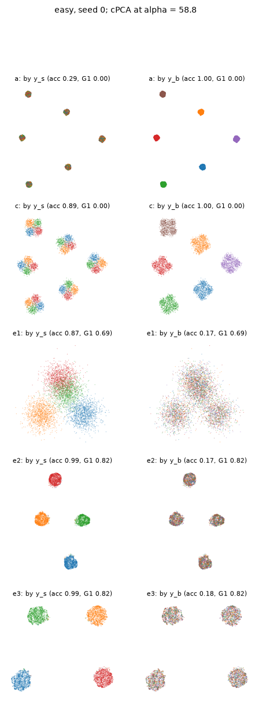
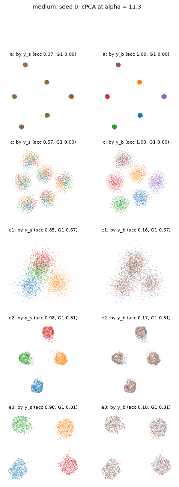
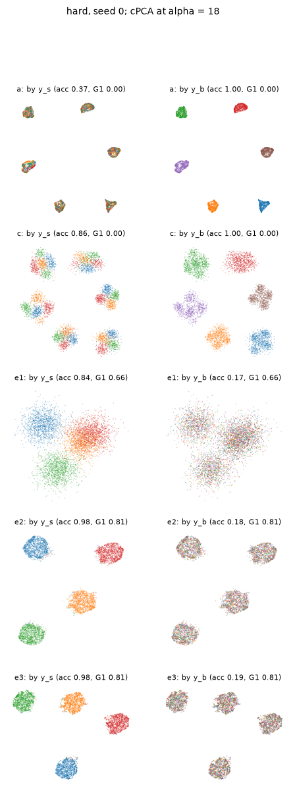

# Phase 5 prep report: global metrics and the cPCA baseline

This report covers the preparation for the next method in the background-contrastive Neg-t-SNE project: a target kNN graph built in a background-suppressed metric. Before building it, two things were needed:
- global metrics that can register whether an embedding is organized by signal rather than by background;
- the contrastive PCA (cPCA) baseline that the next method must beat.

No new method was built.

## How to read this report

**Shared definitions.** The project, data, runs (a)–(d), notation and Phase 4 metrics are defined in `REPORT.md` (repository root), in its sections "How to read this report" and "Method and setup". This report uses them without repeating them.

**Documents and files referred to:**

| short name | file | contents |
|---|---|---|
| **spec** | `Phase_5_Plan.md` (repository root) | the plan for this phase, written by the project owner; §1 is Part A, §2 is Part B |
| **REPORT.md** | `REPORT.md` (repository root) | the Phase 4 report |
| **pre-registration** | `results/phase5prep/metrics_preregistration.md` | global-metric definitions and thresholds, committed before any cPCA result |
| results | `results/phase5prep/` | CSV/JSON results, generated tables (`*.md`) and figures |
| scripts | `scripts/phase5prep_*.py` | the scripts that produced every result |

Tables marked **(generated)** are copied verbatim from `results/phase5prep/*.md` by `scripts/phase5prep_assemble.py`; none is typed by hand. A seven-character code such as `23459ff` is a commit in this repository's git history.

**New run labels:**

| label | run |
|---|---|
| (e1) | cPCA-2D: the 2-D cPCA projection itself, used as the embedding |
| (e2) | cPCA → Neg-t-SNE: the top 10 cPCA components, embedded with the same two-stage Neg-t-SNE as run (a) |
| (e3) | cPCA → UMAP: the same 10-D input, embedded with UMAP |
| (e2-oracle) | (e2) at the **oracle α chosen by 10-D cPCA signal accuracy**. It uses labels, so it is an upper bound, not a fair baseline |

## Summary

1. **The global metrics work.**
   - **Phase 4 runs:** every run scores G1 ≈ 0, G2 ≈ 1 and G3 "shares signal" = 0. That is a background-organized layout, even where (c) recovers the signal within islands.
   - **Signal-only reference:** a reference embedding of the clean signal scores G1 ≈ 0.82, G2 ≈ 0.17 (chance) and G3 "shares signal" = 1.
   - **Thresholds:** the project owner set them after seeing this, and they were committed before any cPCA result (`23459ff`).
2. **cPCA nearly solves all three synthetic levels.** cPCA → Neg-t-SNE (e2) and cPCA → UMAP (e3) pass all four pre-registered criteria on every level:
   - signal accuracy 0.977–0.989;
   - G1 0.80–0.82;
   - G2 ≈ 0.17;
   - G3 "shares signal" = 1;

   which is about the signal-only reference. (e2) improves on Phase 4's (c) in signal accuracy, G1, G2 and G3, consistently across 3 paired seeds at every level. The signal-accuracy gain is +0.10 on easy, +0.40 on medium and +0.11 on hard. Even the raw 2-D projection (e1) meets all four criteria on medium and hard.
3. **The spec's expectation did not hold, and the generator explains why.** The spec expected linear suppression to fall short on medium (overlap) and especially on hard (nonlinear background). In every level the target is signal + background + noise, with the background independent of the signal and distributed exactly like the background dataset, so C_T − C_B = C_S at α = 1, whatever the background map. "Hard" was hard for plain Neg-t-SNE, but by construction not for cPCA.
4. **α selection is not a weak point here.**
   - **10-D signal accuracy, unsupervised α vs oracle α:** within 0.003 on every easy and medium dataset. On hard it is within 0.005 on five datasets and 0.022 below on selection seed 1, where three of the four representatives clustered at small α (0, 0.66, 0.84) and the selected α = 74.4 was not the oracle's 11.3. (e2) still reaches 0.956 there.
   - **After embedding:** (e2) and (e2-oracle) differ by at most 0.003 in confirmation-mean signal accuracy at every level.
5. **Implication for the next phase (interpretation; a decision for the project owner).** On these datasets, cPCA → embed sets the bar at about the signal-only reference. Any benchmark where target = signal + independent background satisfies the identity above, however the signal and background are placed. So a background-suppressed kNN graph can only show value beyond cPCA on benchmarks that **break additivity or independence**: the signal's effect must depend on the background state. Examples:
   - **jointly nonlinear generation:** target x = F(z_b, z_s), background x = F(z_b′, s₀) for a fixed reference signal state s₀;
   - **background-cluster-specific signal maps:** each background cluster has its own signal map A_k. Here G1 and G3 become ill-posed, because "the same signal group" in different background clusters then names unrelated structures.

   Such a benchmark is needed alongside the next method.

## Part A: global metrics

**Definitions** (full text in the pre-registration). All use k = 15 exact neighbors and true labels:

| metric | definition | Phase 4 runs | signal-only reference | chance |
|---|---|---|---|---|
| **G1** | mean fraction of a point's 15 embedding neighbors with the **same signal group and a different background cluster** | 0 | ≈ 0.82 | 0.208 |
| **G2** | background kNN accuracy | 1.0 | ≈ 0.17 | about 0.17 |
| **G3** | over the 24 (signal × background) cells, the fraction whose nearest other cell centroid shares the signal group (or shares the background cluster, or neither) | 0 (shares signal) | 1 (shares signal) | |

**Validation** (Plan item A2).
- **Inputs:**
  - the stored Phase 4 embeddings of (a), best (b), (c) and (d) on every Phase 4 seed;
  - a **signal-only reference**: the two-stage Neg-t-SNE of run (a) applied to S_T + ε (the clean signal plus the dataset's own noise), on seeds 0–2;
  - the high-D X_T, for context.
- **Reload check:** all 72 stored Phase 4 embeddings reproduce their recorded signal and background accuracies exactly.
- **Criterion:** the metrics count as able to register the intended change if every signal-only seed exceeds every Phase 4 run by at least 0.3 on G1 and on G3 "shares signal". The gaps are +0.82 or more on G1 and +1.00 on G3, on every level.

(generated)

Mean [min, max] over seeds. Phase 4 runs use every Phase 4 seed (selection 0-2 and the confirmation seeds); the signal-only reference uses selection seeds 0-2. G1 chance is the exact rate for random neighbors. G2 chance is about 0.17.

### easy

| embedding | seeds | signal acc | G1 | G2 (background acc) | G3 shares signal | G3 shares background | G3 neither |
|---|---|---|---|---|---|---|---|
| high-D X_T (context) | 0, 1, 2, 3, 4, 5 | 0.884 [0.875, 0.892] | 0.000 [0.000, 0.000] | 1.000 [1.000, 1.000] | 0.000 [0.000, 0.000] | 1.000 [1.000, 1.000] | 0.000 [0.000, 0.000] |
| signal-only reference (S_T + noise) | 0, 1, 2 | 0.988 [0.986, 0.991] | 0.819 [0.816, 0.823] | 0.169 [0.162, 0.176] | 1.000 [1.000, 1.000] | 0.000 [0.000, 0.000] | 0.000 [0.000, 0.000] |
| (a) plain | 0, 1, 2, 3, 4, 5 | 0.307 [0.289, 0.322] | 0.000 [0.000, 0.000] | 1.000 [1.000, 1.000] | 0.000 [0.000, 0.000] | 1.000 [1.000, 1.000] | 0.000 [0.000, 0.000] |
| best (b) uniform_extra | 0, 1, 2, 3, 4, 5 | 0.373 [0.356, 0.410] | 0.000 [0.000, 0.000] | 1.000 [1.000, 1.000] | 0.000 [0.000, 0.000] | 1.000 [1.000, 1.000] | 0.000 [0.000, 0.000] |
| (c) xi_b at m*_c | 0, 1, 2, 3, 4, 5 | 0.891 [0.882, 0.899] | 0.000 [0.000, 0.000] | 1.000 [1.000, 1.000] | 0.000 [0.000, 0.000] | 1.000 [1.000, 1.000] | 0.000 [0.000, 0.000] |
| (d) s=0 reference | 0, 1, 2, 3, 4, 5 | 0.340 [0.324, 0.352] | 0.000 [0.000, 0.000] | 1.000 [1.000, 1.000] | 0.000 [0.000, 0.000] | 1.000 [1.000, 1.000] | 0.000 [0.000, 0.000] |

G1 chance: 0.208 [0.208, 0.208]. Separation (signal-only minimum minus Phase 4 maximum; must be >= 0.3): G1 +0.816, G3 shares signal +1.000.

### medium

| embedding | seeds | signal acc | G1 | G2 (background acc) | G3 shares signal | G3 shares background | G3 neither |
|---|---|---|---|---|---|---|---|
| high-D X_T (context) | 0, 1, 2, 3, 4, 5 | 0.707 [0.700, 0.718] | 0.000 [0.000, 0.000] | 1.000 [1.000, 1.000] | 0.000 [0.000, 0.000] | 1.000 [1.000, 1.000] | 0.000 [0.000, 0.000] |
| signal-only reference (S_T + noise) | 0, 1, 2 | 0.988 [0.986, 0.991] | 0.819 [0.817, 0.822] | 0.165 [0.164, 0.167] | 1.000 [1.000, 1.000] | 0.000 [0.000, 0.000] | 0.000 [0.000, 0.000] |
| (a) plain | 0, 1, 2, 3, 4, 5 | 0.372 [0.355, 0.388] | 0.000 [0.000, 0.000] | 1.000 [1.000, 1.000] | 0.000 [0.000, 0.000] | 1.000 [1.000, 1.000] | 0.000 [0.000, 0.000] |
| best (b) uniform_extra | 0, 1, 2, 3, 4, 5 | 0.403 [0.391, 0.416] | 0.000 [0.000, 0.000] | 1.000 [1.000, 1.000] | 0.000 [0.000, 0.000] | 1.000 [1.000, 1.000] | 0.000 [0.000, 0.000] |
| (c) xi_b at m*_c | 0, 1, 2, 3, 4, 5 | 0.571 [0.545, 0.588] | 0.001 [0.001, 0.001] | 0.998 [0.997, 1.000] | 0.000 [0.000, 0.000] | 1.000 [1.000, 1.000] | 0.000 [0.000, 0.000] |
| (d) s=0 reference | 0, 1, 2, 3, 4, 5 | 0.387 [0.379, 0.401] | 0.000 [0.000, 0.000] | 1.000 [1.000, 1.000] | 0.000 [0.000, 0.000] | 1.000 [1.000, 1.000] | 0.000 [0.000, 0.000] |

G1 chance: 0.208 [0.208, 0.208]. Separation (signal-only minimum minus Phase 4 maximum; must be >= 0.3): G1 +0.815, G3 shares signal +1.000.

### hard

| embedding | seeds | signal acc | G1 | G2 (background acc) | G3 shares signal | G3 shares background | G3 neither |
|---|---|---|---|---|---|---|---|
| high-D X_T (context) | 0, 1, 2, 4, 5, 6 | 0.881 [0.849, 0.912] | 0.000 [0.000, 0.000] | 1.000 [1.000, 1.000] | 0.000 [0.000, 0.000] | 1.000 [1.000, 1.000] | 0.000 [0.000, 0.000] |
| signal-only reference (S_T + noise) | 0, 1, 2 | 0.992 [0.991, 0.993] | 0.825 [0.821, 0.827] | 0.168 [0.163, 0.174] | 1.000 [1.000, 1.000] | 0.000 [0.000, 0.000] | 0.000 [0.000, 0.000] |
| (a) plain | 0, 1, 2, 4, 5, 6 | 0.350 [0.338, 0.371] | 0.000 [0.000, 0.000] | 1.000 [1.000, 1.000] | 0.000 [0.000, 0.000] | 1.000 [1.000, 1.000] | 0.000 [0.000, 0.000] |
| best (b) uniform_extra | 0, 1, 2, 4, 5, 6 | 0.422 [0.392, 0.464] | 0.000 [0.000, 0.000] | 1.000 [1.000, 1.000] | 0.000 [0.000, 0.000] | 1.000 [1.000, 1.000] | 0.000 [0.000, 0.000] |
| (c) xi_b at m*_c | 0, 1, 2, 4, 5, 6 | 0.852 [0.810, 0.902] | 0.000 [0.000, 0.000] | 1.000 [1.000, 1.000] | 0.000 [0.000, 0.000] | 1.000 [1.000, 1.000] | 0.000 [0.000, 0.000] |
| (d) s=0 reference | 0, 1, 2, 4, 5, 6 | 0.377 [0.357, 0.400] | 0.000 [0.000, 0.000] | 1.000 [1.000, 1.000] | 0.000 [0.000, 0.000] | 1.000 [1.000, 1.000] | 0.000 [0.000, 0.000] |

G1 chance: 0.208 [0.208, 0.208]. Separation (signal-only minimum minus Phase 4 maximum; must be >= 0.3): G1 +0.821, G3 shares signal +1.000.

**Frozen thresholds for the next method** (per level, on the confirmation seeds; pre-registration, `23459ff`):

| # | criterion | threshold | judged |
|---|---|---|---|
| 1 | G1 | ≥ 0.50 | on every seed |
| 2 | G2 | ≤ 0.50 | on every seed |
| 3 | G3 "shares signal" | ≥ 0.50 | on every seed |
| 4 | signal accuracy | ≥ (c)'s confirmation mean − 0.05 (0.844 / 0.532 / 0.818) | on the mean |

Separately pre-registered: the next method is compared with (e2) on signal accuracy and G1–G3 with the Phase 4 "consistent across 3 paired seeds" rule. Below, criteria 1–4 are applied **descriptively** to the cPCA runs; they don't change the thresholds.

## Part B: the cPCA baseline

### Method (`baselines/cpca.py`, `scripts/phase5prep_cpca.py`)

- **cPCA** (Abid et al. 2018):
  - center X_T and X_B by their own means;
  - compute covariances C_T and C_B (XᵀX / (n − 1));
  - take the top eigenvectors of C_T − α·C_B.
- **Automatic α selection** mirrors the reference package `contrastive` 1.2.0 (`CPCA(standardize=False)`):
  - α grid {0} ∪ 40 log-spaced values from 0.1 to 1000;
  - the affinity between two α is the product of the cosines of the principal angles between the 2-D column spaces of the projected target data;
  - spectral clustering into 4 groups (fixed `random_state`);
  - the group containing α = 0 is dropped, every other group contributes its exemplar, and α = 0 is added back. Usually this gives 4 representatives.
- **Selected α** (label-free, fixed before any dataset was run): the representative with the largest target-to-background variance ratio tr(VᵀC_T V) / tr(VᵀC_B V) in its 2-D subspace.
- **Oracle α:** the grid α whose 10-D cPCA representation has the highest signal kNN accuracy, chosen per dataset seed.
- **Runs:** (e1) at the selected α; (e2) and (e3) on the top 10 components at the selected α; (e2-oracle) at the oracle α. Every representative α also goes through (e1)–(e3) (appendix).
  - (e2) is the two-stage Neg-t-SNE of run (a) with its own exact k = 15 graph and PCA init in the 10-D space.
  - (e3) is `umap-learn` 0.5.12 with defaults (n_neighbors = 15, min_dist = 0.1) and `random_state` = dataset seed.
  - Phase 4's (a) and (c) are reused from their stored embeddings.
- **Seeds:** the Phase 4 seed sets: easy and medium 0–5, hard 0–2 and 4–6 (hard seed 3 stays excluded). The confirmation seeds are primary.
- **Pairing caveat:** (e2) builds its own kNN graph and Stage 1, so it is paired with (c) by dataset seed only, not by a shared starting embedding.
- **Checks:**
  - our cPCA matches the reference package on easy seed 0: maximum principal angle 8.7·10⁻¹¹ rad over all 41 α (tolerance 10⁻⁶), and identical representative α;
  - (e2) and (e3) reruns are bit-identical;
  - after installing `umap-learn` and `contrastive`, the Phase 4 easy seed 0 rerun is still bit-identical.

### Results (generated)

Main tables: confirmation seeds, mean [min, max]. (e1)-(e3) use the label-free selected alpha. Global metrics G1-G3 are defined in results/phase5prep/metrics_preregistration.md.

Reference-package check (easy seed 0): max principal angle 8.71e-11 rad (tolerance 1e-06); representative alphas identical: True. Determinism: (e2) rerun bit-identical True, (e3) True.

#### easy (confirmation seeds 3, 4, 5)

| run | signal acc | signal recall | G1 | G2 (background acc) | G3 shares signal | G3 shares background |
|---|---|---|---|---|---|---|
| (a) plain Neg-t-SNE (Phase 4) | 0.312 [0.304, 0.322] | 0.0036 [0.0033, 0.0037] | 0.000 [0.000, 0.000] | 1.000 [1.000, 1.000] | 0.000 [0.000, 0.000] | 1.000 [1.000, 1.000] |
| (c) xi_b at m*_c (Phase 4) | 0.894 [0.890, 0.899] | 0.0144 [0.0139, 0.0148] | 0.000 [0.000, 0.000] | 1.000 [1.000, 1.000] | 0.000 [0.000, 0.000] | 1.000 [1.000, 1.000] |
| (e1) cPCA-2D | 0.831 [0.733, 0.905] | 0.0579 [0.0570, 0.0590] | 0.670 [0.606, 0.726] | 0.173 [0.169, 0.175] | 0.875 [0.625, 1.000] | 0.000 [0.000, 0.000] |
| (e2) cPCA -> Neg-t-SNE | 0.989 [0.988, 0.990] | 0.0734 [0.0714, 0.0766] | 0.820 [0.818, 0.821] | 0.165 [0.155, 0.172] | 1.000 [1.000, 1.000] | 0.000 [0.000, 0.000] |
| (e3) cPCA -> UMAP | 0.987 [0.987, 0.988] | 0.0798 [0.0788, 0.0812] | 0.819 [0.817, 0.820] | 0.166 [0.158, 0.178] | 1.000 [1.000, 1.000] | 0.000 [0.000, 0.000] |
| (e2-oracle) cPCA -> Neg-t-SNE, oracle alpha chosen by 10-D cPCA signal accuracy | 0.989 [0.988, 0.990] | 0.0715 [0.0684, 0.0733] | 0.815 [0.807, 0.819] | 0.177 [0.160, 0.207] | 1.000 [1.000, 1.000] | 0.000 [0.000, 0.000] |

##### Pre-registered criteria 1-4, applied descriptively

Thresholds: G1 >= 0.50, G2 <= 0.50 and G3 shares signal >= 0.50 on every confirmation seed; signal accuracy mean >= (c)'s confirmation mean - 0.05 = 0.844.

| run | 1: G1 (min) | 2: G2 (max) | 3: G3 shares signal (min) | 4: signal acc (mean) | all four |
|---|---|---|---|---|---|
| (a) plain Neg-t-SNE (Phase 4) | no (0.000) | no (1.000) | no (0.000) | no (0.312) | no |
| (c) xi_b at m*_c (Phase 4) | no (0.000) | no (1.000) | no (0.000) | yes (0.894) | no |
| (e1) cPCA-2D | yes (0.606) | yes (0.175) | yes (0.625) | no (0.831) | no |
| (e2) cPCA -> Neg-t-SNE | yes (0.818) | yes (0.172) | yes (1.000) | yes (0.989) | yes |
| (e3) cPCA -> UMAP | yes (0.817) | yes (0.178) | yes (1.000) | yes (0.987) | yes |
| (e2-oracle) cPCA -> Neg-t-SNE, oracle alpha chosen by 10-D cPCA signal accuracy | yes (0.807) | yes (0.207) | yes (1.000) | yes (0.989) | yes |

##### (c) vs (e2), paired by dataset seed

| metric | (c) - (e2) per seed | mean | consistent across 3 paired seeds |
|---|---|---|---|
| signal acc | -0.095, -0.091, -0.099 | -0.095 | (e2) better |
| G1 | -0.818, -0.821, -0.820 | -0.820 | (e2) better |
| G2 (background acc) (lower is better) | +0.830, +0.845, +0.828 | +0.835 | (e2) better |
| G3 shares signal | -1.000, -1.000, -1.000 | -1.000 | (e2) better |

##### alpha per dataset

| seed | stage | selected alpha | representatives (variance ratio) | oracle alpha | 10-D signal acc: selected / oracle |
|---|---|---|---|---|---|
| 0 | selection | 58.8 | 0 (1.03), 1.06 (1.76), 58.8 (23.04), 624 (2.87) | 2.73 | 0.991 / 0.992 |
| 1 | selection | 8.89 | 0 (1.05), 8.89 (23.76), 119 (20.63), 624 (6.34) | 46.4 | 0.988 / 0.989 |
| 2 | selection | 36.7 | 0 (1.02), 4.38 (23.46), 36.7 (23.74), 492 (7.92) | 36.7 | 0.987 / 0.987 |
| 3 | confirmation | 28.9 | 0 (1.02), 1.34 (18.12), 28.9 (23.42), 492 (6.50) | 4.38 | 0.989 / 0.989 |
| 4 | confirmation | 11.3 | 0 (1.00), 0.661 (1.02), 11.3 (23.80), 389 (10.31) | 2.73 | 0.991 / 0.991 |
| 5 | confirmation | 14.3 | 0 (1.02), 0.661 (1.05), 14.3 (23.63), 389 (8.40) | 1.34 | 0.989 / 0.990 |

#### medium (confirmation seeds 3, 4, 5)

| run | signal acc | signal recall | G1 | G2 (background acc) | G3 shares signal | G3 shares background |
|---|---|---|---|---|---|---|
| (a) plain Neg-t-SNE (Phase 4) | 0.368 [0.355, 0.388] | 0.0038 [0.0036, 0.0041] | 0.000 [0.000, 0.000] | 1.000 [1.000, 1.000] | 0.000 [0.000, 0.000] | 1.000 [1.000, 1.000] |
| (c) xi_b at m*_c (Phase 4) | 0.582 [0.573, 0.588] | 0.0060 [0.0058, 0.0064] | 0.001 [0.001, 0.001] | 0.998 [0.997, 0.999] | 0.000 [0.000, 0.000] | 1.000 [1.000, 1.000] |
| (e1) cPCA-2D | 0.812 [0.765, 0.902] | 0.0348 [0.0343, 0.0353] | 0.646 [0.608, 0.716] | 0.167 [0.159, 0.172] | 1.000 [1.000, 1.000] | 0.000 [0.000, 0.000] |
| (e2) cPCA -> Neg-t-SNE | 0.980 [0.978, 0.982] | 0.0445 [0.0431, 0.0462] | 0.808 [0.805, 0.809] | 0.167 [0.160, 0.178] | 1.000 [1.000, 1.000] | 0.000 [0.000, 0.000] |
| (e3) cPCA -> UMAP | 0.977 [0.975, 0.979] | 0.0444 [0.0428, 0.0465] | 0.804 [0.799, 0.807] | 0.168 [0.165, 0.171] | 1.000 [1.000, 1.000] | 0.000 [0.000, 0.000] |
| (e2-oracle) cPCA -> Neg-t-SNE, oracle alpha chosen by 10-D cPCA signal accuracy | 0.980 [0.977, 0.982] | 0.0447 [0.0431, 0.0458] | 0.806 [0.803, 0.809] | 0.170 [0.161, 0.177] | 1.000 [1.000, 1.000] | 0.000 [0.000, 0.000] |

##### Pre-registered criteria 1-4, applied descriptively

Thresholds: G1 >= 0.50, G2 <= 0.50 and G3 shares signal >= 0.50 on every confirmation seed; signal accuracy mean >= (c)'s confirmation mean - 0.05 = 0.532.

| run | 1: G1 (min) | 2: G2 (max) | 3: G3 shares signal (min) | 4: signal acc (mean) | all four |
|---|---|---|---|---|---|
| (a) plain Neg-t-SNE (Phase 4) | no (0.000) | no (1.000) | no (0.000) | no (0.368) | no |
| (c) xi_b at m*_c (Phase 4) | no (0.001) | no (0.999) | no (0.000) | yes (0.582) | no |
| (e1) cPCA-2D | yes (0.608) | yes (0.172) | yes (1.000) | yes (0.812) | yes |
| (e2) cPCA -> Neg-t-SNE | yes (0.805) | yes (0.178) | yes (1.000) | yes (0.980) | yes |
| (e3) cPCA -> UMAP | yes (0.799) | yes (0.171) | yes (1.000) | yes (0.977) | yes |
| (e2-oracle) cPCA -> Neg-t-SNE, oracle alpha chosen by 10-D cPCA signal accuracy | yes (0.803) | yes (0.177) | yes (1.000) | yes (0.980) | yes |

##### (c) vs (e2), paired by dataset seed

| metric | (c) - (e2) per seed | mean | consistent across 3 paired seeds |
|---|---|---|---|
| signal acc | -0.393, -0.396, -0.405 | -0.398 | (e2) better |
| G1 | -0.809, -0.804, -0.808 | -0.807 | (e2) better |
| G2 (background acc) (lower is better) | +0.837, +0.820, +0.837 | +0.832 | (e2) better |
| G3 shares signal | -1.000, -1.000, -1.000 | -1.000 | (e2) better |

##### alpha per dataset

| seed | stage | selected alpha | representatives (variance ratio) | oracle alpha | 10-D signal acc: selected / oracle |
|---|---|---|---|---|---|
| 0 | selection | 11.3 | 0 (1.03), 11.3 (12.29), 119 (5.12), 389 (1.87) | 11.3 | 0.983 / 0.983 |
| 1 | selection | 18 | 0 (1.05), 1.06 (1.08), 18 (12.42), 307 (3.82) | 3.46 | 0.977 / 0.980 |
| 2 | selection | 18 | 0 (1.02), 1.34 (9.65), 18 (12.44), 307 (4.23) | 4.38 | 0.977 / 0.978 |
| 3 | confirmation | 8.89 | 0 (1.02), 8.89 (12.21), 151 (5.20), 492 (2.49) | 8.89 | 0.981 / 0.981 |
| 4 | confirmation | 2.73 | 0 (1.00), 0.522 (1.02), 2.73 (12.25), 307 (4.59) | 3.46 | 0.979 / 0.981 |
| 5 | confirmation | 4.38 | 0 (1.02), 4.38 (12.29), 46.4 (11.53), 389 (3.24) | 2.15 | 0.978 / 0.979 |

#### hard (confirmation seeds 4, 5, 6)

| run | signal acc | signal recall | G1 | G2 (background acc) | G3 shares signal | G3 shares background |
|---|---|---|---|---|---|---|
| (a) plain Neg-t-SNE (Phase 4) | 0.347 [0.339, 0.353] | 0.0036 [0.0032, 0.0039] | 0.000 [0.000, 0.000] | 1.000 [1.000, 1.000] | 0.000 [0.000, 0.000] | 1.000 [1.000, 1.000] |
| (c) xi_b at m*_c (Phase 4) | 0.868 [0.843, 0.902] | 0.0136 [0.0123, 0.0156] | 0.000 [0.000, 0.000] | 1.000 [1.000, 1.000] | 0.000 [0.000, 0.000] | 1.000 [1.000, 1.000] |
| (e1) cPCA-2D | 0.869 [0.864, 0.873] | 0.0431 [0.0404, 0.0458] | 0.685 [0.678, 0.693] | 0.166 [0.158, 0.180] | 1.000 [1.000, 1.000] | 0.000 [0.000, 0.000] |
| (e2) cPCA -> Neg-t-SNE | 0.980 [0.976, 0.984] | 0.0529 [0.0469, 0.0570] | 0.805 [0.799, 0.813] | 0.171 [0.166, 0.177] | 1.000 [1.000, 1.000] | 0.000 [0.000, 0.000] |
| (e3) cPCA -> UMAP | 0.978 [0.974, 0.980] | 0.0576 [0.0533, 0.0620] | 0.803 [0.798, 0.810] | 0.167 [0.156, 0.173] | 1.000 [1.000, 1.000] | 0.000 [0.000, 0.000] |
| (e2-oracle) cPCA -> Neg-t-SNE, oracle alpha chosen by 10-D cPCA signal accuracy | 0.983 [0.981, 0.985] | 0.0572 [0.0507, 0.0626] | 0.812 [0.810, 0.813] | 0.168 [0.167, 0.169] | 1.000 [1.000, 1.000] | 0.000 [0.000, 0.000] |

##### Pre-registered criteria 1-4, applied descriptively

Thresholds: G1 >= 0.50, G2 <= 0.50 and G3 shares signal >= 0.50 on every confirmation seed; signal accuracy mean >= (c)'s confirmation mean - 0.05 = 0.818.

| run | 1: G1 (min) | 2: G2 (max) | 3: G3 shares signal (min) | 4: signal acc (mean) | all four |
|---|---|---|---|---|---|
| (a) plain Neg-t-SNE (Phase 4) | no (0.000) | no (1.000) | no (0.000) | no (0.347) | no |
| (c) xi_b at m*_c (Phase 4) | no (0.000) | no (1.000) | no (0.000) | yes (0.868) | no |
| (e1) cPCA-2D | yes (0.678) | yes (0.180) | yes (1.000) | yes (0.869) | yes |
| (e2) cPCA -> Neg-t-SNE | yes (0.799) | yes (0.177) | yes (1.000) | yes (0.980) | yes |
| (e3) cPCA -> UMAP | yes (0.798) | yes (0.173) | yes (1.000) | yes (0.978) | yes |
| (e2-oracle) cPCA -> Neg-t-SNE, oracle alpha chosen by 10-D cPCA signal accuracy | yes (0.810) | yes (0.169) | yes (1.000) | yes (0.983) | yes |

##### (c) vs (e2), paired by dataset seed

| metric | (c) - (e2) per seed | mean | consistent across 3 paired seeds |
|---|---|---|---|
| signal acc | -0.133, -0.082, -0.120 | -0.112 | (e2) better |
| G1 | -0.799, -0.813, -0.804 | -0.805 | (e2) better |
| G2 (background acc) (lower is better) | +0.834, +0.830, +0.823 | +0.829 | (e2) better |
| G3 shares signal | -1.000, -1.000, -1.000 | -1.000 | (e2) better |

##### alpha per dataset

| seed | stage | selected alpha | representatives (variance ratio) | oracle alpha | 10-D signal acc: selected / oracle |
|---|---|---|---|---|---|
| 0 | selection | 18 | 0 (1.00), 1.7 (7.52), 18 (19.77), 307 (4.21) | 18 | 0.983 / 0.983 |
| 1 | selection | 74.4 | 0 (0.99), 0.661 (1.01), 0.838 (1.03), 74.4 (3.56) | 11.3 | 0.955 / 0.977 |
| 2 | selection | 36.7 | 0 (1.01), 2.15 (7.03), 36.7 (16.23), 307 (2.76) | 8.89 | 0.980 / 0.984 |
| 4 | confirmation | 5.54 | 0 (1.00), 1.34 (4.29), 5.54 (13.19), 119 (7.74) | 28.9 | 0.977 / 0.981 |
| 5 | confirmation | 28.9 | 0 (0.99), 2.15 (7.32), 28.9 (17.00), 624 (3.61) | 11.3 | 0.983 / 0.983 |
| 6 | confirmation | 5.54 | 0 (1.01), 1.06 (1.20), 5.54 (14.95), 242 (10.29) | 14.3 | 0.980 / 0.984 |

#### Appendix: selection seeds 0-2

##### easy

| run | signal acc | signal recall | G1 | G2 (background acc) | G3 shares signal | G3 shares background |
|---|---|---|---|---|---|---|
| (a) plain Neg-t-SNE (Phase 4) | 0.303 [0.289, 0.314] | 0.0031 [0.0029, 0.0032] | 0.000 [0.000, 0.000] | 1.000 [1.000, 1.000] | 0.000 [0.000, 0.000] | 1.000 [1.000, 1.000] |
| (c) xi_b at m*_c (Phase 4) | 0.888 [0.882, 0.895] | 0.0144 [0.0140, 0.0147] | 0.000 [0.000, 0.000] | 1.000 [1.000, 1.000] | 0.000 [0.000, 0.000] | 1.000 [1.000, 1.000] |
| (e1) cPCA-2D | 0.888 [0.873, 0.897] | 0.0576 [0.0546, 0.0596] | 0.703 [0.689, 0.716] | 0.172 [0.166, 0.184] | 1.000 [1.000, 1.000] | 0.000 [0.000, 0.000] |
| (e2) cPCA -> Neg-t-SNE | 0.988 [0.986, 0.990] | 0.0728 [0.0699, 0.0748] | 0.818 [0.814, 0.820] | 0.168 [0.164, 0.174] | 1.000 [1.000, 1.000] | 0.000 [0.000, 0.000] |
| (e3) cPCA -> UMAP | 0.987 [0.985, 0.989] | 0.0803 [0.0771, 0.0836] | 0.816 [0.813, 0.819] | 0.171 [0.158, 0.179] | 1.000 [1.000, 1.000] | 0.000 [0.000, 0.000] |
| (e2-oracle) cPCA -> Neg-t-SNE, oracle alpha chosen by 10-D cPCA signal accuracy | 0.988 [0.986, 0.990] | 0.0732 [0.0720, 0.0748] | 0.817 [0.813, 0.820] | 0.170 [0.164, 0.173] | 1.000 [1.000, 1.000] | 0.000 [0.000, 0.000] |

##### medium

| run | signal acc | signal recall | G1 | G2 (background acc) | G3 shares signal | G3 shares background |
|---|---|---|---|---|---|---|
| (a) plain Neg-t-SNE (Phase 4) | 0.376 [0.369, 0.387] | 0.0037 [0.0036, 0.0040] | 0.000 [0.000, 0.000] | 1.000 [1.000, 1.000] | 0.000 [0.000, 0.000] | 1.000 [1.000, 1.000] |
| (c) xi_b at m*_c (Phase 4) | 0.561 [0.545, 0.572] | 0.0061 [0.0056, 0.0067] | 0.001 [0.001, 0.001] | 0.998 [0.998, 1.000] | 0.000 [0.000, 0.000] | 1.000 [1.000, 1.000] |
| (e1) cPCA-2D | 0.852 [0.847, 0.859] | 0.0353 [0.0341, 0.0368] | 0.670 [0.662, 0.675] | 0.167 [0.158, 0.176] | 1.000 [1.000, 1.000] | 0.000 [0.000, 0.000] |
| (e2) cPCA -> Neg-t-SNE | 0.978 [0.975, 0.982] | 0.0447 [0.0437, 0.0464] | 0.805 [0.801, 0.811] | 0.169 [0.165, 0.174] | 1.000 [1.000, 1.000] | 0.000 [0.000, 0.000] |
| (e3) cPCA -> UMAP | 0.974 [0.971, 0.979] | 0.0455 [0.0447, 0.0462] | 0.803 [0.800, 0.806] | 0.171 [0.164, 0.175] | 1.000 [1.000, 1.000] | 0.000 [0.000, 0.000] |
| (e2-oracle) cPCA -> Neg-t-SNE, oracle alpha chosen by 10-D cPCA signal accuracy | 0.978 [0.975, 0.982] | 0.0443 [0.0429, 0.0462] | 0.806 [0.801, 0.811] | 0.171 [0.165, 0.181] | 1.000 [1.000, 1.000] | 0.000 [0.000, 0.000] |

##### hard

| run | signal acc | signal recall | G1 | G2 (background acc) | G3 shares signal | G3 shares background |
|---|---|---|---|---|---|---|
| (a) plain Neg-t-SNE (Phase 4) | 0.353 [0.338, 0.371] | 0.0039 [0.0037, 0.0041] | 0.000 [0.000, 0.000] | 1.000 [1.000, 1.000] | 0.000 [0.000, 0.000] | 1.000 [1.000, 1.000] |
| (c) xi_b at m*_c (Phase 4) | 0.836 [0.810, 0.859] | 0.0128 [0.0121, 0.0133] | 0.000 [0.000, 0.000] | 1.000 [1.000, 1.000] | 0.000 [0.000, 0.000] | 1.000 [1.000, 1.000] |
| (e1) cPCA-2D | 0.782 [0.648, 0.857] | 0.0349 [0.0116, 0.0524] | 0.604 [0.475, 0.680] | 0.165 [0.160, 0.169] | 1.000 [1.000, 1.000] | 0.000 [0.000, 0.000] |
| (e2) cPCA -> Neg-t-SNE | 0.972 [0.956, 0.981] | 0.0505 [0.0333, 0.0647] | 0.798 [0.777, 0.810] | 0.174 [0.168, 0.177] | 1.000 [1.000, 1.000] | 0.000 [0.000, 0.000] |
| (e3) cPCA -> UMAP | 0.971 [0.952, 0.982] | 0.0524 [0.0336, 0.0687] | 0.795 [0.773, 0.807] | 0.179 [0.171, 0.185] | 1.000 [1.000, 1.000] | 0.000 [0.000, 0.000] |
| (e2-oracle) cPCA -> Neg-t-SNE, oracle alpha chosen by 10-D cPCA signal accuracy | 0.980 [0.975, 0.983] | 0.0571 [0.0490, 0.0647] | 0.807 [0.799, 0.811] | 0.174 [0.170, 0.177] | 1.000 [1.000, 1.000] | 0.000 [0.000, 0.000] |

#### Appendix: every alpha representative (all seeds)

##### easy

| seed | alpha | selected | e1 signal acc | e2 signal acc | e3 signal acc | e2 G1 | e3 G1 | e2 G2 | e3 G2 |
|---|---|---|---|---|---|---|---|---|---|
| 0 | 0 |  0.249 | 0.296 | 0.384 | 0.000 | 0.000 | 1.000 | 1.000 |
| 0 | 1.06 |  0.707 | 0.986 | 0.986 | 0.119 | 0.118 | 0.901 | 0.897 |
| 0 | 58.8 | yes 0.873 | 0.990 | 0.989 | 0.820 | 0.815 | 0.174 | 0.179 |
| 0 | 624 |  0.539 | 0.945 | 0.943 | 0.771 | 0.765 | 0.159 | 0.164 |
| 1 | 0 |  0.248 | 0.309 | 0.393 | 0.000 | 0.000 | 1.000 | 1.000 |
| 1 | 8.89 | yes 0.897 | 0.986 | 0.985 | 0.814 | 0.813 | 0.168 | 0.177 |
| 1 | 119 |  0.782 | 0.986 | 0.985 | 0.812 | 0.812 | 0.175 | 0.173 |
| 1 | 624 |  0.751 | 0.970 | 0.967 | 0.797 | 0.796 | 0.169 | 0.157 |
| 2 | 0 |  0.242 | 0.299 | 0.399 | 0.000 | 0.000 | 1.000 | 1.000 |
| 2 | 4.38 |  0.903 | 0.987 | 0.986 | 0.816 | 0.816 | 0.173 | 0.163 |
| 2 | 36.7 | yes 0.894 | 0.988 | 0.987 | 0.820 | 0.819 | 0.164 | 0.158 |
| 2 | 492 |  0.797 | 0.968 | 0.966 | 0.795 | 0.793 | 0.161 | 0.166 |
| 3 | 0 |  0.252 | 0.305 | 0.387 | 0.000 | 0.000 | 1.000 | 1.000 |
| 3 | 1.34 |  0.885 | 0.985 | 0.982 | 0.787 | 0.789 | 0.224 | 0.209 |
| 3 | 28.9 | yes 0.905 | 0.988 | 0.987 | 0.818 | 0.820 | 0.170 | 0.161 |
| 3 | 492 |  0.738 | 0.962 | 0.960 | 0.784 | 0.784 | 0.166 | 0.166 |
| 4 | 0 |  0.251 | 0.315 | 0.421 | 0.000 | 0.000 | 1.000 | 1.000 |
| 4 | 0.661 |  0.246 | 0.319 | 0.418 | 0.000 | 0.000 | 1.000 | 1.000 |
| 4 | 11.3 | yes 0.856 | 0.990 | 0.988 | 0.821 | 0.819 | 0.155 | 0.158 |
| 4 | 389 |  0.816 | 0.976 | 0.975 | 0.805 | 0.803 | 0.180 | 0.167 |
| 5 | 0 |  0.253 | 0.307 | 0.408 | 0.000 | 0.000 | 1.000 | 1.000 |
| 5 | 0.661 |  0.251 | 0.315 | 0.412 | 0.000 | 0.000 | 1.000 | 1.000 |
| 5 | 14.3 | yes 0.733 | 0.988 | 0.988 | 0.820 | 0.817 | 0.172 | 0.178 |
| 5 | 389 |  0.838 | 0.974 | 0.973 | 0.801 | 0.802 | 0.165 | 0.152 |

##### medium

| seed | alpha | selected | e1 signal acc | e2 signal acc | e3 signal acc | e2 G1 | e3 G1 | e2 G2 | e3 G2 |
|---|---|---|---|---|---|---|---|---|---|
| 0 | 0 |  0.308 | 0.372 | 0.416 | 0.000 | 0.000 | 1.000 | 1.000 |
| 0 | 11.3 | yes 0.851 | 0.982 | 0.979 | 0.811 | 0.806 | 0.165 | 0.175 |
| 0 | 119 |  0.663 | 0.948 | 0.945 | 0.773 | 0.767 | 0.175 | 0.169 |
| 0 | 389 |  0.451 | 0.876 | 0.873 | 0.683 | 0.676 | 0.158 | 0.161 |
| 1 | 0 |  0.297 | 0.366 | 0.416 | 0.000 | 0.000 | 1.000 | 1.000 |
| 1 | 1.06 |  0.535 | 0.923 | 0.939 | 0.128 | 0.097 | 0.864 | 0.903 |
| 1 | 18 | yes 0.847 | 0.976 | 0.972 | 0.803 | 0.802 | 0.168 | 0.164 |
| 1 | 307 |  0.680 | 0.931 | 0.923 | 0.746 | 0.741 | 0.172 | 0.166 |
| 2 | 0 |  0.315 | 0.383 | 0.427 | 0.000 | 0.000 | 1.000 | 1.000 |
| 2 | 1.34 |  0.860 | 0.970 | 0.968 | 0.761 | 0.755 | 0.238 | 0.258 |
| 2 | 18 | yes 0.859 | 0.975 | 0.971 | 0.801 | 0.800 | 0.174 | 0.175 |
| 2 | 307 |  0.708 | 0.916 | 0.914 | 0.726 | 0.724 | 0.181 | 0.166 |
| 3 | 0 |  0.276 | 0.363 | 0.414 | 0.000 | 0.000 | 1.000 | 1.000 |
| 3 | 8.89 | yes 0.902 | 0.982 | 0.979 | 0.809 | 0.805 | 0.161 | 0.171 |
| 3 | 151 |  0.728 | 0.946 | 0.940 | 0.767 | 0.762 | 0.170 | 0.156 |
| 3 | 492 |  0.588 | 0.884 | 0.877 | 0.694 | 0.688 | 0.175 | 0.174 |
| 4 | 0 |  0.297 | 0.383 | 0.427 | 0.000 | 0.000 | 1.000 | 1.000 |
| 4 | 0.522 |  0.330 | 0.376 | 0.428 | 0.000 | 0.000 | 1.000 | 1.000 |
| 4 | 2.73 | yes 0.770 | 0.981 | 0.975 | 0.805 | 0.799 | 0.178 | 0.167 |
| 4 | 307 |  0.723 | 0.930 | 0.925 | 0.742 | 0.733 | 0.174 | 0.170 |
| 5 | 0 |  0.279 | 0.364 | 0.402 | 0.000 | 0.000 | 1.000 | 1.000 |
| 5 | 4.38 | yes 0.765 | 0.978 | 0.976 | 0.809 | 0.807 | 0.160 | 0.165 |
| 5 | 46.4 |  0.878 | 0.975 | 0.975 | 0.802 | 0.797 | 0.181 | 0.187 |
| 5 | 389 |  0.674 | 0.910 | 0.905 | 0.725 | 0.720 | 0.162 | 0.163 |

##### hard

| seed | alpha | selected | e1 signal acc | e2 signal acc | e3 signal acc | e2 G1 | e3 G1 | e2 G2 | e3 G2 |
|---|---|---|---|---|---|---|---|---|---|
| 0 | 0 |  0.338 | 0.338 | 0.386 | 0.000 | 0.000 | 1.000 | 1.000 |
| 0 | 1.7 |  0.841 | 0.947 | 0.946 | 0.754 | 0.747 | 0.207 | 0.215 |
| 0 | 18 | yes 0.840 | 0.981 | 0.982 | 0.810 | 0.806 | 0.176 | 0.185 |
| 0 | 307 |  0.599 | 0.970 | 0.968 | 0.795 | 0.794 | 0.161 | 0.159 |
| 1 | 0 |  0.267 | 0.328 | 0.388 | 0.000 | 0.000 | 1.000 | 1.000 |
| 1 | 0.661 |  0.285 | 0.472 | 0.666 | 0.000 | 0.000 | 1.000 | 1.000 |
| 1 | 0.838 |  0.286 | 0.498 | 0.714 | 0.000 | 0.000 | 1.000 | 1.000 |
| 1 | 74.4 | yes 0.648 | 0.956 | 0.952 | 0.777 | 0.773 | 0.168 | 0.180 |
| 2 | 0 |  0.301 | 0.331 | 0.396 | 0.000 | 0.000 | 1.000 | 1.000 |
| 2 | 2.15 |  0.831 | 0.962 | 0.960 | 0.770 | 0.771 | 0.197 | 0.182 |
| 2 | 36.7 | yes 0.857 | 0.980 | 0.978 | 0.806 | 0.807 | 0.177 | 0.171 |
| 2 | 307 |  0.567 | 0.970 | 0.968 | 0.796 | 0.793 | 0.167 | 0.169 |
| 4 | 0 |  0.320 | 0.321 | 0.378 | 0.000 | 0.000 | 1.000 | 1.000 |
| 4 | 1.34 |  0.773 | 0.928 | 0.924 | 0.705 | 0.690 | 0.239 | 0.267 |
| 4 | 5.54 | yes 0.864 | 0.976 | 0.974 | 0.799 | 0.798 | 0.166 | 0.172 |
| 4 | 119 |  0.680 | 0.962 | 0.960 | 0.783 | 0.780 | 0.166 | 0.166 |
| 5 | 0 |  0.290 | 0.403 | 0.500 | 0.000 | 0.000 | 1.000 | 1.000 |
| 5 | 2.15 |  0.822 | 0.954 | 0.955 | 0.763 | 0.764 | 0.201 | 0.206 |
| 5 | 28.9 | yes 0.871 | 0.984 | 0.980 | 0.813 | 0.810 | 0.170 | 0.156 |
| 5 | 624 |  0.634 | 0.953 | 0.951 | 0.777 | 0.774 | 0.157 | 0.161 |
| 6 | 0 |  0.290 | 0.335 | 0.393 | 0.000 | 0.000 | 1.000 | 1.000 |
| 6 | 1.06 |  0.691 | 0.890 | 0.931 | 0.070 | 0.048 | 0.931 | 0.960 |
| 6 | 5.54 | yes 0.873 | 0.980 | 0.979 | 0.804 | 0.802 | 0.177 | 0.173 |
| 6 | 242 |  0.839 | 0.980 | 0.976 | 0.805 | 0.803 | 0.167 | 0.167 |

### Why cPCA succeeds on these datasets (analysis of the data generator)

**Population identity.** In every level the data are generated as:
- target: x = S + G + ε, with S = ρ·A z_s and G = B(z_b);
- background: x = G′ + ε′, with G′ = B(z_b′).

z_s, z_b, z_b′ and the noise are drawn independently, G′ has exactly the same distribution as G, and ε and ε′ have the same variance σ²I. Hence, in the population,

    C_T = C_S + C_G + σ²I,    C_B = C_G + σ²I,    so    C_T − C_B = C_S  at α = 1.

This holds **whether the background map B is linear (easy, medium) or nonlinear (hard)**: only the covariance of G enters, and it cancels. At α = 1, cPCA's top directions are therefore the signal's own directions. cPCA can only be hurt by finite-sample error in the two covariance estimates: the background part of C_T comes from the target's background draws G, and C_B from the separate draws G′, 5000 points each.

**Why the selected α can exceed 1 without losing the signal** (secondary explanation; post-hoc data diagnostic). The selected α ranged from 2.7 to 74, always above 1. For α > 1,

    C_T − α·C_B = C_S − (α − 1)(C_G + σ²I),

which subtracts background variance (plus a little noise variance) from every direction. In directions where the background has essentially no variance, the signal survives this almost untouched. The table counts how many of the 50 directions carry background variance at or above the noise variance (0.01), and the fraction of signal variance in the remaining directions (generated by `scripts/phase5prep_summary.py` from the clean Bg_T and S_T):

| level | seeds | background directions with variance >= noise variance (of 50) | fraction of signal variance in the remaining, background-free directions |
|---|---|---|---|
| easy | 0, 1, 2, 3, 4, 5 | 5–5 | 1.00–1.00 |
| medium | 0, 1, 2, 3, 4, 5 | 5–5 | 0.50–0.50 |
| hard | 0, 1, 2, 4, 5, 6 | 34–38 | 0.17–0.35 |

**Reading the table:**
- **easy:** the background spans 5 directions and the signal lies entirely outside them.
- **medium:** by construction, half of the signal is inside the background's span and half outside.
- **hard:** the nonlinear background spreads over 34–38 directions, yet 17–35% of the signal still lies where the background has no variance, and more lies where it has little.

With 4 well-separated signal groups, that remaining part is enough even at large α.

### Figures (seed 0; colored by signal y_s and by background y_b)







## Limitations

- **The datasets are synthetic and additive** (target = signal + independent background + noise), which by the identity above makes cPCA exact in the population. The results say nothing about data with a **non-additive or background-dependent signal**. Benchmarks for the next method must break additivity or independence, for example jointly nonlinear generation x = F(z_b, z_s) with background F(z_b′, s₀), or background-cluster-specific signal maps. With cluster-specific maps, G1 and G3 are ill-posed, because the same signal label in different background clusters names unrelated groups.
- **The background is discrete clusters**; continuous backgrounds are untested (REPORT.md, "Failures, surprises, and limits").
- **G3 is coarse:** 24 cells give steps of 1/24, and every embedding so far sits at 0 or 1.
- **Signal recall is still small in absolute terms** (up to about 0.08). Still, (e2)'s recall is 4–7× that of Phase 4's (c) and 12–21× that of (a). It measures exact neighbors in the 3-D clean signal.
- **(e2) is not paired with (c) through a shared Stage 1** (see Method).

## Reproducibility

- **Determinism:** same rules as Phase 4 (deterministic algorithms, 4 threads, seeded generators, exact kNN graphs). `umap-learn` runs single-threaded with a fixed `random_state`. Reruns of (e2) and (e3) on easy seed 0 are bit-identical (`results/phase5prep/cpca_check.json`).
- **Environment:**
  - adds `umap-learn` 0.5.12 (with `numba` 0.68.0, `llvmlite` 0.50.0 and `pynndescent` 0.6.0) and `contrastive` 1.2.0. The latter is installed `--no-deps` from the PyPI source archive, sha256 `7d6c2ba9…f1f7b2`; it declares no license, so it is not vendored;
  - existing packages were pinned during installation and did not change (`env/`, commit `25f173a`);
  - the Phase 4 bit-identity check still passes (`results/phase5prep/phase4_recheck_after_install.json`).
- **Provenance:**
  - metric code `8067d25`;
  - validation `58b573e`;
  - thresholds frozen `23459ff`, before the cPCA code (`2ea1ae1`) and every cPCA result.
- **To regenerate:**

  ```
  python scripts/phase5prep_metrics.py
  python scripts/phase5prep_cpca.py
  python scripts/phase5prep_summary.py
  python scripts/phase5prep_assemble.py
  ```
