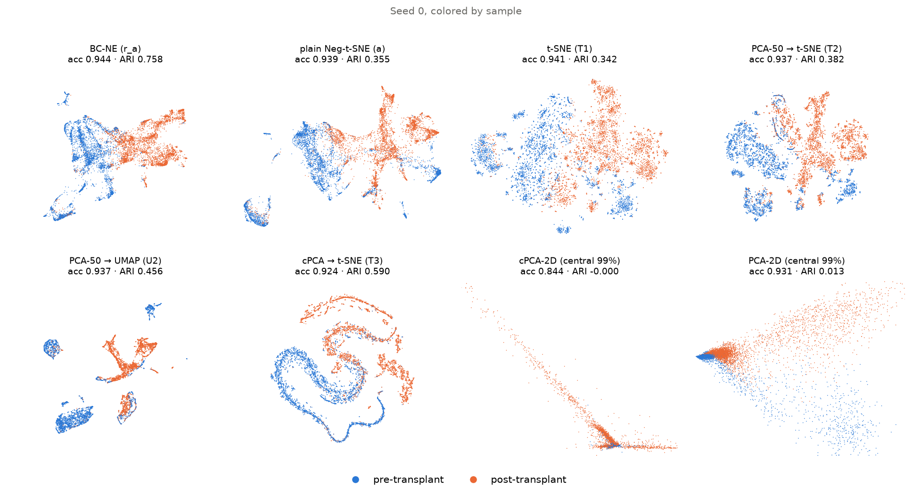
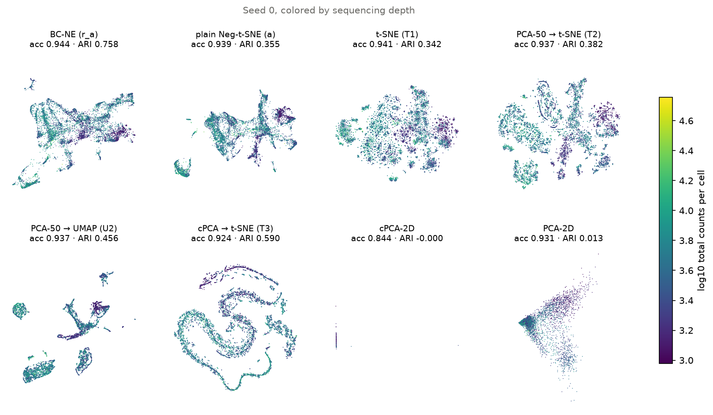
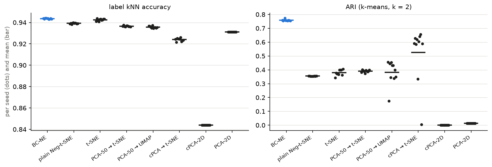
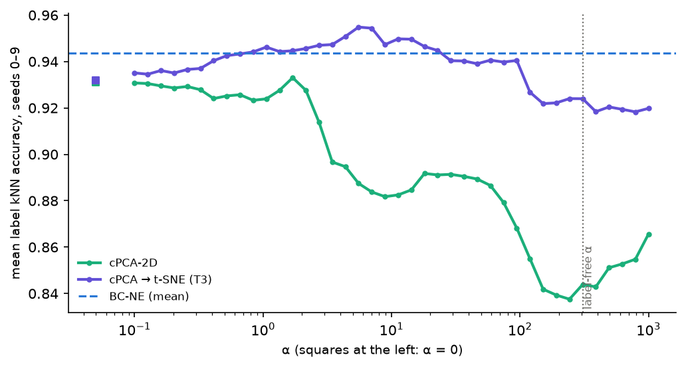
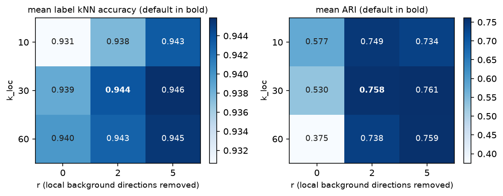
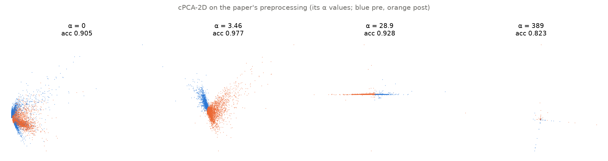

# Single-cell RNA-seq: AML patient 027 against a healthy donor

This phase tests BC-NE on real data that was not built to be additive: the cPCA paper's single-cell example (its
Figure 3, from Zheng et al. 2017).
- **Target:** 7898 bone marrow cells from leukemia (AML) patient 027, 3933 before a stem-cell transplant and 3965
  after. The label is pre vs post.
- **Background:** 1985 bone marrow cells from a healthy donor.
- **What the two share:** cell-type variation (T cells, B cells, monocytes, erythroid cells, …). What only the target
  has: the pre vs post difference.

**Design:**
- **Claim type:** pre-registered (`results/scrna/preregistration.md`, `82ca18e`, committed before any label pre-check
  or embedding).
- **BC-NE** is (r_a) only: the residual graph (k_loc = 30, r = 2) and one 750-epoch Neg-t-SNE fit. No background
  negatives.
- **Baselines:** plain Neg-t-SNE, t-SNE, PCA-50 → t-SNE, PCA-50 → UMAP, cPCA → t-SNE, cPCA-2D and PCA-2D.
- **Seeds:** 0–9. The data are fixed, so the seeds vary only the algorithms' randomness, and every seed counts.
- **Preprocessing** (one transform for target and background): counts per cell normalized and log-transformed, the 500
  most dispersed genes, each gene standardized.
- **Platform:** the cluster only.

## Summary

1. **On the primary metric, BC-NE is the most accurate map, but by small margins.**
   - **Accuracy:** label kNN accuracy is 0.944 for BC-NE and 0.924–0.943 for every baseline except cPCA-2D,
     which is lower, at 0.844.
   - **Pre-registered verdicts:** BC-NE beats plain Neg-t-SNE, PCA-50 → t-SNE, PCA-50 → UMAP, cPCA → t-SNE, cPCA-2D
     and PCA-2D, consistently across 10 paired seeds. Against t-SNE it is not consistent: the mean difference is
     +0.001.
   - **The margins:** apart from cPCA-2D (+0.100), they are +0.004 to +0.020.
   - **Why the margins are small:** the pre-registered ceiling rule (both T1 and r_a at least 0.95) narrowly does not
     apply. But the high-dimensional data already reach 0.951, and every 2-D map comes close, so accuracy barely
     separates the methods here.
2. **The clear difference is in how the two samples are laid out** (ARI, descriptive).
   - **BC-NE:** splitting it into two k-means clusters recovers pre vs post with ARI 0.758 (0.755–0.773 over seeds).
   - **Every other map:** 0.525 at best (cPCA → t-SNE, which varies from 0.005 to 0.657 across seeds), and 0.36–0.39
     for t-SNE, PCA → t-SNE, UMAP and plain Neg-t-SNE.
   - **In the figure:** BC-NE puts the pre and post cells in two broad halves of the map. The other neighbor
     embeddings scatter both samples over many cell-type clusters, which a two-way split does not follow.
   - **The residual graph is what changes this:** plain Neg-t-SNE on the raw graph reaches only 0.355.
3. **BC-NE keeps less of the cell-type structure the background shares** (descriptive).
   - **The measure:** the overlap of embedding neighbors' nearest background cells.
   - **Values:** BC-NE 0.457, against 0.55–0.60 for t-SNE, PCA → t-SNE, UMAP and plain Neg-t-SNE, and 0.29–0.35 for
     the cPCA maps.
   - **For reference:** the 500-gene kNN graph scores 0.632, and random pairs 0.181.
   - **What it means:** BC-NE removes part of the background-shared organization. cPCA removes more but loses
     accuracy at its label-free α.
4. **cPCA's label-free α is a poor choice here.**
   - **The rule picks α = 307 on every seed:** cPCA → t-SNE then reaches 0.924 and cPCA-2D 0.844.
   - **Choosing α with the labels** (descriptive; an upper bound, as in the tuned-T3 phase): cPCA → t-SNE reaches
     0.955 at α = 5.54, a little above BC-NE (0.944), and cPCA-2D 0.933 at α = 1.7.
   - **As on MNIST:** a well-chosen α makes global cPCA competitive. The label-free rule does not find it.
5. **The paper's figure replicates.**
   - **The α values:** with the paper's own preprocessing, our cPCA finds exactly the paper's four representative α
     values (0, 3.46, 28.9, 389).
   - **Accuracy:** at α = 3.46, the value the paper shows, cPCA-2D separates pre from post with accuracy 0.977.
   - **But:** the label-free rule picks α = 389 there (0.823), and plain PCA-2D already reaches 0.905.
6. **The local background directions matter here, unlike on MNIST** (descriptive sensitivity).
   - **With mean subtraction only (r = 0),** ARI is 0.375–0.577. With r = 2 or 5 it is 0.734–0.761.
   - **Accuracy varies little:** 0.931–0.946.
   - **The default (k_loc = 30, r = 2)** is within 0.003 of the best cell on both.
7. **A larger background changes little for BC-NE.** Adding donor 2 (4457 background cells) gives 0.942 against
   0.944. It helps cPCA-2D (0.879 against 0.844).
8. **All checks pass.** Every seed-0 rerun was bit-identical, the main job reproduced the smoke test's embeddings
   exactly, and no map fragmented.

## What this does and does not show

- **Batch:** pre and post are separate 10x runs, and post cells have lower sequencing depth (median log10 total counts
  3.48 vs 3.69). In the maps, lower-depth regions largely coincide with the post cells (second embedding figure). So some of what any method
  separates may be technical, as in the paper's own figure.
- **Biology:** there is one patient and one donor. The seeds measure only the algorithms' randomness, so "consistent
  across 10 paired seeds" means stable on these cells, not general.
- **Additivity:** we cannot show the background is non-additive. This is real data with a structured background (many
  cell types), and the residual graph's local directions matter here (item 6), unlike on MNIST-on-grass.
- **The comparison that matters:** on accuracy, BC-NE is level with the best label-free baselines and below
  label-tuned cPCA → t-SNE. Its advantage is the global two-group layout (ARI), which no baseline matches. ARI was a
  secondary metric with no pre-registered verdict.

## Pre-checks (generated, before any embedding)

Cells: pre 3933, post 3965, background 1985. Median log10 total counts: pre 3.69, post 3.48, background 3.29.

### Label kNN accuracy in high dimension (k = 15, stratified 5-fold)

| space | accuracy |
|---|---|
| 500 genes | 0.951 |
| PCA-50 | 0.947 |
| cPCA-10 (alpha 307) | 0.926 |
| residuals (k_loc 30, r 2) | 0.950 |

### Background-structure retention: reference values

| graph | mean Jaccard |
|---|---|
| all pairs | 0.181 |
| 500-gene kNN graph | 0.632 |
| residual kNN graph | 0.545 |

### Label-free α per seed

| seed | α | representatives |
|---|---|---|
| 0 | 307 | 0, 3.46, 22.9, 307 |
| 1 | 307 | 0, 3.46, 22.9, 307 |
| 2 | 307 | 0, 3.46, 22.9, 307 |
| 3 | 307 | 0, 3.46, 22.9, 307 |
| 4 | 307 | 0, 3.46, 22.9, 307 |
| 5 | 307 | 0, 3.46, 22.9, 307 |
| 6 | 307 | 0, 3.46, 22.9, 307 |
| 7 | 307 | 0, 3.46, 22.9, 307 |
| 8 | 307 | 0, 3.46, 22.9, 307 |
| 9 | 307 | 0, 3.46, 22.9, 307 |

### Replication: the paper's preprocessing, cPCA-2D

Label-free α on the paper's preprocessing: 389.

| α | label kNN accuracy |
|---|---|
| 0 | 0.905 |
| 3.45511 | 0.977 |
| 28.9427 | 0.928 |
| 388.816 | 0.823 |

## Results (generated)

### Every run, seeds 0–9: mean [min, max]

| run | label kNN accuracy | ARI | background-structure retention | fragmented seeds |
|---|---|---|---|---|
| BC-NE (r_a) | 0.944 [0.943, 0.944] | 0.758 [0.755, 0.773] | 0.457 [0.456, 0.457] | 0 of 10 |
| plain Neg-t-SNE (a) | 0.939 [0.938, 0.940] | 0.355 [0.353, 0.356] | 0.572 [0.571, 0.572] | 0 of 10 |
| t-SNE (T1) | 0.943 [0.941, 0.944] | 0.379 [0.342, 0.406] | 0.595 [0.594, 0.596] | 0 of 10 |
| PCA-50 → t-SNE (T2) | 0.937 [0.936, 0.938] | 0.390 [0.373, 0.401] | 0.564 [0.564, 0.565] | 0 of 10 |
| PCA-50 → UMAP (U2) | 0.936 [0.934, 0.937] | 0.383 [0.176, 0.456] | 0.551 [0.550, 0.552] | 0 of 10 |
| cPCA → t-SNE (T3) | 0.924 [0.922, 0.926] | 0.525 [0.005, 0.657] | 0.350 [0.348, 0.351] | 0 of 10 |
| cPCA-2D | 0.844 [0.844, 0.844] | -0.000 [-0.000, -0.000] | 0.286 [0.286, 0.286] | 0 of 10 |
| PCA-2D | 0.931 [0.931, 0.931] | 0.013 [0.013, 0.013] | 0.429 [0.429, 0.429] | 0 of 10 |

### Pre-registered comparisons (label kNN accuracy; differences are r_a − baseline)

| comparison | per-seed differences: min, max | mean | verdict |
|---|---|---|---|
| r_a vs plain Neg-t-SNE (a) | +0.0032, +0.0060 | +0.0044 | r_a better, consistent across 10 paired seeds |
| r_a vs t-SNE (T1) | -0.0005, +0.0033 | +0.0011 | not consistent |
| r_a vs PCA-50 → t-SNE (T2) | +0.0057, +0.0080 | +0.0071 | r_a better, consistent across 10 paired seeds |
| r_a vs PCA-50 → UMAP (U2) | +0.0066, +0.0094 | +0.0080 | r_a better, consistent across 10 paired seeds |
| r_a vs cPCA → t-SNE (T3) | +0.0167, +0.0217 | +0.0197 | r_a better, consistent across 10 paired seeds |
| r_a vs cPCA-2D | +0.0990, +0.1002 | +0.0997 | r_a better, consistent across 10 paired seeds |
| r_a vs PCA-2D | +0.0118, +0.0129 | +0.0125 | r_a better, consistent across 10 paired seeds |

Ceiling rule (mean T1 and mean r_a both ≥ 0.95): T1 0.943, r_a 0.944 → does not apply.

### BC-NE sensitivity (descriptive): mean label kNN accuracy

| k_loc \ r | 0 | 2 | 5 |
|---|---|---|---|
| 10 | 0.931 | 0.938 | 0.943 |
| 30 | 0.939 | 0.944 | 0.946 |
| 60 | 0.940 | 0.943 | 0.945 |

Mean ARI:

| k_loc \ r | 0 | 2 | 5 |
|---|---|---|---|
| 10 | 0.577 | 0.749 | 0.734 |
| 30 | 0.530 | 0.758 | 0.761 |
| 60 | 0.375 | 0.738 | 0.759 |

### cPCA with α chosen using labels (descriptive; an upper bound, not a fair baseline)

| run | α chosen with labels (best mean accuracy) | its mean accuracy | label-free α | its mean accuracy |
|---|---|---|---|---|
| cPCA-2D | 1.7 | 0.933 | 307 | 0.844 |
| cPCA → t-SNE (T3) | 5.54 | 0.955 | 307 | 0.924 |

### Larger background (descriptive): label kNN accuracy

| run | donor 1 (1985 cells) | donors 1 + 2 (4457 cells) |
|---|---|---|
| BC-NE (r_a) | 0.944 [0.943, 0.944] | 0.942 [0.941, 0.943] |
| cPCA → t-SNE (T3) | 0.924 [0.922, 0.926] | 0.923 [0.923, 0.924] |
| cPCA-2D | 0.844 [0.844, 0.844] | 0.879 [0.879, 0.879] |

### Checks

Seed-0 reruns bit-identical: yes, every run (no exceptions).

### Runtimes (one thread, whole process)

| process | median runtime (s) | range |
|---|---|---|
| BC-NE (r_a) | 142 | 130–144 |
| plain Neg-t-SNE (a) | 133 | 122–137 |
| t-SNE (T1) | 50 | 40–53 |
| PCA-50 → t-SNE (T2) | 46 | 45–51 |
| PCA-50 → UMAP (U2) | 37 | 35–39 |
| cPCA fit + T3 + cPCA-2D + PCA-2D | 49 | 44–53 |

## Figures

**Seed 0, colored by sample** (the two linear projections are drawn on the central 99% of cells):

**Seed 0, colored by sequencing depth:**

**Every seed: label kNN accuracy and ARI** (dots per seed, bar at the mean):

**cPCA against α** (mean over seeds; the label-free α is marked; BC-NE's mean for reference):

**BC-NE sensitivity** (k_loc × r):

**Replication of the paper's Figure 3a** (the paper's preprocessing; cPCA-2D at its α values):

## Reproducibility

On the cluster (see `cluster/README.md`):

    python data/scrna.py                                   # download, verify, preprocess, write the manifest
    sbatch --export=ALL,THREADS=1 cluster/parallel.sbatch cluster/jobs/scrna_precheck.txt
    sbatch --export=ALL,THREADS=1 cluster/parallel.sbatch cluster/jobs/scrna_smoke.txt
    sbatch --export=ALL,THREADS=1 cluster/parallel.sbatch cluster/jobs/scrna_main.txt
    python scripts/scrna_run.py --merge
    python scripts/scrna_report.py
    python scripts/scrna_assemble.py

- **Commits:**
  - data module and metric: `2727984`, `be255d1`;
  - manifest: `ce1cc59`;
  - pre-registration and run script: `82ca18e`;
  - results: `3ddc78c`;
  - figures redrawn with the linear projections zoomed: `d4f24d1`, `f74c28a`.
- **Jobs:**
  - 6282: pre-check, 35 s;
  - 6283: smoke test, 9 processes, 1 min 30 s;
  - 6284: main, 186 processes, 37 min.
- **Data:** `data/MANIFEST_scrna.md` pins the four 10x tarballs and the processed file. A rebuild was byte-identical.
- **Recorded in every run JSON:** the environment, the Slurm job, 1 thread and a clean commit. Embeddings (`.npy`)
  stay on the cluster.
