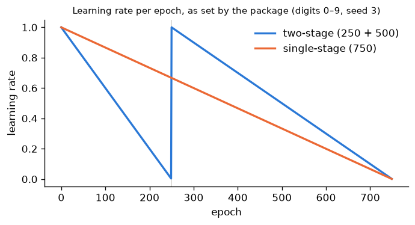
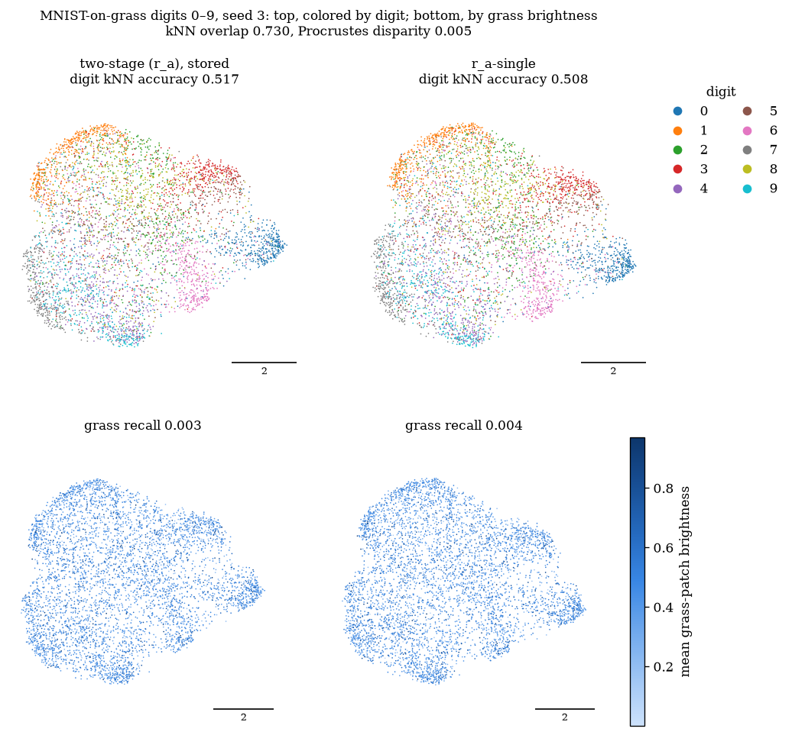
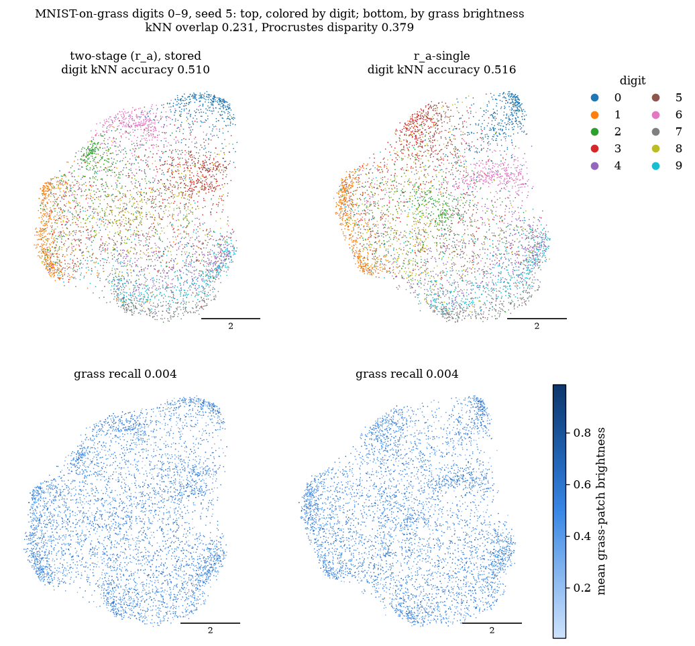
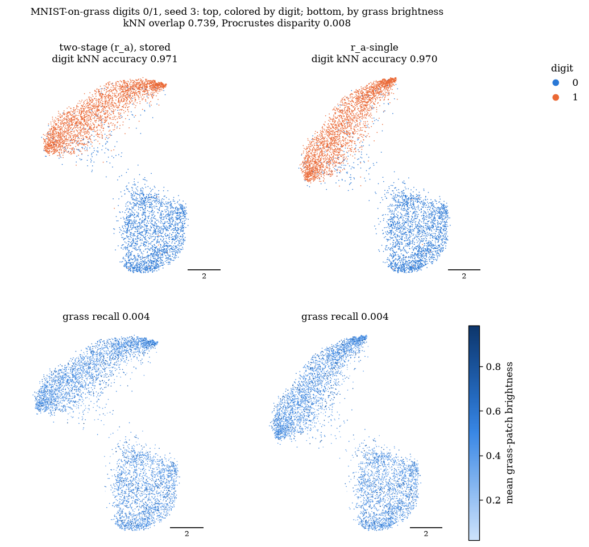
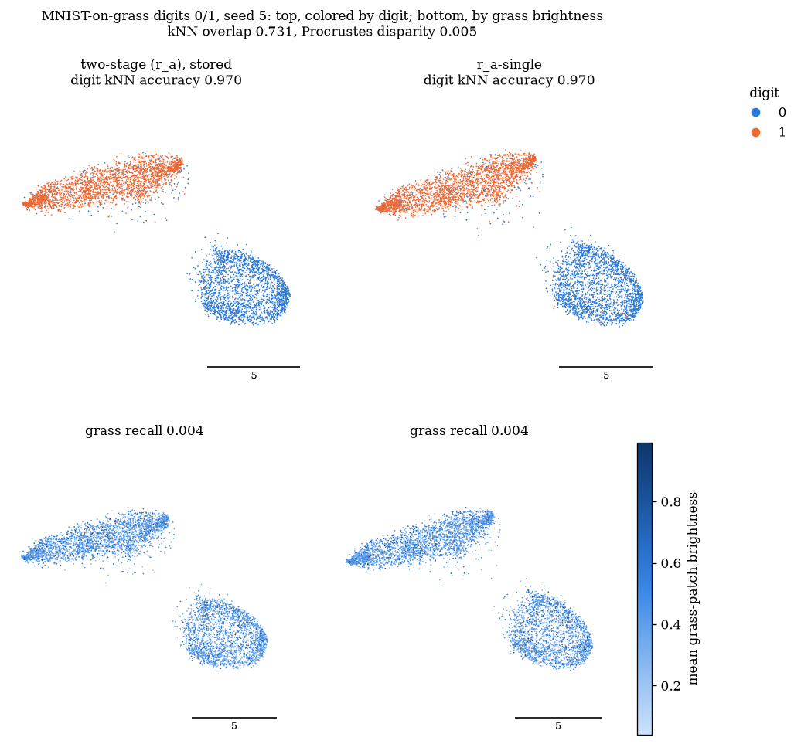

# Single-stage vs two-stage (r_a)

(r_a) is the method's core form: the residual graph (k_loc = 30, r = 2) embedded with Neg-t-SNE, with no background negatives. Until now it ran on the **two-stage schedule** inherited from the original method:
- a 250-epoch first stage;
- then a 500-epoch second stage from that embedding, with a fresh learning-rate schedule.

The second stage exists to switch on background negatives, which (r_a) doesn't use. So for (r_a), the only thing that happens at the handoff is the learning-rate reset.

This check asks whether **one standard Neg-t-SNE run of 750 epochs** ("r_a-single") gives essentially the same result. It covers MNIST-on-grass digits 0/1 and 0–9, seeds 0–5. Confirmation seeds 3–5 are primary.
- **Claim type:** descriptive, with no pre-registered verdict.
- **Rule committed in advance:** before any single-stage run, a definition of "matches closely" and an adoption rule were committed (`d6f7be0`). The plan is `docs/plans/single_stage_plan.md`.
- **Not affected:** (r_c), BC-NE with background negatives, keeps its two-stage schedule and is not part of this check. The existing 0/1 and 0–9 reports are unchanged.

## Summary

1. **r_a-single matches two-stage (r_a) closely on both datasets, on every seed.**
   - All 12 seeds, including the secondary seeds 0–2, are within tolerance on both digit kNN accuracy and grass recall.
   - Mean Δ over seeds 3–5 (single − two-stage):

     | dataset | Δ digit kNN accuracy | Δ grass recall |
     |---|---|---|
     | 0/1 | −0.0001 | +0.0001 |
     | 0–9 | −0.0016 | +0.0001 |

   - The closest call is 0–9 seed 3: Δ = −0.0086, against a tolerance of 0.0092.
   - **Under the committed adoption rule, single-stage (r_a) becomes the method's core form for future experiments.**
2. **Secondary metrics agree too** (descriptive):
   - recall vs clean digits is within 0.0011 on every seed;
   - mean ARI changes by +0.0015 (0/1) and +0.012 (0–9).
3. **On some seeds the two runs settle into a different global arrangement** (descriptive).
   - **Scale of training-seed noise:** two-stage runs that differ only in training seed agree at kNN overlap 0.71–0.75, with Procrustes disparity ≤ 0.015.
   - **Most seeds:** single vs two-stage agrees about as well as that (overlap 0.73–0.77).
   - **Exceptions:**
     - **0–9:** seeds 0, 4 and 5, with overlap 0.23–0.40 and Procrustes disparity up to 0.38;
     - **0/1:** seed 1, with overlap 0.64 and disparity 0.22.
   - **What the figure shows** (0–9 seed 5): the same digit groups form in both runs but sit in different places. Every quality metric is within tolerance there.
   - So the schedule can change *where* groups end up, but not *how well* the digits are separated or the grass removed.
4. **Runtime is about the same.** Both versions train for 750 epochs. The differences in the table come from runs in different jobs (63–119 s two-stage, 64–89 s single-stage) and aren't a speed effect.

## Criterion and package behavior (generated, committed before any single-stage run)

Generated by `scripts/single_stage_run.py --check` from `noise_reference.json`. The plan is
`docs/plans/single_stage_plan.md`.

### Tolerances

The noise ranges come from seed 3 of each dataset: two-stage (r_a), stored run (training seed 3) plus training seeds
1003 and 2003. Each tolerance is max(0.005, noise range).

| dataset | noise_acc | tolerance, digit kNN accuracy | noise_grass | tolerance, grass recall |
|---|---|---|---|---|
| digits 0/1 | 0.0016 | 0.0050 | 0.0001 | 0.0050 |
| digits 0–9 | 0.0092 | 0.0092 | 0.0002 | 0.0050 |

### "Matches closely" (descriptive, not a verdict)

Applied separately to each dataset, on confirmation seeds 3, 4 and 5. It holds for a dataset if, on every one of those
seeds, r_a-single minus the stored two-stage (r_a) satisfies
- |Δ digit kNN accuracy| ≤ the dataset's accuracy tolerance, and
- |Δ grass recall| ≤ the dataset's grass tolerance.

### Adoption rule

- If "matches closely" holds on both datasets, future experiments use single-stage (r_a) as the method's core form.
- If it fails on either dataset, they keep two-stage (r_a).
- Either way, (r_c) keeps its two-stage schedule.

### Package behavior (read from the code)

- **Early exaggeration** (`third_party/contrastive-ne/src/cne/cne.py:462`) uses the exaggerated spectrum parameter only
  when `self.s is not None`. r_a-single sets only neg_spec = 1.0, so `s` stays unset and the objective is the same in
  every epoch. Each single-stage run asserts that `s` is unset.
- **Learning rate** (`new_lr`, `cne.py:702`): linear annealing over each fit's own `n_epochs`. Two-stage anneals over
  250 epochs, then restarts and anneals over 500; single-stage anneals once over 750. Every run records its per-epoch
  rates.

The learning rate per epoch, as each run recorded it:

## Results (generated)

### Reuse check of the stored two-stage runs

| dataset | seed | stored at | Slurm job | code unchanged since | .npy SHA-256 matches | digit accuracy reproduced |
|---|---|---|---|---|---|---|
| digits 0/1 | 0 | `9405a42` | 6034 | **no** | yes | yes |
| digits 0/1 | 1 | `9405a42` | 6034 | **no** | yes | yes |
| digits 0/1 | 2 | `9405a42` | 6034 | **no** | yes | yes |
| digits 0/1 | 3 | `1511f6c` | 6036 | **no** | yes | yes |
| digits 0/1 | 4 | `1511f6c` | 6036 | **no** | yes | yes |
| digits 0/1 | 5 | `1511f6c` | 6036 | **no** | yes | yes |
| digits 0–9 | 0 | `065e966` | 6086 | yes | yes | yes |
| digits 0–9 | 1 | `065e966` | 6086 | yes | yes | yes |
| digits 0–9 | 2 | `065e966` | 6086 | yes | yes | yes |
| digits 0–9 | 3 | `ba1f582` | 6087 | yes | yes | yes |
| digits 0–9 | 4 | `ba1f582` | 6087 | yes | yes | yes |
| digits 0–9 | 5 | `ba1f582` | 6087 | yes | yes | yes |

Seed-3 two-stage rerun, bit-identical to the stored embedding: digits 0/1 yes, digits 0–9 yes.

### Optimization-noise reference (seed 3, two-stage)

| dataset | training seed | digit kNN accuracy | recall vs grass |
|---|---|---|---|
| digits 0/1 | 3 | 0.9712 | 0.0043 |
| digits 0/1 | 1003 | 0.9710 | 0.0042 |
| digits 0/1 | 2003 | 0.9696 | 0.0044 |
| digits 0–9 | 3 | 0.5170 | 0.0034 |
| digits 0–9 | 1003 | 0.5078 | 0.0032 |
| digits 0–9 | 2003 | 0.5132 | 0.0033 |

| dataset | noise_acc | tolerance, accuracy | noise_grass | tolerance, grass recall |
|---|---|---|---|---|
| digits 0/1 | 0.0016 | 0.0050 | 0.0001 | 0.0050 |
| digits 0–9 | 0.0092 | 0.0092 | 0.0002 | 0.0050 |

Layout agreement between those two-stage runs (descriptive, added after the results, to read the agreement numbers below against):

| dataset | pair (training seeds) | kNN overlap at 15 | Procrustes disparity |
|---|---|---|---|
| digits 0/1 | 3 vs 1003 | 0.715 | 0.015 |
| digits 0/1 | 3 vs 2003 | 0.730 | 0.010 |
| digits 0/1 | 1003 vs 2003 | 0.751 | 0.007 |
| digits 0–9 | 3 vs 1003 | 0.713 | 0.005 |
| digits 0–9 | 3 vs 2003 | 0.717 | 0.005 |
| digits 0–9 | 1003 vs 2003 | 0.716 | 0.005 |

### Digits 0/1

Matches closely on seeds 3–5: yes. Single-stage seed-3 rerun bit-identical: yes.

#### Confirmation seeds 3–5 (primary)

| seed | digit acc, two-stage | digit acc, single | Δ | within ±0.0050 | grass recall, two-stage | grass recall, single | Δ | within ±0.0050 | matches closely |
|---|---|---|---|---|---|---|---|---|---|
| 3 | 0.9712 | 0.9704 | -0.0008 | yes | 0.0043 | 0.0043 | +0.0001 | yes | yes |
| 4 | 0.9738 | 0.9744 | +0.0006 | yes | 0.0042 | 0.0043 | +0.0001 | yes | yes |
| 5 | 0.9698 | 0.9698 | +0.0000 | yes | 0.0041 | 0.0043 | +0.0002 | yes | yes |

Mean [min, max] over seeds 3–5:

| metric | two-stage (r_a) | r_a-single | Δ (single − two-stage) |
|---|---|---|---|
| digit kNN accuracy | 0.972 [0.970, 0.974] | 0.972 [0.970, 0.974] | -0.0001 [-0.0008, +0.0006] |
| recall vs grass (lower is better) | 0.004 [0.004, 0.004] | 0.004 [0.004, 0.004] | +0.0001 [+0.0001, +0.0002] |
| recall vs clean digits | 0.055 [0.054, 0.056] | 0.055 [0.054, 0.056] | -0.0003 [-0.0011, +0.0002] |
| ARI (k-means) | 0.873 [0.856, 0.887] | 0.874 [0.858, 0.887] | +0.0015 [+0.0000, +0.0022] |
| kNN overlap at 15, single vs two-stage | | | 0.745 [0.731, 0.764] |
| Procrustes disparity (0 = same shape) | | | 0.009 [0.005, 0.015] |
| runtime, s | 63 [63, 63] | 69 [68, 70] | |

#### Selection seeds 0–2 (secondary)

| seed | digit acc, two-stage | digit acc, single | Δ | within ±0.0050 | grass recall, two-stage | grass recall, single | Δ | within ±0.0050 | matches closely |
|---|---|---|---|---|---|---|---|---|---|
| 0 | 0.9720 | 0.9728 | +0.0008 | yes | 0.0041 | 0.0043 | +0.0003 | yes | yes |
| 1 | 0.9736 | 0.9706 | -0.0030 | yes | 0.0037 | 0.0035 | -0.0002 | yes | yes |
| 2 | 0.9712 | 0.9712 | +0.0000 | yes | 0.0039 | 0.0039 | +0.0000 | yes | yes |

| metric | two-stage (r_a) | r_a-single | Δ (single − two-stage) |
|---|---|---|---|
| digit kNN accuracy | 0.972 [0.971, 0.974] | 0.972 [0.971, 0.973] | -0.0007 [-0.0030, +0.0008] |
| recall vs grass (lower is better) | 0.004 [0.004, 0.004] | 0.004 [0.003, 0.004] | +0.0000 [-0.0002, +0.0003] |
| recall vs clean digits | 0.059 [0.058, 0.060] | 0.059 [0.057, 0.061] | +0.0000 [-0.0007, +0.0008] |
| ARI (k-means) | 0.872 [0.866, 0.875] | 0.874 [0.873, 0.875] | +0.0022 [-0.0007, +0.0082] |
| kNN overlap at 15, single vs two-stage | | | 0.726 [0.639, 0.772] |
| Procrustes disparity (0 = same shape) | | | 0.073 [0.001, 0.215] |
| runtime, s | 109 [101, 119] | 68 [64, 71] | |

### Digits 0–9

Matches closely on seeds 3–5: yes. Single-stage seed-3 rerun bit-identical: yes.

#### Confirmation seeds 3–5 (primary)

| seed | digit acc, two-stage | digit acc, single | Δ | within ±0.0092 | grass recall, two-stage | grass recall, single | Δ | within ±0.0050 | matches closely |
|---|---|---|---|---|---|---|---|---|---|
| 3 | 0.5170 | 0.5084 | -0.0086 | yes | 0.0034 | 0.0035 | +0.0001 | yes | yes |
| 4 | 0.5138 | 0.5114 | -0.0024 | yes | 0.0034 | 0.0037 | +0.0003 | yes | yes |
| 5 | 0.5102 | 0.5164 | +0.0062 | yes | 0.0039 | 0.0037 | -0.0002 | yes | yes |

Mean [min, max] over seeds 3–5:

| metric | two-stage (r_a) | r_a-single | Δ (single − two-stage) |
|---|---|---|---|
| digit kNN accuracy | 0.514 [0.510, 0.517] | 0.512 [0.508, 0.516] | -0.0016 [-0.0086, +0.0062] |
| recall vs grass (lower is better) | 0.004 [0.003, 0.004] | 0.004 [0.004, 0.004] | +0.0001 [-0.0002, +0.0003] |
| recall vs clean digits | 0.050 [0.046, 0.053] | 0.050 [0.046, 0.052] | -0.0003 [-0.0007, -0.0001] |
| ARI (k-means) | 0.225 [0.205, 0.243] | 0.237 [0.225, 0.244] | +0.0120 [-0.0010, +0.0361] |
| kNN overlap at 15, single vs two-stage | | | 0.427 [0.231, 0.730] |
| Procrustes disparity (0 = same shape) | | | 0.165 [0.005, 0.379] |
| runtime, s | 73 [62, 79] | 81 [66, 89] | |

#### Selection seeds 0–2 (secondary)

| seed | digit acc, two-stage | digit acc, single | Δ | within ±0.0092 | grass recall, two-stage | grass recall, single | Δ | within ±0.0050 | matches closely |
|---|---|---|---|---|---|---|---|---|---|
| 0 | 0.5194 | 0.5114 | -0.0080 | yes | 0.0036 | 0.0039 | +0.0002 | yes | yes |
| 1 | 0.5108 | 0.5116 | +0.0008 | yes | 0.0037 | 0.0036 | -0.0001 | yes | yes |
| 2 | 0.5540 | 0.5484 | -0.0056 | yes | 0.0036 | 0.0035 | -0.0001 | yes | yes |

| metric | two-stage (r_a) | r_a-single | Δ (single − two-stage) |
|---|---|---|---|
| digit kNN accuracy | 0.528 [0.511, 0.554] | 0.524 [0.511, 0.548] | -0.0043 [-0.0080, +0.0008] |
| recall vs grass (lower is better) | 0.004 [0.004, 0.004] | 0.004 [0.003, 0.004] | +0.0000 [-0.0001, +0.0002] |
| recall vs clean digits | 0.050 [0.046, 0.052] | 0.049 [0.045, 0.051] | -0.0005 [-0.0010, +0.0002] |
| ARI (k-means) | 0.237 [0.220, 0.260] | 0.237 [0.222, 0.262] | +0.0007 [-0.0026, +0.0027] |
| kNN overlap at 15, single vs two-stage | | | 0.625 [0.397, 0.749] |
| Procrustes disparity (0 = same shape) | | | 0.029 [0.003, 0.077] |
| runtime, s | 86 [80, 91] | 66 [65, 66] | |

**Adoption rule outcome: single-stage (r_a) becomes the core form.**

Runtimes: the two-stage times come from the stored runs (jobs listed above), the single-stage times from this check's job; both cover the residual graph and the fit, on 1 thread.

## Figures

Seed 3 is the planned figure seed. The second figure for each dataset shows the confirmation seed where the two layouts agree least, chosen by lowest kNN overlap rather than by eye. Colors:
- **0/1:** blue and orange;
- **0–9:** tab10, as in the 0–9 report;
- **bottom rows:** grass brightness.

**Digits 0–9, seed 3** (layouts agree):

**Digits 0–9, seed 5** (least agreement; the same groups in a different arrangement):

**Digits 0/1, seeds 3 and 5:**

## Limitations

- **Thin noise reference.** The tolerances come from three training seeds on one dataset seed. For 0/1 and for grass recall on both datasets, the 0.005 floor sets the tolerance, not the measured noise.
- **Close call on 0–9 seed 3.** Δ = −0.0086 against a tolerance of 0.0092. On the other two confirmation seeds the differences are −0.0024 and +0.0062. The mean difference over seeds 3–5 is −0.0016, and it is −0.0043 over seeds 0–2. So there is no sign of a systematic gap, but it can't be ruled out at this resolution.
- **Two datasets, both additive.** The check covers only MNIST-on-grass, where target = 0.25 × digit + grass.

## What changes

- **(r_a), BC-NE:** from now on it means the residual graph followed by one 750-epoch Neg-t-SNE run with package defaults (`fit_neg(pca_init(X_T), G, seed, n_epochs=750)`).
- **(r_c), BC-NE+BN:** keeps its two-stage schedule and stays a reference run in every future experiment.
- **Earlier reports:** their results stay as recorded, with two-stage (r_a).
- **The tuned-T3 experiment** (`docs/plans/t3_tuning_plan.md`): its comparison 2 becomes r_a-single vs T3\*. It reuses this check's 0–9 single-stage runs on seeds 3–5. Two-stage (r_a) vs T3\* is reported there descriptively.

## Future work (not run)

- **Is the warm-up needed for (r_c)?** Test one run with background negatives active from the first epoch against two-stage (r_c), using the same noise-based tolerance approach. This would test the warm-up's original rationale for the first time: letting a layout form before the background term acts.

## Reproducibility

On the cluster (see `cluster/README.md`):

    sbatch --export=ALL,THREADS=1 cluster/parallel.sbatch cluster/jobs/single_stage_1.txt
    python scripts/single_stage_run.py --check          # writes criterion.md; commit it before job 2
    sbatch --export=ALL,THREADS=1 cluster/parallel.sbatch cluster/jobs/single_stage_2.txt
    python scripts/single_stage_run.py --merge
    python scripts/single_stage_report.py
    python scripts/single_stage_assemble.py

- **Commits:**
  - scripts and plan: `7200fc4`;
  - job 6100 results and the criterion: `d6f7be0`;
  - report additions after the results (training-seed layout agreement, least-agreeing-seed figure): `aafc8de` and `1072e8e`.
- **Jobs:** 6100 (reuse check and noise reference, 6 runs, 1 min 14 s) and 6101 (12 single-stage runs and 2 reruns, 1 min 44 s).
- **Recorded in every run JSON:** the environment, the Slurm job, 1 thread and a clean commit.
